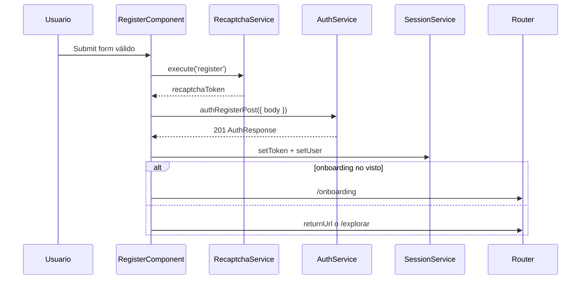

# Story 1.3: Registro de usuario

Status: done

<!-- Validation opcional: validate-create-story antes de dev-story -->

## Story

Como visitante,
quiero registrarme con email, contraseña y código postal,
para obtener acceso a la plataforma.

**Diseño de referencia:** [`docs/project/Login.html`](../../docs/project/Login.html) (pestaña «Crear cuenta»), [`docs/project/Onboarding.html`](../../docs/project/Onboarding.html) (primera visita tras registro).

**FR:** FR-F1 · **Épica:** 1

## Acceptance Criteria

1. **Registro exitoso**
   - **Given** la ruta `/register` sin sesión activa
   - **When** completo el formulario reactivo válido y reCAPTCHA V3
   - **Then** se llama `AuthService.authRegisterPost` con body `{ email, password, postalCode, recaptchaToken }` tipado como `RegisterRequest`
   - **And** ante `201` se guarda el JWT con `SessionService.setToken(res.token)`
   - **And** se almacena `res.user` (`AuthUser`) en estado de sesión accesible para el shell
   - **And** si el usuario no completó onboarding antes, navega a `/onboarding`; si no, navega a `returnUrl` de query (si existe y es ruta interna segura) o `/explorar`

2. **Email duplicado (409)**
   - **When** el backend responde `409`
   - **Then** se muestra mensaje genérico del tipo «No pudimos crear la cuenta con este correo. ¿Ya tienes cuenta? Inicia sesión» (sin revelar si el email existe en el servidor)

3. **Código postal o payload inválido (400)**
   - **When** el backend responde `400` (validación Zod o `GeocodingException`)
   - **Then** si el mensaje menciona código postal / geocodificación → error en campo postal
   - **And** si es validación de email/password → errores en el campo correspondiente o banner según `errors[]` del body

4. **reCAPTCHA insuficiente (422)**
   - **When** el backend responde `422`
   - **Then** se muestra mensaje para reintentar la verificación (no enviar de nuevo sin nueva ejecución de reCAPTCHA)

5. **Validación cliente**
   - **Given** el formulario con campos inválidos
   - **When** intento enviar
   - **Then** los controles muestran errores inline y **no** se envía la petición
   - **And** reglas alineadas con backend: email válido, password `minLength(8)`, postalCode `^\d{5}$` (5 dígitos, como `Login.html`)

6. **Accesibilidad (NFR-F2)**
   - **Given** la pantalla de registro
   - **When** un lector de pantalla la recorre
   - **Then** labels asociados, `aria-invalid` / `aria-describedby` en errores, focus visible, contraste según tokens (sin alterar colores del design system)

7. **Onboarding post-registro (UX-DR3)**
   - **Given** registro exitoso y `localStorage` sin clave `rgl_onboarding_done`
   - **When** el usuario completa o salta el flujo en `/onboarding`
   - **Then** la UI reproduce `Onboarding.html` (slides, tipografía, colores, animaciones clave)
   - **And** al finalizar se marca `rgl_onboarding_done = '1'` y se navega a `/explorar` (o `returnUrl` si venía de ruta protegida)

## Tasks / Subtasks

- [x] **reCAPTCHA V3** (AC: 1, 4)
  - [x] Instalar `ng-recaptcha-2` (compatible Angular 21) o cargar script v3 con `environment.recaptchaSiteKey`
  - [x] Registrar `provideRecaptchaV3` / `RecaptchaV3Module` en `app.config.ts` con site key de entorno
  - [x] Servicio `RecaptchaService` en `core/services/` que ejecute acción `'register'` al enviar formulario
  - [x] Documentar en README dev: clave de prueba en `.env` / `environment.development.ts`

- [x] **Estado de usuario en sesión** (AC: 1)
  - [x] Extender `SessionService` (o `AuthStateService` en `core/services/`) con `user` signal, `setUser(AuthUser)`, `clearUser()` sincronizado con `clearToken()`
  - [x] Opcional: persistir `user` en `localStorage` (`rgl_auth_user`) para hidratar shell tras refresh — JSON parse seguro, SSR-safe

- [x] **Formulario registro** (AC: 1, 5, 6)
  - [x] `RegisterComponent`: template + estilos según pestaña «Crear cuenta» de `Login.html` (sin pestaña login en la misma vista; enlace a `/login`)
  - [x] `ReactiveFormsModule` + `FormGroup`: `email`, `password`, `postalCode`
  - [x] Reutilizar `app-field-input`, `app-alert-box`, `app-btn` de `shared/components/`
  - [x] **CRÍTICO:** `FieldInputComponent` hoy solo tiene `input()` de `value` — añadir `ControlValueAccessor` **o** `output`/`input` two-way para enlazar con reactive forms
  - [x] Estado `submitting` signal; deshabilitar botón durante petición
  - [x] Nota reCAPTCHA al pie (`RecaptchaNote` del prototipo)

- [x] **Integración API** (AC: 1–4)
  - [x] `inject(AuthService)` → `authRegisterPost({ body })`
  - [x] Mapear `HttpErrorResponse` por `status` (409, 400, 422, 5xx)
  - [x] No usar `HttpClient` directo ni URLs hardcodeadas

- [x] **Navegación post-éxito** (AC: 1, 7)
  - [x] Leer `returnUrl` de `ActivatedRoute.snapshot.queryParamMap` (misma convención que `authGuard`)
  - [x] Validar `returnUrl`: debe empezar por `/`, no `//`, no URL absoluta externa
  - [x] Ruta lazy `/onboarding` en `auth.routes.ts` o ruta protegida según diseño (público post-registro con token ya guardado)
  - [x] `OnboardingComponent` mínimo fiel a `Onboarding.html` (puede ser slides simplificados si el HTML es extenso — pero colores/tipografía 100 % tokens)

- [x] **Tests** (AC: todos)
  - [x] `register.component.spec.ts`: validadores, no submit si inválido, mensajes 409/400/422 mockeando `AuthService`
  - [x] Test integración: éxito llama `setToken` + `setUser` + navigate
  - [x] `ng build` + `ng test` sin regresiones en interceptores/guard (1.2)

- [x] **Verificación manual**
  - [x] Backend local + `recaptchaSiteKey` de prueba
  - [x] Registro OK → onboarding (primera vez) → `/explorar`
  - [x] Email duplicado → mensaje genérico
  - [x] CP `99999` → error postal
  - [x] Side-by-side `/register` vs `Login.html` pestaña registro

### Review Findings

- [x] [Review][Decision] EMAIL_PATTERN + Validators.email aplicados juntos al mismo campo — Resuelto: eliminado `Validators.email`, conservado `EMAIL_PATTERN`.

- [x] [Review][Patch] isAuthenticated() escribe en señales dentro de computed() [src/app/core/services/session.service.ts:15]
- [x] [Review][Patch] @HostListener en OnboardingComponent viola convención CLAUDE.md [src/app/features/auth/onboarding/onboarding.component.ts:58]
- [x] [Review][Patch] serverFieldErrors no se limpia al editar el campo tras error de servidor [src/app/features/auth/register/register.component.ts:57]
- [x] [Review][Patch] Estado del componente mutado tras destrucción sin DestroyRef [src/app/features/auth/register/register.component.ts:130]
- [x] [Review][Patch] sanitizeReturnUrl no bloquea /javascript: con barra inicial codificada [src/app/core/utils/return-url.util.ts:7]
- [x] [Review][Patch] returnUrl=%2Fonboarding produce bucle infinito de redirección [src/app/core/utils/return-url.util.ts + register.component.ts:122]
- [x] [Review][Patch] inFlight y submitting redundantes + ventana de doble-submit [src/app/features/auth/register/register.component.ts:91]
- [x] [Review][Patch] firstValueFrom en RecaptchaService sin timeout puede bloquear el formulario [src/app/core/services/recaptcha.service.ts:17]
- [x] [Review][Patch] isOnboardingDone() usa typeof localStorage en lugar de isPlatformBrowser [src/app/core/constants/onboarding.ts:3]
- [x] [Review][Patch] tabindex="-1" en botón toggle de contraseña viola WCAG 2.1.1 [src/app/shared/components/field-input/field-input.component.ts:53]
- [x] [Review][Patch] Body de error 400 casteado sin validar Array.isArray antes de iterar [src/app/features/auth/register/register-error.util.ts:24]
- [x] [Review][Patch] [AC4] Mensaje 422 dice "Recarga" en lugar de invitar a reintentar [src/app/features/auth/register/register-error.util.ts:21]
- [x] [Review][Patch] [AC3] Regex geocodificación no captura "GeocodingException" + mismatch case-sensitive para postalCode [src/app/features/auth/register/register-error.util.ts:26]
- [x] [Review][Patch] [AC6] role="alert" en elemento insertado dinámicamente puede no ser anunciado por lectores de pantalla [src/app/features/auth/register/register.component.html:7]
- [x] [Review][Patch] mapRegisterError trata error de reCAPTCHA como error de conexión genérico [src/app/features/auth/register/register-error.util.ts:9]
- [x] [Review][Patch] Test: sin cobertura para recaptcha.execute() lanzando excepción [src/app/features/auth/register/register.component.spec.ts]
- [x] [Review][Patch] Test: sin cobertura para doble submit rápido [src/app/features/auth/register/register.component.spec.ts]
- [x] [Review][Patch] Test: sin cobertura para sanitizeReturnUrl con /javascript: o inputs codificados [src/app/core/utils/return-url.util.spec.ts]

- [x] [Review][Defer] Clave de sitio reCAPTCHA v3 en source (dev key; site keys son públicas por diseño) [src/environments/environment.development.ts:9] — deferred, pre-existing
- [x] [Review][Defer] ngOnInit redirige antes de que termine el replay de hidratación SSR [src/app/features/auth/onboarding/onboarding.component.ts:49] — deferred, pre-existing
- [x] [Review][Defer] Token en localStorage no validado estructuralmente (firma validada en servidor) [src/app/core/services/session.service.ts:107] — deferred, pre-existing
- [x] [Review][Defer] fieldError() no está memoizado como computed() [src/app/features/auth/register/register.component.ts:57] — deferred, pre-existing

## Dev Notes

### Dependencias de historias anteriores (bloqueantes)

| Historia | Qué debe existir antes de 1.3 |
|----------|-------------------------------|
| **1.1** (done) | `AuthLayoutComponent`, rutas `/register`, tokens en `styles.scss`, átomos `FieldInput`, `AlertBox`, `Btn` |
| **1.2** (in-progress / ready-for-dev) | `SessionService`, interceptores JWT + 401, `AuthGuard` real, `provideApiClient()` |

Si **1.2** no está mergeada: implementar registro igualmente, pero la redirección a `/explorar` requerirá guard + token; no reimplementar interceptores en esta historia.

### Estado actual del repo (lectura obligatoria)

| Archivo | Estado hoy | Acción |
|---------|------------|--------|
| `register.component.ts` | Placeholder `<h1>Crear cuenta</h1>` | Reemplazar con formulario completo |
| `login.component.ts` | Placeholder | No implementar login aquí (historia 1.4); solo `routerLink` a `/login` |
| `SessionService` | Token JWT OK | Añadir usuario en memoria (+ opcional localStorage) |
| `AuthService` (generado) | `authRegisterPost` listo | Usar tal cual |
| `environment.*.ts` | `recaptchaSiteKey: ''` | Rellenar para dev |
| `FieldInputComponent` | Sin binding a formularios | Extender CVA o outputs |

### Contrato API — registro

**Request** (`RegisterRequest`):

```typescript
{
  email: string;
  password: string;      // min 8 en backend (Zod)
  postalCode: string;    // min 1 max 10 en backend; UI: 5 dígitos ES
  recaptchaToken: string;
}
```

**Response** (`AuthResponse`, 201):

```typescript
{ token: string; user: AuthUser }
```

**Errores backend** ([`docs/architecture.md`](../../docs/architecture.md) F3, tests `backend/tests/auth-register.test.ts`):

| HTTP | Origen | Mensaje UI sugerido |
|------|--------|---------------------|
| 400 | Zod / CP no geocodificable | Campo o banner según `message` / `errors` |
| 409 | Email existente | Genérico + enlace a login |
| 422 | reCAPTCHA score &lt; 0.5 | Reintentar verificación |
| 401 en `/auth/register` | No debe redirigir (interceptor 1.2 excluye ruta) | Mostrar error en formulario |

### Diseño — Login.html (pestaña registro)

Elementos a portar en `/register`:

- Título contextual (h1 en card, no duplicar h1 de marca del layout — ver fix 1.1 en `auth-layout`)
- Campos: Correo, Contraseña (toggle ojo), Código postal con helper «Para mostrarte objetos a menos de 50 km»
- Botón primario «Crear cuenta» (`app-btn`, full width)
- Pie: «¿Ya tienes cuenta? **Iniciar sesión**» → `/login`
- `RecaptchaNote` (texto 11px, `--fg-muted`)
- `AlertBox` para errores API (variant `error`)

**No** incluir tabs login/register en la misma vista (ruta dedicada `/register`).

### Diseño — Onboarding.html

- Ruta `/onboarding` tras primer registro exitoso
- Reproducir slides concepto/roles/reputación según prototipo (scroll o carousel)
- CTA final → `/explorar` + flag `rgl_onboarding_done`
- Usuario con sesión puede acceder; si ya autenticado y flag presente, redirect directo a feed

### Mapa de archivos

```
src/app/
├── app.config.ts                          # UPDATE — providers reCAPTCHA v3
├── features/auth/
│   ├── auth.routes.ts                     # UPDATE — ruta onboarding
│   ├── register/
│   │   ├── register.component.ts          # UPDATE
│   │   ├── register.component.html        # NEW (si template externo)
│   │   ├── register.component.scss        # NEW
│   │   └── register.component.spec.ts     # NEW
│   └── onboarding/
│       ├── onboarding.component.ts        # NEW
│       └── onboarding.component.scss      # NEW
├── core/services/
│   ├── session.service.ts                 # UPDATE — user state
│   └── recaptcha.service.ts               # NEW (wrapper ng-recaptcha-2)
└── shared/components/field-input/
    └── field-input.component.ts           # UPDATE — CVA o outputs
```

### Flujo de registro (secuencia)



### Ejemplo implementación (referencia)

```typescript
import { inject } from '@angular/core';
import { Router, ActivatedRoute } from '@angular/router';
import { AuthService } from '../../../core/api/generated/services/auth.service';
import { SessionService } from '../../../core/services/session.service';
import { RecaptchaService } from '../../../core/services/recaptcha.service';

const authApi = inject(AuthService);
const session = inject(SessionService);
const router = inject(Router);
const route = inject(ActivatedRoute);

const recaptchaToken = await inject(RecaptchaService).execute('register');
const res = await authApi.authRegisterPost({
  body: { email, password, postalCode, recaptchaToken },
});
session.setToken(res.token);
session.setUser(res.user);
const returnUrl = route.snapshot.queryParamMap.get('returnUrl');
const onboardingDone = localStorage.getItem('rgl_onboarding_done');
if (!onboardingDone) {
  await router.navigate(['/onboarding'], { queryParams: returnUrl ? { returnUrl } : {} });
} else {
  await router.navigateByUrl(returnUrl && returnUrl.startsWith('/') ? returnUrl : '/explorar');
}
```

### Manejo de errores HTTP

```typescript
import { HttpErrorResponse } from '@angular/common/http';

function mapRegisterError(err: unknown): { banner?: string; fields?: Record<string, string> } {
  if (!(err instanceof HttpErrorResponse)) {
    return { banner: 'Error de conexión. Inténtalo de nuevo.' };
  }
  switch (err.status) {
    case 409:
      return { banner: 'No pudimos crear la cuenta con este correo. ¿Ya tienes cuenta?' };
    case 422:
      return { banner: 'No pudimos verificar que eres humano. Recarga e inténtalo de nuevo.' };
    case 400: {
      const msg = (err.error as { message?: string })?.message ?? '';
      if (/postal|código|geocod/i.test(msg)) {
        return { fields: { postalCode: 'Código postal no válido o no encontrado' } };
      }
      return { banner: 'Revisa los datos del formulario.' };
    }
    default:
      return { banner: 'No pudimos completar el registro. Inténtalo más tarde.' };
  }
}
```

### Anti-patrones — NO HACER

- `HttpClient.post('/auth/register')` manual
- Duplicar `RegisterRequest` en `core/models/`
- Material / PrimeNG / formularios template-driven
- `ngClass` / `ngStyle`
- Inventar colores o tipografías fuera de tokens
- Redirigir a `/login` en 401 de register (el interceptor ya excluye `/auth/register`)
- Implementar login/logout completo (historia 1.4)
- Omitir onboarding si la tabla de diseño de épica 1.3 lo exige (UX-DR3 bloqueante)

### Inteligencia historia 1.2

- Usar `AuthService` generado + `SessionService` — nunca mezclar responsabilidades
- `authRegisterPost` devuelve `Promise<AuthResponse>` (cliente ng-openapi-gen actual)
- Interceptor 401: rutas excluidas incluyen `/auth/register`
- Feed protegido: ruta real es `/explorar` (no `/items`)

### Inteligencia historia 1.1

- `AuthLayout` ya envuelve `/register`
- Átomos compartidos listos; falta cableado formulario
- Review 1.1: un solo `h1` por pantalla auth (título en componente hijo)

### Git reciente

- `6001892` — configuración app, estructura, API client
- Patrón: standalone, signals, interceptores funcionales, tests Vitest

## Technical Requirements

| ID | Requisito |
|----|-----------|
| TR-1 | `ReactiveFormsModule` + validadores sincronizados con Zod backend |
| TR-2 | reCAPTCHA V3: token fresco en cada submit; acción `'register'` |
| TR-3 | `AuthService.authRegisterPost` único punto de llamada HTTP |
| TR-4 | `SessionService.setToken` + persistencia usuario para shell |
| TR-5 | Post-registro: `/onboarding` → `/explorar` o `returnUrl` sanitizado |
| TR-6 | `ChangeDetectionStrategy.OnPush` + signals para UI state |
| TR-7 | Mensajes 409 genéricos (seguridad — no enumerar emails) |
| TR-8 | WCAG AA: labels, roles alert, focus, contraste tokens |

## Architecture Compliance

- §2 carpetas: `features/auth/`, `core/services/`, `shared/components/`
- NFR-F1: standalone, signals, OnPush
- NFR-F2: AXE en flujo registro
- NFR-F9: `recaptchaSiteKey` en environments
- NFR-F12: reactive forms, `@if`, sin `ngClass`
- UX-DR2 + UX-DR3: Login + Onboarding pixel-perfect
- FR-F1 cubierto íntegramente en esta historia

## Library & Framework Requirements

| Paquete | Uso |
|---------|-----|
| `@angular/forms` | Reactive forms |
| `ng-recaptcha-2` (^21.x) | reCAPTCHA v3 — `RecaptchaV3Service` |
| Cliente generado | `AuthService`, `RegisterRequest`, `AuthResponse`, `AuthUser` |

**Prohibido:** axios, jwt-decode, UI kits, `HttpClient` directo al API.

**Config reCAPTCHA:** registrar site key en [Google reCAPTCHA admin](https://www.google.com/recaptcha/admin) (v3); secret solo en backend.

## File Structure Requirements

| Ruta | Acción |
|------|--------|
| `features/auth/register/*` | Implementación principal |
| `features/auth/onboarding/*` | Onboarding post-registro |
| `core/services/session.service.ts` | Extender con user |
| `core/services/recaptcha.service.ts` | Wrapper v3 |
| `shared/components/field-input/*` | CVA para forms |
| `environments/*.ts` | `recaptchaSiteKey` real en dev |

## Testing Requirements

- Unit: validación formulario, mapping errores HTTP, no submit inválido
- Mock `AuthService.authRegisterPost` y `RecaptchaService.execute`
- Verificar `SessionService.setToken` / `setUser` en éxito
- Navegación: onboarding vs explorar según flag
- Regresión: `auth-error.interceptor` no redirige en register 401
- `ng build` producción sin errores SSR (sin `localStorage` en servidor)

## Previous Story Intelligence

**1.2** define `SessionService`, interceptores y guard — consumir sin duplicar. El archivo de historia 1.2 documenta nombres, rutas excluidas 401 y ejemplo `authLoginPost` (mismo patrón para register).

**1.1** entregó layout auth, tokens CSS, átomos y rutas lazy. Register vive dentro de `AuthLayout`; comparar visualmente con `Login.html`.

## Project Context Reference

- [`_bmad-output/project-context.md`](../project-context.md) — diseño bloqueante, cliente OpenAPI
- [`docs/api-client.md`](../../docs/api-client.md) — `authRegisterPost`, regeneración
- [`docs/architecture.md`](../../docs/architecture.md) — § F3 registro
- [`_bmad-output/planning-artifacts/epics.md`](../planning-artifacts/epics.md) — Story 1.3, tabla diseño

## Latest Tech Information

- **ng-recaptcha-2@21.x** (nov 2025): soporte Angular 18+; usar `RecaptchaV3Service.execute(action)` antes del POST.
- **Angular 21**: interceptores y guards funcionales ya usados en el repo; mantener `inject()`.
- **reCAPTCHA v3**: score verificado solo en backend (&lt; 0.5 → 422); frontend solo obtiene token.
- No hay paquete reCAPTCHA en `package.json` hoy — añadir en esta historia.

## Dev Agent Record

### Agent Model Used

Composer (dev-story)

### Debug Log References

- `ReCaptchaV3Service` (ng-recaptcha-2) — nombre exportado con capitalización distinta a la documentación genérica.

### Completion Notes List

- Formulario `/register` con reactive forms, validación cliente (email, password ≥8, CP 5 dígitos), reCAPTCHA v3 (`ng-recaptcha-2`) y `AuthService.authRegisterPost`.
- `SessionService` extendido con `user` signal + `rgl_auth_user` en localStorage; `clearToken` limpia usuario.
- `FieldInputComponent` implementa `ControlValueAccessor` para enlazar con formularios reactivos.
- Flujo post-registro: onboarding (`/onboarding`, guard) si no existe `rgl_onboarding_done`; si no, `returnUrl` sanitizado o `/explorar`.
- Tests: 35 passing (`ng test`), build producción OK (`ng build`).

### File List

- package.json
- package-lock.json
- README.md
- src/app/app.config.ts
- src/app/app.routes.ts
- src/app/core/constants/onboarding.ts
- src/app/core/services/recaptcha.service.ts
- src/app/core/services/session.service.ts
- src/app/core/services/session.service.spec.ts
- src/app/core/utils/return-url.util.ts
- src/app/features/auth/onboarding/onboarding.component.ts
- src/app/features/auth/onboarding/onboarding.component.scss
- src/app/features/auth/register/register.component.ts
- src/app/features/auth/register/register.component.html
- src/app/features/auth/register/register.component.scss
- src/app/features/auth/register/register.component.spec.ts
- src/app/features/auth/register/register-error.util.ts
- src/app/features/auth/register/register-error.util.spec.ts
- src/app/shared/components/field-input/field-input.component.ts
- src/app/shared/components/field-input/field-input.component.scss
- src/environments/environment.development.ts

### Change Log

- 2026-05-21: Implementación historia 1.3 — registro, reCAPTCHA v3, onboarding post-registro, tests y documentación dev.

## Story Completion Status

- **Status:** done
- **Nota:** Code-review adversarial completado (2026-05-21). 19 patches aplicados, 4 issues diferidos, 3 descartados.
- **Prerrequisito:** Historia 1.2 completada (SessionService + interceptores + guard).

### Retrofit 8-f5 (2026-05-27)

Post-`201` en registro: hidratar sesión con `GET /users/me` + `sessionUserFromPrivateProfile` (no `AuthUser` de la respuesta) y redirigir siempre a `/verificacion-pendiente`. Detalle en `8-f5-retrofit-registro-redirect-verificacion-pendiente.md`.
