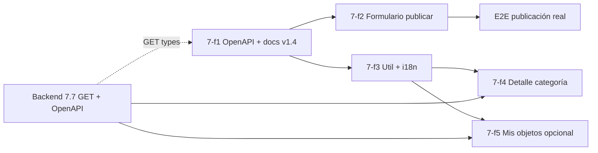

# Story 7-f1: Regenerar cliente OpenAPI y architecture v1.4

Status: done

<!-- Validation: checklist BMad create-story aplicado. Ultimate context engine analysis completed - comprehensive developer guide created. Épica 7-f DLT-004 — historia fundacional; sin cambios de UI. -->

## Story

Como desarrollador frontend,
quiero el cliente API y la documentación de arquitectura alineados con DLT-004 (v1.4),
para implementar las historias 7-f2…7-f5 contra contratos correctos de `category` y `weightRange`.

## Acceptance Criteria

1. **Given** `../backend/openapi/openapi.json` como fuente de verdad (POST con enums DLT-004; GET con `category`/`weightRange` **cuando** exista historia backend **7.7**)
   **When** ejecuto la cadena de regeneración documentada en `docs/api-client.md`
   **Then** `npm run api:generate` completa sin error
   **And** `PublishItemMultipart` incluye `category` y `weightRange` **requeridos** con unions enum canónicas
   **And** los modelos de respuesta de ítem (`GetItemResponse`, `ItemSummary`, `MyItem`) incluyen `category` (y `weightRange` si el OpenAPI lo define) **solo cuando** el spec backend los expone — documentar en Completion Notes si aún faltan por 7.7

2. **Given** el cliente regenerado
   **When** inspecciono tipos clave de ítems
   **Then** cumplen el delta aprobado (`docs/delta-frontend-DLT-004.md`):

   | Modelo / servicio | Campos / método esperados |
   |---|---|
   | `PublishItemMultipart` | `category`: union 9 valores; `weightRange`: union 4 valores; ambos required junto a `title`, `description`, `condition`, `postalCode` |
   | `GetItemResponse` | `category` (+ `weightRange` opcional en contrato) **tras 7.7 backend** |
   | `ItemSummary` | `category`, `weightRange` **tras 7.7 backend** |
   | `MyItem` | `category`, `weightRange` **tras 7.7 backend** |
   | `ItemsService` | `itemsPost`, `itemsGet`, `itemsIdGet`, `usersMeItemsGet` sin cambio de firma — solo tipos de body/response |

   **Enums esperados en `PublishItemMultipart.category`:** `furniture`, `electronics`, `clothing`, `books`, `toys`, `kitchen`, `sports`, `tools`, `other`.

   **Enums esperados en `PublishItemMultipart.weightRange`:** `lt1`, `1to5`, `5to20`, `gt20`.

3. **Given** Correct Course `sprint-change-proposal-2026-05-26-DLT-004.md` y delta DLT-004
   **When** reviso `docs/architecture.md`
   **Then** la cabecera indica **Versión 1.4** con referencia a DLT-004
   **And** §4 documenta `category`/`weightRange` en `POST /items`, `GET /items`, `GET /items/:id`, `GET /users/me/items`
   **And** §5 incluye `ItemCategory`, `ItemWeightRange`, `Item` e `ItemSummary` con ambos campos
   **And** §6 incluye reglas DLT-004: selectores obligatorios en publicación, categoría visible en detalle, **`weightRange` invisible** en UI de lectura, categoría opcional en mis objetos
   **And** nota de coordinación backend **7.7** presente si GET aún no expone campos en OpenAPI

4. **Given** `docs/api-client.md` como guía operativa
   **When** cierro la historia
   **Then** la sección «Multipart: publicar objeto» lista `category` y `weightRange` además de los campos existentes
   **And** la sección «Modelos» cita enums de ítem analíticos y modelos de respuesta con `category` cuando aplique
   **And** se documenta dependencia opcional: regenerar tras merge de backend **7.7**

5. **Given** código generado versionado en git
   **When** termino la regeneración
   **Then** **no** edito manualmente ningún fichero bajo `src/app/core/api/generated/`
   **And** el diff del cliente generado queda listo para commit (historia fundacional épica 7-f)

6. **Given** alcance acotado de 7-f1 (solo contrato + docs)
   **When** ejecuto `npm run build` tras regenerar
   **Then** documento en Completion Notes el resultado (éxito o errores TS esperados)
   **And** **no** implemento selectores UI ni util i18n en esta historia (reservados a **7-f2**, **7-f3**, **7-f4**, **7-f5**)
   **And** **no** elimino el hardcode `'other'`/`'lt1'` en `publicar.component.ts` — eso es **7-f2**

## Tasks / Subtasks

### A. Preparación y verificación del contrato (AC: 1)

- [x] Verificar estado de `../backend/openapi/openapi.json`:
  - `PublishItemMultipart`: `category` + `weightRange` en `required` ✅ (ya presente)
  - `GetItemResponse`, `ItemSummary`, `MyItem`: ¿incluyen `category`? (depende **7.7**) — **No** aún en OpenAPI GET
- [x] Si el spec local estuviera desactualizado en POST: `cd ../backend && npm run openapi:generate` — no necesario; POST ya actualizado
- [x] Si backend **7.7** ya mergeó: confirmar GET actualizado antes de regenerar frontend — **7.7 pendiente**
- [x] Desde raíz frontend: `npm run api:generate` — exit 0, 44 modelos / 5 servicios

### B. Validación del cliente generado (AC: 1, 2, 5)

- [x] Abrir y contrastar:
  - `src/app/core/api/generated/models/publish-item-multipart.ts` — unions enum completas ✅
  - `src/app/core/api/generated/models/get-item-response.ts` — sin `category` (esperado hasta 7.7)
  - `src/app/core/api/generated/models/item-summary.ts` — sin campos analíticos (esperado hasta 7.7)
  - `src/app/core/api/generated/models/my-item.ts` — sin campos analíticos (esperado hasta 7.7)
- [x] Confirmar reexport en `models.ts` y métodos en `services/items.service.ts`, `services/users.service.ts` — sin cambio de firma
- [x] **Prohibido:** editar ficheros en `generated/` — cumplido

### C. Verificar / completar documentación de arquitectura (AC: 3)

- [x] Revisar `docs/architecture.md` §4–6 — v1.4 completo:
  - Catálogo enum en POST §4 ✅
  - Interfaces §5 (`ItemCategory`, `ItemWeightRange`, `Item`, `ItemSummary`) ✅
  - Reglas §6 (formulario, detalle, weightRange oculto, mis objetos opcional) ✅
  - Nota coordinación **7.7** al pie de §6 ✅
- [x] **No** duplicar bloques delta antiguos — fuente v1.4 activa en cuerpo principal; deltas históricos al final sin modificar

### D. Actualizar guía operativa API (AC: 4)

- [x] Editar `docs/api-client.md`:
  - «Multipart: publicar objeto» → añadir `category`, `weightRange` al listado de campos FormData ✅
  - «Modelos» → citar unions de `PublishItemMultipart`; mencionar `GetItemResponse.category` cuando exista en spec ✅
  - Nota breve: tras backend **7.7**, repetir cadena `openapi:generate` → `api:generate` ✅

### E. Verificación final (AC: 5, 6)

- [x] `npm run build` — **éxito** (exit 0); warnings de budget SCSS preexistentes, sin errores TS
- [x] Completar File List y Completion Notes en Dev Agent Record
- [x] GET aún sin `category` en OpenAPI: **parcial — pendiente 7.7**; cierre 7-f1 no bloqueado (AC #1 condicional)

## Dev Notes

### Contexto DLT-004 — brecha actual (evidencia en repo, 2026-05-26)

Backend completó Épica 7 DLT-004 (persistencia + POST obligatorio). Correct Course frontend aprobado 2026-05-26. El frontend tiene deuda documentada desde **6-f1**.

| Artefacto | Estado actual (pre-7-f1) | Objetivo post-7-f1 |
|---|---|---|
| `backend/openapi/openapi.json` — POST | ✅ `PublishItemMultipart` con enums | Sin cambio |
| `backend/openapi/openapi.json` — GET | ❌ `GetItemResponse`, `ItemSummary`, `MyItem` **sin** `category`/`weightRange` | Actualizar tras **7.7** + regenerar |
| `publish-item-multipart.ts` | ✅ Unions enum completas | Verificado / regenerado |
| `get-item-response.ts` | ❌ Sin `category` | Con `category` tras **7.7** |
| `item-summary.ts` | ❌ Sin `category` | Con campos tras **7.7** |
| `my-item.ts` | ❌ Sin `category` | Con campos tras **7.7** |
| `docs/architecture.md` | ✅ v1.4 fusionado (Correct Course) | Verificar §4–6 completos |
| `docs/api-client.md` | ⚠️ Multipart sin `category`/`weightRange` | Actualizado |
| `publicar.component.ts` | ⚠️ Hardcode `category: 'other'`, `weightRange: 'lt1'` | **No tocar** — **7-f2** |

Evidencia hardcode (deuda 6-f1):

```281:288:src/app/features/items/publicar/publicar.component.ts
      const body: PublishItemMultipart = {
        title: title.trim(),
        description: description.trim(),
        condition,
        postalCode: postalCode.trim(),
        category: 'other',
        weightRange: 'lt1',
        images: this.imageBlobs(),
      };
```

### Cadena de regeneración (obligatoria)

```bash
# Opcional — si openapi.json backend desactualizado o tras merge 7.7
cd ../backend
npm run openapi:generate

# Obligatorio — desde raíz regalalo
cd ../regalalo
npm run api:generate
```

Config: `openapi-ng.config.json` → input `../backend/openapi/openapi.json`, output `src/app/core/api/generated`, `removeStaleFiles: true`.

### Archivos generados clave (inspección post-regeneración)

| Fichero | Qué validar |
|---|---|
| `models/publish-item-multipart.ts` | `category` + `weightRange` required unions |
| `models/get-item-response.ts` | `category?` tras 7.7 |
| `models/item-summary.ts` | Campos analíticos tras 7.7 |
| `models/my-item.ts` | Campos analíticos tras 7.7 |
| `fn/items/items-post.ts` | `multipart/form-data` sin cambio de PATH |

**No tocar manualmente:** todo `src/app/core/api/generated/**`

### Coordinación backend 7.7 (bloqueante parcial)

| Capacidad frontend | ¿Bloqueada por 7.7? |
|---|---|
| Regenerar tipos POST | **No** — ya en spec |
| Validar tipos GET en cliente | **Sí** — hasta OpenAPI GET actualizado |
| **7-f2** formulario publicar | **No** — enums ya en `PublishItemMultipart` |
| **7-f4** detalle categoría | **Sí** — necesita `GetItemResponse.category` |
| **7-f5** mis objetos etiqueta | **Sí** — necesita `MyItem.category` |

**7-f1 puede cerrarse** con POST verificado y docs v1.4 completos aunque GET siga pendiente. Tras **7.7**, repetir `api:generate` (puede ser sub-tarea de 7-f1 o primer paso de 7-f4 — documentar en Completion Notes).

### Dependencias de la épica 7-f (orden estricto)



**7-f1 desbloquea:** 7-f2, 7-f3 (tipos POST y docs). **7-f4** y **7-f5** requieren además **7.7** backend.

### Inteligencia de historia 6-f1 (épica anterior análoga)

Patrón probado en **6-f1-regenerar-cliente-openapi-y-architecture-v1-3.md`:

- Regenerar sin tocar `generated/` a mano
- Completar `docs/architecture.md` §6 si faltan reglas del delta
- Actualizar `docs/api-client.md` con nuevos campos/servicios
- `npm run build` puede fallar por features desalineadas → **no arreglar UI en historia fundacional**
- En 6-f1, `publicar.component.ts` ya fallaba por `PublishItemMultipart` — parche temporal hardcode; **7-f2** elimina esa deuda

### Qué NO hacer en esta historia

- ❌ Modificar `publicar.component.ts` ni otros componentes Angular
- ❌ Crear `item-category-label.util.ts` ni claves i18n (historia **7-f3**)
- ❌ Mostrar categoría en detalle o listados (**7-f4**, **7-f5**)
- ❌ Editar ficheros en `generated/` a mano
- ❌ Duplicar `ItemCategory`/`ItemWeightRange` en `core/models/` si ya existen unions en tipos generados — preferir reexport/wrapper solo si 7-f3 lo define explícitamente
- ❌ Cambiar interceptores, guards ni pipeline de imágenes

### Architecture compliance

| Regla | Fuente |
|---|---|
| Cliente OpenAPI canónico | `docs/api-client.md`, `AGENTS.md`, `_bmad-output/project-context.md` |
| No editar `generated/` | `docs/api-client.md` regla #1 |
| `apiUrl` termina en `/api` | `environment*.ts` — sin cambio en 7-f1 |
| Contratos §4–5 referencia | `docs/architecture.md` v1.4 |
| Delta fuente aprobado | `docs/delta-frontend-DLT-004.md` |
| Correct Course | `_bmad-output/planning-artifacts/sprint-change-proposal-2026-05-26-DLT-004.md` |
| Catálogo analítico PRD | `docs/prd-analytics.md` §4 (referencia cruzada, no duplicar tabla completa) |
| `weightRange` invisible en UI lectura | `docs/architecture.md` §6, delta §6 Regla 3 |

### Errores de compilación esperados (NO arreglar en 7-f1)

Tras regenerar **sin** cambios en features:

| Escenario | Resultado esperado | Historia que lo corrige |
|---|---|---|
| OpenAPI GET sin cambios | Build **puede pasar** (hardcode satisface POST types) | — |
| Tras 7.7 + regeneración | Build pasa si features no usan aún `category` en templates | **7-f4** consume campo |
| Intento de quitar hardcode en 7-f1 | ❌ Fuera de alcance | **7-f2** |

### Testing requirements

- **Sin tests nuevos** en 7-f1 (historia de infraestructura/documentación).
- Verificación manual: inspección de tipos generados + `npm run build` report.
- Historias 7-f2+ actualizarán `publicar.component.spec.ts` y specs de detalle.

### Referencias obligatorias

- [Source: docs/api-client.md] — regeneración y reglas de uso
- [Source: docs/delta-frontend-DLT-004.md] — delta DLT-004 Secciones A–B
- [Source: docs/architecture.md] — v1.4 §4–6
- [Source: _bmad-output/planning-artifacts/epics.md#Story-7-f1] — AC originales
- [Source: _bmad-output/planning-artifacts/sprint-change-proposal-2026-05-26-DLT-004.md] — Correct Course DLT-004
- [Source: _bmad-output/implementation-artifacts/6-f1-regenerar-cliente-openapi-y-architecture-v1-3.md] — patrón historia fundacional
- [Source: ../backend/openapi/openapi.json] — spec OpenAPI
- [Source: openapi-ng.config.json] — config ng-openapi-gen

## Dev Agent Record

### Agent Model Used

Composer (dev-story 2026-05-26)

### Debug Log References

- OpenAPI POST: `PublishItemMultipart.required` incluye `category`, `weightRange` con enums canónicos (9 + 4 valores).
- OpenAPI GET: `GetItemResponse`, `ItemSummary`, `MyItem` sin `category`/`weightRange` — backend **7.7** pendiente.
- `npm run api:generate`: exit 0; cliente ya alineado (sin diff en `generated/`).
- `npm run build`: exit 0; warnings budget SCSS preexistentes (perfil, landing, onboarding, mis-objetos).

### Completion Notes List

- **AC #1 (parcial GET):** Regeneración completada. POST verificado. Tipos GET pendientes de backend **7.7** — documentado, no bloquea cierre.
- **AC #2:** `PublishItemMultipart` cumple delta DLT-004 (category 9 valores, weightRange 4 valores, ambos required). Servicios `ItemsService`/`UsersService` sin cambio de firma.
- **AC #3:** `docs/architecture.md` v1.4 §4–6 verificados completos (enums POST, interfaces §5, reglas §6, nota 7.7).
- **AC #4:** `docs/api-client.md` actualizado — multipart con `category`/`weightRange`, sección Modelos DLT-004, nota regeneración post-7.7.
- **AC #5:** Ningún fichero editado manualmente en `generated/`.
- **AC #6:** Build exitoso; `publicar.component.ts` no modificado (hardcode → **7-f2**).
- **Siguiente paso:** Tras merge backend **7.7**, repetir `api:generate` antes de **7-f4**/**7-f5**. Desbloqueadas **7-f2** y **7-f3**.

### File List

- `docs/api-client.md` — guía operativa DLT-004 (multipart + modelos + nota 7.7)
- `_bmad-output/implementation-artifacts/sprint-status.yaml` — status 7-f1
- `_bmad-output/implementation-artifacts/7-f1-regenerar-cliente-openapi-y-architecture-v1-4.md` — story (este archivo)

**Verificados sin cambio:** `src/app/core/api/generated/**` (regeneración idempotente), `docs/architecture.md` (v1.4 ya fusionado).

### Change Log

- 2026-05-26: dev-story 7-f1 — regeneración OpenAPI, validación tipos POST, docs api-client v1.4, build OK. GET parcial pendiente 7.7.
- 2026-05-26: Code review — clean review (0 patch, 0 decision-needed, 1 defer GET→7.7); status → done.
