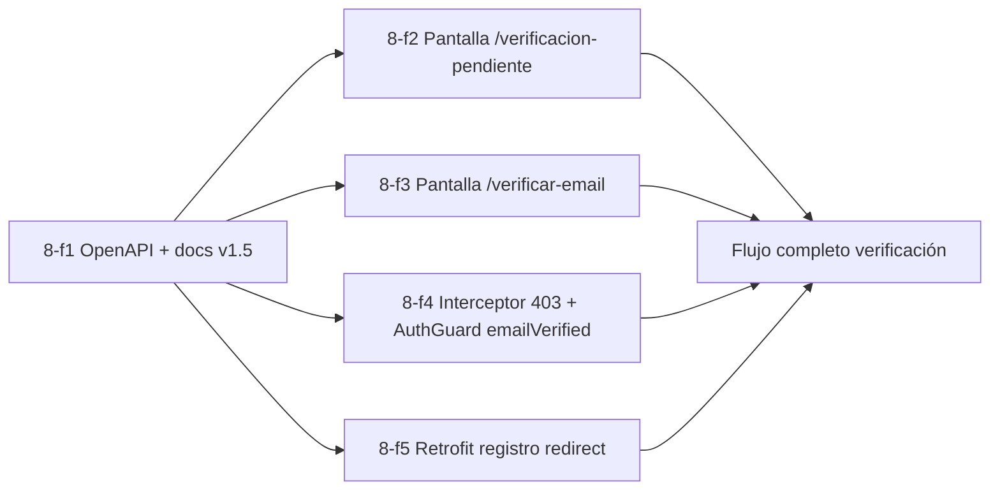

# Story 8-f1: Regenerar cliente OpenAPI y architecture v1.5

Status: done

<!-- Validation: checklist BMad create-story aplicado. Ultimate context engine analysis completed - comprehensive developer guide created. Épica 8-f DLT-email-verification — historia fundacional; sin cambios de UI. -->

## Story

Como desarrollador frontend,
quiero el cliente API y la documentación de arquitectura alineados con DLT-email-verification (v1.5),
para implementar las historias 8-f2…8-f5 contra contratos correctos de verificación de email.

## Acceptance Criteria

1. **Given** `../backend/openapi/openapi.json` actualizado con los nuevos endpoints de verificación de email
   **When** ejecuto la cadena de regeneración documentada en `docs/api-client.md`
   **Then** `npm run api:generate` completa sin error
   **And** `AuthService` incluye los métodos generados para `GET /auth/verify-email` y `POST /auth/resend-verification`
   **And** el modelo `AuthUser` (respuesta de registro) incluye `emailVerified: boolean`

2. **Given** el cliente regenerado
   **When** inspecciono los tipos clave de autenticación
   **Then** cumplen el delta aprobado (`docs/delta-frontend-email-verification.md`):

   | Modelo / método | Estado esperado |
   |---|---|
   | `AuthUser.emailVerified` | `boolean` — presente y requerido |
   | `AuthService.authVerifyEmailGet` (o nombre generado equivalente) | método para `GET /auth/verify-email?token=` |
   | `AuthService.authResendVerificationPost` (o nombre generado equivalente) | método para `POST /auth/resend-verification` |
   | Métodos existentes (`authRegisterPost`, `authLoginPost`, etc.) | **sin cambio de firma** |

3. **Given** el delta aprobado (`docs/delta-frontend-email-verification.md`)
   **When** reviso `docs/architecture.md`
   **Then** la cabecera indica **Versión 1.5** con referencia a DLT-email-verification
   **And** §2 incluye carpetas `verify-email/` y `verification-pending/` dentro de `features/auth/`
   **And** §4 (F3 Autenticación) documenta:
   - `POST /auth/register` respuesta actualizada con `emailVerified: boolean` (siempre `false` en registro)
   - Nuevo contrato `GET /auth/verify-email?token=<token>`: 200 `{message}`, 400 token inválido
   - Nuevo contrato `POST /auth/resend-verification`: 200 `{message}`, 401, 409 (ya verificado), 429 `Retry-After`
   **And** §5 refleja `emailVerified: boolean` en la interfaz `User` (ya presente en v1.4) y nota que `SessionUser` (`core/services/session.service.ts`) necesita `emailVerified?: boolean` — tarea de **8-f4**
   **And** §6 incluye las cinco reglas nuevas de presentación del delta:
   - Post-registro (201): JWT en localStorage → redirigir a `/verificacion-pendiente`, no al feed ni a `returnUrl`
   - Pantalla `/verificacion-pendiente`: info + botón reenvío con cooldown 30 s (`Retry-After` o default 30 s tras 200)
   - Pantalla `/verificar-email`: extraer token del query param → auto-llamar GET; 200 → redirect `/login` con confirmación; 400 → error con enlace a `/verificacion-pendiente`
   - Interceptor 403 con `{ code: "EMAIL_NOT_VERIFIED" }`: **no** limpiar token, redirigir a `/verificacion-pendiente`
   - `AuthGuard`: verificar `emailVerified` del usuario en estado; si `false` → redirigir a `/verificacion-pendiente`

4. **Given** `docs/api-client.md` como guía operativa
   **When** cierro la historia
   **Then** la tabla de servicios generados lista los nuevos métodos de `AuthService` para verificación de email
   **And** se documenta que `SessionUser` en `session.service.ts` necesita `emailVerified?: boolean` (postergado a **8-f4**)

5. **Given** código generado versionado en git
   **When** termino la regeneración
   **Then** **no** edito manualmente ningún fichero bajo `src/app/core/api/generated/`
   **And** el diff del cliente generado queda listo para commit (historia fundacional épica 8-f)

6. **Given** alcance acotado de 8-f1 (solo contrato + docs)
   **When** ejecuto `npm run build` tras regenerar
   **Then** documento en Completion Notes el resultado (éxito o errores TS)
   **And** **no** implemento pantallas ni componentes de verificación de email en esta historia
   **And** **no** modifico `register.component.ts`, interceptores ni `AuthGuard`

## Tasks / Subtasks

### A. Preparación y verificación del contrato backend (AC: 1)

- [x] Verificar estado de `../backend/openapi/openapi.json`:
  - ¿Incluye `GET /auth/verify-email`? ✅ Sí
  - ¿Incluye `POST /auth/resend-verification`? ✅ Sí
  - ¿`AuthUser` (respuesta de `POST /auth/register`) incluye `emailVerified: boolean`? ⚠️ No aún — documentado como pendiente backend
- [x] Si el spec local estuviera desactualizado: `cd ../backend && npm run openapi:generate` — ejecutado; nuevos endpoints ya presentes
- [x] Si los endpoints no existen en el spec: N/A — endpoints sí existen
- [x] Desde raíz frontend: `npm run api:generate` — exit 0, 45 modelos / 5 servicios

### B. Validación del cliente regenerado (AC: 1, 2, 5)

- [x] Abrir y contrastar ficheros clave:
  - `src/app/core/api/generated/services/auth.service.ts` → `authVerifyEmailGet` + `authResendVerificationPost` presentes ✅
  - `src/app/core/api/generated/models/auth-user.ts` → sin `emailVerified` (pendiente backend — documentado) ⚠️
  - Modelo nuevo `EmailNotVerifiedError { code: 'EMAIL_NOT_VERIFIED'; message: string }` ✅ (bonus del spec)
- [x] Confirmar que los métodos existentes (`authRegisterPost`, `authLoginPost`, `authForgotPasswordPost`, `authResetPasswordPost`) mantienen firma sin cambio ✅
- [x] Confirmar que `PrivateProfile.emailVerified` sigue presente (ya estaba en v1.4 — sin regresión) ✅
- [x] **Prohibido:** editar ficheros en `generated/` — cumplido ✅

### C. Verificar / completar documentación de arquitectura (AC: 3)

- [x] Actualizar cabecera de `docs/architecture.md`: **Versión 1.5** con nota DLT-email-verification ✅
- [x] §2 — Añadidas subcarpetas `verify-email/` y `verification-pending/` en `features/auth/` ✅
- [x] §4 (F3 Autenticación) — tres cambios aplicados:
  1. Respuesta `POST /auth/register` actualizada con `emailVerified: false` y nota de pendiente backend ✅
  2. Bloque completo para `GET /auth/verify-email` ✅
  3. Bloque completo para `POST /auth/resend-verification` con errores 401/409/429 y nota Retry-After ✅
- [x] §5 — Notas sobre `SessionUser` (pendiente 8-f4) y `EmailNotVerifiedError` añadidas ✅
- [x] §6 — Cinco nuevas reglas de presentación DLT-email-verification añadidas + nota coordinación backend ✅
- [x] **No** duplicado bloque del delta — cuerpo principal v1.5 ✅

### D. Actualizar guía operativa API (AC: 4)

- [x] Editar `docs/api-client.md`:
  - Tabla `AuthService` ampliada con `authVerifyEmailGet`, `authResendVerificationPost` ✅
  - Nota DLT-email-verification con info de headers, Retry-After y EmailNotVerifiedError ✅
  - Nota sobre `AuthUser.emailVerified` pendiente backend ✅
  - Nota sobre `SessionUser` → postergado a **8-f4** ✅

### E. Verificación final (AC: 5, 6)

- [x] `npm run build` — **exit 0**; warnings budget SCSS preexistentes (onboarding, landing, mis-objetos, perfil), sin errores TS ✅
- [x] File List y Completion Notes completados en Dev Agent Record ✅

## Dev Notes

### Contexto DLT-email-verification — brecha actual (evidencia en repo, 2026-05-27)

El backend completó Epic de verificación de email (EVT-014, TPL-009). Correct Course frontend aprobado 2026-05-27.

| Artefacto | Estado actual (pre-8-f1) | Objetivo post-8-f1 |
|---|---|---|
| `backend/openapi/openapi.json` — nuevos endpoints | ⚠️ Verificar: GET /auth/verify-email, POST /auth/resend-verification | Confirmados en spec |
| `auth.service.ts` | 4 métodos: register, login, forgot-password, reset-password | + 2 métodos verify-email + resend-verification |
| `models/auth-user.ts` | Sin `emailVerified` | `emailVerified: boolean` |
| `models/private-profile.ts` | ✅ Ya tiene `emailVerified: boolean` | Sin cambio |
| `session.service.ts` → `SessionUser` | Sin `emailVerified` | **No tocar** — tarea de **8-f4** |
| `docs/architecture.md` | ✅ v1.4 | v1.5 con contratos y reglas DLT-email-verification |
| `docs/api-client.md` | AuthService solo con 4 métodos | + nuevos métodos verificación |
| Carpetas `verify-email/` `verification-pending/` | ❌ No existen | Documentadas en §2 (implementadas en 8-f2, 8-f3) |

### Cadena de regeneración (obligatoria)

```bash
# Opcional — si openapi.json backend desactualizado o no tiene los endpoints
cd ../backend
npm run openapi:generate

# Obligatorio — desde raíz regalalo
cd ../regalalo
npm run api:generate
```

Config: `openapi-ng.config.json` → input `../backend/openapi/openapi.json`, output `src/app/core/api/generated`, `removeStaleFiles: true`.

### Archivos generados clave (inspección post-regeneración)

| Fichero | Qué validar |
|---|---|
| `services/auth.service.ts` | Nuevos métodos para verify-email y resend-verification |
| `models/auth-user.ts` | Campo `emailVerified: boolean` añadido |
| `models/*.ts` nuevos | Cualquier modelo de respuesta específico de verificación |
| `fn/auth/*.ts` nuevos | Funciones para los 2 nuevos endpoints |

**No tocar manualmente:** todo `src/app/core/api/generated/**`

### Impacto build: análisis de compatibilidad

Tras regenerar con `AuthUser` ganando `emailVerified`:

| Escenario | Comportamiento esperado |
|---|---|
| `register.component.ts` llama `session.setUser(res.user)` | **Build pasa** — TypeScript structural typing permite extra properties (AuthUser → SessionUser). `emailVerified` se serializa en localStorage pero `SessionUser` aún no lo declara — legible solo tras 8-f4 |
| `SessionUser` sin `emailVerified` | **Esperado** — `AuthGuard` y retrofit se implementan en **8-f4** |
| Otros consumidores de `AuthUser` | Revisar si existen; añadir field es aditivo y no rompe |
| Build general | Esperado **exit 0** — regen aditiva |

### Qué NO hacer en esta historia

- ❌ Crear componente `verification-pending/` (historia **8-f2**)
- ❌ Crear componente `verify-email/` (historia **8-f3**)
- ❌ Modificar `auth-error.interceptor.ts` ni lógica de 403 (historia **8-f4**)
- ❌ Modificar `AuthGuard` (historia **8-f4**)
- ❌ Añadir `emailVerified` a `SessionUser` en `session.service.ts` (historia **8-f4**)
- ❌ Cambiar redirect en `register.component.ts` (historia **8-f5**)
- ❌ Editar ficheros en `generated/` a mano
- ❌ Añadir rutas para las nuevas pantallas en `app.routes.ts` (historias **8-f2**, **8-f3**)

### Architecture compliance

| Regla | Fuente |
|---|---|
| Cliente OpenAPI canónico | `docs/api-client.md`, `project-context.md` |
| No editar `generated/` | `docs/api-client.md` regla #1 |
| `apiUrl` termina en `/api` | `environment*.ts` — sin cambio en 8-f1 |
| Contratos §4 referencia | `docs/architecture.md` v1.5 (post-historia) |
| Delta fuente aprobado | `docs/delta-frontend-email-verification.md` |
| Correct Course | `_bmad-output/planning-artifacts/sprint-change-proposal-2026-05-27-email-verification.md` |

### Dependencias de la épica 8-f (orden estricto)



**8-f1 desbloquea todo.** Las historias 8-f2 y 8-f3 pueden desarrollarse en paralelo entre sí; 8-f4 y 8-f5 son independientes entre sí pero pequeñas.

### Inteligencia de historia 7-f1 (épica anterior análoga)

Patrón probado en `7-f1-regenerar-cliente-openapi-y-architecture-v1-4.md`:

- Regenerar sin tocar `generated/` a mano
- Completar `docs/architecture.md` §6 si faltan reglas del delta
- Actualizar `docs/api-client.md` con nuevos campos/servicios
- `npm run build` puede fallar por features desalineadas → **no arreglar UI en historia fundacional**
- En 7-f1 no había regresión de build; se espera igual aquí (cambio aditivo)

**Diferencia clave respecto a 7-f1:** en 7-f1 había una dependencia parcial del backend (historia 7.7 aún pendiente para GET). Aquí la propuesta indica que **el backend ya implementó todos los endpoints** (EVT-014, TPL-009). Si al verificar el spec los endpoints aún no estuvieran, bloquear la historia y documentarlo.

### Testing requirements

- **Sin tests nuevos** en 8-f1 (historia de infraestructura/documentación).
- Verificación manual: inspección de tipos generados + `npm run build` report.
- Historias 8-f2+ crearán specs de componentes para las nuevas pantallas.

### Referencias obligatorias

- [Source: docs/api-client.md] — regeneración y reglas de uso
- [Source: docs/delta-frontend-email-verification.md] — delta DLT-email-verification
- [Source: docs/architecture.md] — v1.4 base; actualizar a v1.5
- [Source: _bmad-output/planning-artifacts/epics.md#Story-8-f1] — AC originales
- [Source: _bmad-output/planning-artifacts/sprint-change-proposal-2026-05-27-email-verification.md] — Correct Course DLT-email-verification
- [Source: _bmad-output/implementation-artifacts/7-f1-regenerar-cliente-openapi-y-architecture-v1-4.md] — patrón historia fundacional
- [Source: ../backend/openapi/openapi.json] — spec OpenAPI fuente de verdad
- [Source: openapi-ng.config.json] — config ng-openapi-gen
- [Source: src/app/core/services/session.service.ts] — SessionUser (extensión postergada a 8-f4)
- [Source: src/app/core/api/generated/services/auth.service.ts] — estado actual pre-8-f1

## Dev Agent Record

### Agent Model Used

Claude Sonnet 4.6 (dev-story 2026-05-27)

### Debug Log References

- Backend `openapi:generate`: ejecutado. Nuevos endpoints `GET /auth/verify-email` y `POST /auth/resend-verification` confirmados en spec. `AuthUser` schema **sin** `emailVerified` — backend pendiente de añadirlo.
- `npm run api:generate`: exit 0; 45 modelos / 5 servicios. Nuevos ficheros: `fn/auth/auth-verify-email-get.ts`, `fn/auth/auth-resend-verification-post.ts`, `models/email-not-verified-error.ts`.
- `AuthService` post-regen: 6 métodos (register, login, forgot-password, reset-password, **verifyEmailGet**, **resendVerificationPost**). Firmas existentes sin cambio.
- `EmailNotVerifiedError { code: 'EMAIL_NOT_VERIFIED'; message: string }` — modelo extra generado desde spec backend; útil para 8-f4.
- `npm run build`: exit 0. Warnings budget SCSS preexistentes (onboarding, landing, mis-objetos, perfil) — sin regresión nueva.

### Completion Notes List

- **AC #1 (diseño confirmado):** Regeneración completada. Nuevos endpoints verify-email y resend-verification verificados en cliente. `AuthUser` no incluye `emailVerified` **por diseño** (AC#5 backend story 8.2) — el campo no formará parte del payload de registro. El frontend obtiene `emailVerified` de `PrivateProfile` via `GET /users/me` post-registro (ver flujo §6 architecture.md v1.5). No se requiere regenerar el cliente para este campo.
- **AC #2:** `AuthService.authVerifyEmailGet` (token query param) y `authResendVerificationPost` (sin body, bearer auth) presentes. Firmas existentes sin cambio. Bonus: `EmailNotVerifiedError` con literal `code: 'EMAIL_NOT_VERIFIED'` — usar en 8-f4 para distinguir el 403.
- **AC #3:** `docs/architecture.md` actualizado a v1.5. §2 con carpetas verify-email/ y verification-pending/. §4 F3 con contratos completos de los 3 cambios. §5 con notas SessionUser y EmailNotVerifiedError. §6 con las 5 reglas de presentación DLT-email-verification.
- **AC #4:** `docs/api-client.md` actualizado — AuthService ampliado, notas DLT-email-verification, nota pendiente AuthUser.emailVerified, nota SessionUser 8-f4.
- **AC #5:** Ningún fichero editado manualmente en `generated/`.
- **AC #6:** Build exitoso. No se implementaron componentes, interceptores ni AuthGuard.
- **Siguiente paso:** Desbloqueadas 8-f2, 8-f3, 8-f4, 8-f5. Para 8-f4/8-f5: `emailVerified` se obtiene de `GET /users/me` post-registro (no del payload de registro). No se requiere regeneración adicional del cliente para este campo.

### File List

- `docs/architecture.md` — v1.5: §2 carpetas auth, §4 contratos email verification, §5 notas SessionUser + EmailNotVerifiedError, §6 cinco reglas DLT-email-verification
- `docs/api-client.md` — AuthService con nuevos métodos; notas DLT-email-verification, AuthUser pendiente, SessionUser 8-f4
- `src/app/core/api/generated/services/auth.service.ts` — +authVerifyEmailGet, +authResendVerificationPost (regenerado)
- `src/app/core/api/generated/fn/auth/auth-verify-email-get.ts` — nuevo (regenerado)
- `src/app/core/api/generated/fn/auth/auth-resend-verification-post.ts` — nuevo (regenerado)
- `src/app/core/api/generated/models/email-not-verified-error.ts` — nuevo (regenerado)
- `src/app/core/api/generated/models.ts` — reexport actualizado (regenerado)
- `src/app/core/api/generated/functions.ts` — reexport actualizado (regenerado)
- `../backend/openapi/openapi.json` — regenerado con `npm run openapi:generate`
- `_bmad-output/implementation-artifacts/8-f1-regenerar-cliente-openapi-y-architecture-v1-5.md` — story (este archivo)
- `_bmad-output/implementation-artifacts/sprint-status.yaml` — status 8-f1 → review

### Change Log

- 2026-05-27: dev-story 8-f1 — regeneración OpenAPI backend + frontend, validación cliente, docs architecture v1.5 + api-client.md. Build OK. AuthUser.emailVerified pendiente backend.
- 2026-05-27: code review 8-f1 — patches aplicados: (1) nota Retry-After vía HttpErrorResponse en §6; (2) diseño AuthUser.emailVerified intencionalmente ausente — fuente es GET /users/me; (3) eliminado emailVerified del bloque JSON §4; (4) error handling GET /users/me en flujo post-registro; (5) `!emailVerified` (falsy) en lugar de `=== false` en §6 AuthGuard.

### Review Findings

- [x] [Review][Decision] AC #1/#2 parcial — `AuthUser.emailVerified` ausente del cliente generado — RESUELTO: aceptado como `done`; backend debe actualizar schema `AuthUser` y regenerar cliente antes de implementar 8-f4 (guard `emailVerified`). Precedente análogo a 7-f1.
- [x] [Review][Patch] `docs/architecture.md` §6 no documenta canal de error para 429/Retry-After — APLICADO: añadida nota de implementación en regla `/verificacion-pendiente` indicando que 429 llega como `HttpErrorResponse` y que `Retry-After` se lee de `(err as HttpErrorResponse).headers.get('Retry-After')`. [`docs/architecture.md` §6]
- [x] [Review][Defer] `AuthGuard` emailVerified check no implementado — 8-f4 (scope boundary explícito de la épica) [`src/app/core/auth.guard.ts`] — deferred, pre-existing
- [x] [Review][Defer] `authErrorInterceptor` no maneja 403 `EMAIL_NOT_VERIFIED` — 8-f4 (scope boundary explícito) [`src/app/core/auth-error.interceptor.ts`] — deferred, pre-existing
- [x] [Review][Defer] `SessionUser.emailVerified` ausente → guard `=== false` nunca se cumple en `undefined` — requiere actualización backend + 8-f4 [`src/app/core/services/session.service.ts`] — deferred, pre-existing
- [x] [Review][Defer] Patrones ng-openapi-gen en código generado (casts `any`, `firstValueFrom` sin `.catch`, `filter` silencioso) — patrón pre-existente en todos los archivos generados, coherente con el resto del cliente [`src/app/core/api/generated/`] — deferred, pre-existing

**Segunda pasada (2026-05-27):**
- [x] [Review][Patch] Contradicción en §4: ejemplo JSON mostraba `"emailVerified": false` — APLICADO: campo eliminado del bloque JSON [`docs/architecture.md` §4 POST /auth/register]
- [x] [Review][Patch] §6 flujo post-registro sin manejo de error de `GET /users/me` — APLICADO: añadida regla "ante error, tratar como `emailVerified: false` y redirigir a `/verificacion-pendiente`" [`docs/architecture.md` §6]
- [x] [Review][Patch] `emailVerified === false` (strict) cambiado a `!emailVerified` (falsy) — APLICADO en §6 regla AuthGuard y en nota general §6 [`docs/architecture.md` §6]
- [x] [Review][Defer] `register.component.ts` no llama `GET /users/me` post-registro — 8-f5 [`src/app/features/auth/register/register.component.ts`] — deferred, pre-existing
- [x] [Review][Defer] Patrón `if (this.destroyed) return` debe replicarse tras el `await usersMeGet()` en 8-f5 [`src/app/features/auth/register/register.component.ts`] — deferred, pre-existing
- [x] [Review][Defer] `setUser(res.user)` usa `AuthUser` sin `emailVerified`; 8-f5 debe llamar `setUser` solo tras `/users/me` con `PrivateProfile` [`src/app/features/auth/register/register.component.ts`] — deferred, pre-existing
- [x] [Review][Defer] `authVerifyEmailGet` token ausente debe chequearse antes de llamar a la API — 8-f3 [`src/app/features/auth/verify-email/`] — deferred, pre-existing
- [x] [Review][Defer] §4 POST /auth/resend-verification sin cross-ref a §6 para Retry-After vía `HttpErrorResponse` [`docs/architecture.md` §4] — deferred, pre-existing
