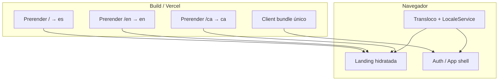

# i18n en regalalo: landing con prerender + app en runtime

**Fecha:** 2026-05-21  
**Autor:** Emanuel  
**Tipo:** Investigación técnica (BMad TR)

---

## Resumen ejecutivo

Para **español, catalán e inglés** en una app Angular 21 donde **solo la landing necesita HTML estático/SEO** y el resto puede ser **CSR con cambio de idioma en runtime**, la recomendación es:

1. **Transloco (`@jsverse/transloco`)** como capa única de traducciones en toda la app (incluida landing).
2. **Ajustar `app.routes.server.ts`**: prerender **solo** la ruta raíz (y variantes por idioma si se desea SEO por locale); **`RenderMode.Client`** para el resto (`auth`, `explorar`, etc.).
3. **Landing SEO**: prerender **3 URLs** (`/`, `/en`, `/ca` o prefijo `/es`) con el idioma fijado en build/prerender params; meta `hreflang` + `lang` en `<html>`.
4. **No adoptar `@angular/localize` como estrategia principal** salvo un experimento aislado en landing: implica builds por locale y choca con el modelo “una app, selector de idioma en runtime” del producto autenticado.

**Riesgo conocido:** regresión en Angular CLI ≥20.3.7 al prerenderizar `/` con i18n y ciertas configs (`discoverRoutes: false`) — probar la landing en CI antes de cerrar la historia.

---

## Contexto del proyecto (estado actual)

| Aspecto | Estado |
|---------|--------|
| Angular | 21.x, standalone, signals, SSR habilitado en `angular.json` |
| Rutas servidor | `app.routes.server.ts` define `path: '**'` → **`RenderMode.Prerender` para todo** |
| Intención producto | SSR/prerender **solo landing**; resto **runtime (CSR)** |
| i18n | No implementado; copy en español en componentes |
| Idiomas objetivo | `es` (default), `ca`, `en` |
| Diseño | Prototipos HTML en español; traducciones vía JSON/claves, no HTML triplicado |

**Desalineación a corregir en implementación:** hoy todo el árbol se prerenderiza; hay que acotar prerender a landing (y rutas de locale si aplica).

---

## Opciones evaluadas

### A. `@angular/localize` (oficial, compile-time)

| Pros | Contras |
|------|---------|
| Integración nativa, bundles optimizados por idioma | Cambio de idioma = otro build o recarga completa |
| Bueno para sitios marketing con URL por locale | Complejidad en CI (×3 builds o post-process) |
| Prerender multi-locale documentado pero limitado | Poco alineado con app autenticada + selector en shell |

**Veredicto:** Reservar solo si en el futuro la landing se despliega como sitio estático separado. **No** como base del MVP completo.

### B. **Transloco** (runtime, JSON)

| Pros | Contras |
|------|---------|
| Cambio de idioma sin recargar; carga lazy de JSON | Pequeño coste runtime; cuidado en prerender (loader absoluto) |
| `provideTransloco` + standalone (Angular 16+) | Doc SSR de Transloco desactualizada; patrón manual con `RenderMode` |
| Un solo código para landing + auth + features | Mensajes de error del **backend** siguen en un idioma (fuera de alcance) |
| Compatible con señales / OnPush | |

**Veredicto:** **Opción recomendada** para el 95% del producto y también para textos de landing en prerender.

### C. `ngx-translate`

Similar a Transloco; ecosistema más antiguo. En Angular 21 el mantenimiento activo y schematic de **@jsverse/transloco** pesan a favor de Transloco.

---

## Arquitectura recomendada (híbrida)



### 1. Render modes (`app.routes.server.ts`)

Alineado con [Angular Server Routes](https://angular.dev/api/ssr/ServerRoute):

```typescript
export const serverRoutes: ServerRoute[] = [
  { path: '', renderMode: RenderMode.Prerender },
  { path: 'en', renderMode: RenderMode.Prerender },  // si URL sin prefijo para es
  { path: 'ca', renderMode: RenderMode.Prerender },
  { path: '**', renderMode: RenderMode.Client },
];
```

- **Landing (`''`)**: HTML estático en deploy → SEO, LCP, crawlers.
- **Resto**: no generar HTML en build; primera pintura en cliente con Transloco ya inicializado desde `localStorage`/navigator.

> Orden de rutas: las más específicas primero; fallback `**` en Client.

### 2. Transloco — configuración base

```typescript
provideTransloco({
  config: {
    availableLangs: [
      { id: 'es', label: 'Español' },
      { id: 'ca', label: 'Català' },
      { id: 'en', label: 'English' },
    ],
    defaultLang: 'es',
    fallbackLang: 'es',
    reRenderOnLangChange: true,
    prodMode: !isDevMode(),
  },
  loader: TranslocoHttpLoader, // public/i18n/{lang}.json
}),
```

**Estructura de ficheros:**

```
public/i18n/
  es.json
  ca.json
  en.json
src/app/core/i18n/
  locale.service.ts      # persistencia, document.lang, sync con router en landing
  transloco-loader.ts
```

**Convención de claves:** `feature.section.key` (ej. `auth.register.title`, `landing.hero.lead`).

### 3. Landing + prerender + idioma

**Estrategia A (recomendada): rutas por locale en marketing**

| URL | Idioma prerenderizado |
|-----|----------------------|
| `/` o `/es` | `es` |
| `/en` | `en` |
| `/ca` | `ca` |

En build/prerender, inyectar idioma activo **antes** de renderizar (APP_INITIALIZER o `provideAppInitializer` + `TranslocoService.setActiveLang` según path).

`getPrerenderParams` en la ruta vacía no aplica; usar **rutas explícitas** en `app.routes.ts` (alias de `LandingComponent`) o params en server route si Angular lo expone para subpaths.

**SEO complementario:**

- `<html lang="ca">` por página prerenderizada
- `<link rel="alternate" hreflang="...">` entre `/`, `/en`, `/ca`
- Título y meta description traducidos en JSON `landing.*`

**Estrategia B (mínima):** una sola prerender en `es`; selector en cliente cambia idioma tras hidratar. Menor SEO en `en`/`ca` para crawlers que no ejecutan JS — **aceptable solo si SEO multilingüe no es prioridad MVP**.

### 4. App autenticada (runtime puro)

- Mismo Transloco; **`RenderMode.Client`** evita doble fuente de verdad SSR/cliente.
- `LocaleService`:
  - Lee `localStorage` (`rgl_locale`) → si válido, `setActiveLang`
  - Si no, `navigator.language` mapeado a `es`|`ca`|`en` (fallback `es`)
  - Al cambiar: persistir + `document.documentElement.lang`
- Selector en shell (`AppShellComponent`) y opcionalmente en `AuthLayout` / landing.
- **Pipes/fechas:** `DatePipe` con locale registrado (`registerLocaleData` para `ca`, `en`, `es`).

### 5. Qué no hace falta en MVP

| Tema | Decisión |
|------|----------|
| SSR en `/login`, `/register` | No — Client + Transloco |
| Traducir errores API | Fuera de alcance; mapear códigos a claves i18n en frontend |
| Duplicar HTML en `docs/project/` por idioma | Prohibido por project-context; extraer copy a JSON |
| `@angular/localize` en features | No |

---

## Integración con BMad / historia sugerida

**Historia propuesta:** «1-x Internacionalización (es, ca, en)» — después de cerrar 1-3, **antes de 1-4**.

**Criterios de aceptación técnicos (borrador):**

1. Transloco configurado; JSON para `es`, `ca`, `en`.
2. `app.routes.server.ts` con prerender solo landing (+ rutas locale si A).
3. `LocaleService` + selector; persistencia `rgl_locale`.
4. Landing: textos vía claves; al menos un locale prerenderizado verificado en `dist/`.
5. Migración piloto: `landing` + `register` (o solo landing si 1-3 ya cerrada).
6. `project-context.md` actualizado con reglas i18n.
7. Documentar limitación: errores backend no traducidos.

**Dependencia:** corregir prerender global `**` actual antes o dentro de la misma historia.

---

## Riesgos y mitigaciones

| Riesgo | Mitigación |
|--------|------------|
| [Issue #31877](https://github.com/angular/angular-cli/issues/31877) — loop “Redirecting” en `/` con i18n + prerender | Probar build local; `discoverRoutes` acorde a docs Angular 21; evitar `routesFile` conflictivo |
| Flash de idioma incorrecto en CSR | `APP_INITIALIZER` carga JSON del locale guardado antes de bootstrap del shell |
| Catalán (`ca`) en `DatePipe` | `registerLocaleData` desde `@angular/common/locales/ca` |
| Crecimiento de JSON | Namespaces por feature; lazy load opcional `provideTranslocoScope` por ruta lazy |
| Divergencia prerender vs runtime en landing | Misma fuente `public/i18n/*.json`; en prerender setear lang por URL |

---

## Roadmap de implementación (orden)

1. Cambiar `serverRoutes` → Client para `**`, Prerender solo landing (+ locale paths).
2. `ng add @jsverse/transloco` o instalación manual + `provideTransloco`.
3. Crear JSON `es` (extraer copy landing + auth piloto).
4. `LocaleService` + selector UI (tokens diseño existentes).
5. Traducir `ca`, `en` (profesional o IA + revisión nativa para `ca`).
6. `hreflang` + `lang` en landing.
7. Regla en `project-context.md`: prohibido string visible hardcodeado en templates nuevos.

---

## Fuentes consultadas

- [Transloco — Quickstart / provideTransloco](https://jsverse.gitbook.io/transloco/getting-started)
- [Transloco — SSR (nota doc desactualizada)](https://jsverse.gitbook.io/transloco/advanced-features/ssr-support)
- [Angular — Server routes / RenderMode](https://angular.dev/api/ssr/ServerRoute)
- [Angular CLI issue #31877 — prerender + i18n en `/`](https://github.com/angular/angular-cli/issues/31877)
- [Blog: Angular i18n with Transloco (2025)](https://blog.rasc.ch/2025/08/angular-i18n-transloco.html)
- Código local: `src/app/app.routes.server.ts`, `app.routes.ts`, `angular.json`

---

## Decisión final (para historia / arquitectura)

| Decisión | Elección |
|----------|----------|
| Librería principal | **@jsverse/transloco** |
| Render landing | **Prerender** (1 o 3 URLs por locale) |
| Render app | **Client** |
| Idiomas | `es` (default), `ca`, `en` |
| `@angular/localize` | No en MVP |
| Próximo paso BMad | `[CS]` create-story → `[DS]` dev-story |
