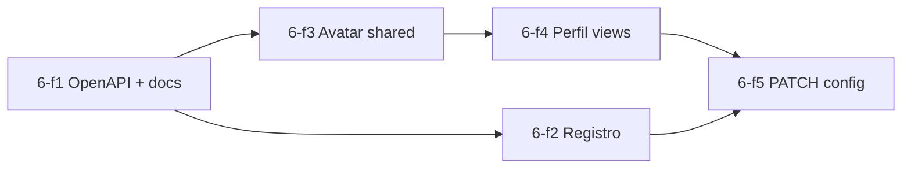

# Sprint Change Proposal — DLT-003_2 (modelo de usuario en frontend)

**Fecha:** 2026-05-25  
**Proyecto:** regalalo (frontend)  
**Autor del análisis:** Correct Course (BMad)  
**Solicitante:** Emanuel — activación con `docs/delta-frontend-DLT-003_2.md`  
**Referencia delta:** DLT-003 · `technical-design-frontend` v1.2 → v1.3  

**Estado del documento:** ✅ Aprobado por Emanuel — 2026-05-25  

---

## 1. Resumen del problema

### Problema

El frontend se implementó contra **`docs/architecture.md` v1.2** (usuario sin `firstName`/`lastName`/`avatarUrl`/`phone`/`preferredLanguage`, sin `PATCH /users/me`). El **backend ya cumple DLT-003** (Épica 6 backend en `done`), pero el cliente Angular **no regeneró OpenAPI** y las historias **1.3, 1.5, 5.1, 5.5** y componentes compartidos quedaron alineados al contrato antiguo.

### Contexto de descubrimiento

- Delta formal **`delta-frontend-DLT-003_2.md`** (estado: pendiente de aprobación) documenta el desfase entre contrato API/UI y la implementación actual.
- `PrivateProfile` / `PublicProfile` generados **no incluyen** campos nuevos; registro solo envía `{ email, password, postalCode, recaptchaToken }`.
- Avatares usan `initialsFromUserId(uuid)` en lugar de `firstName[0] + lastName[0]` o `avatarUrl`.
- Pestaña **Configuración** en `/profile` es solo lectura (email + postal); no existe formulario `PATCH /users/me` ni aviso de invalidación JWT al cambiar código postal.

### Evidencia

| Fuente | Hecho |
|--------|--------|
| `delta-frontend-DLT-003_2.md` | 6 cambios API + 2 modelos TS + 3 reglas de presentación |
| `backend/openapi/openapi.json` | `firstName`, `avatarUrl`, `PATCH /users/me` presentes |
| `src/app/core/api/generated/models/private-profile.ts` | Solo campos v1.2 |
| `register.component.ts` | Formulario sin `firstName` / `lastName` / `phone` |
| `perfil.component.ts` | `displayName` desde email; `initialsFromUserId` |
| `sprint-status.yaml` | Épicas 1–5 en `done`; **sin épica 6 frontend** |
| Backend `sprint-status.yaml` | 6-1…6-5 DLT-003 `done` |

### Tipo de issue

**Nuevo requisito / alineación de contrato** — el backend avanzó con DLT-003; el frontend debe ponerse al día. No es un bug de lógica de negocio ya entregada, sino **deuda de sincronización** entre repos y artefactos.

### Historia disparadora (equivalente)

No hay una story frontend fallida; el disparador es el **delta DLT-003_2** tras completar la Épica 6 del backend.

---

## 2. Análisis de impacto

### 2.1 Épicas afectadas

| Épica | Estado | Impacto |
|-------|--------|---------|
| **1** Autenticación | `done` | **Retrofit 1.3** (registro), **1.5** (login user DTO), posible sesión almacenada |
| **2** Objetos | `done` | Filas donante / detalle: avatar con regla nueva |
| **3** Candidatos | `done` | `candidate-row`, perfil público desde candidatos |
| **4** Entregas | `done` | Avatares en detalle de sesión |
| **5** Perfil | `done` | **Retrofit mayor 5.1, 5.5** + nueva capacidad edición perfil |
| **6 (nueva, frontend)** | — | Crear épica/historias de alineación DLT-003 (espejo de backend, solo UI+cliente) |

La épica 5 **sigue siendo viable**; los AC actuales están **incompletos** respecto al contrato v1.3.

### 2.2 Historias con AC obsoletos o incompletos

| Historia | Estado | Qué falta |
|----------|--------|----------|
| **1.3** Registro | `done` | Campos y payload; validación 2 chars; `phone` opcional |
| **1.5** Login | `done` | Persistir `firstName`/`lastName` del `user` en sesión si se usan en UI |
| **5.1** Perfil privado | `done` | Mostrar nombre, avatar, teléfono, idioma, `emailVerified` |
| **5.5** Perfil público | `done` | `firstName`, `lastName`, `avatarUrl` |
| **—** (nueva) | — | `PATCH /users/me`, aviso postal, `returnUrl` tras 401 |

### 2.3 Conflictos en artefactos

| Artefacto | Conflicto | Acción |
|-----------|-----------|--------|
| `docs/architecture.md` §4–5 | Desactualizado vs delta y OpenAPI | Fusionar contenido de `delta-frontend-DLT-003_2.md` → v1.3 |
| `delta-frontend-DLT-003_2.md` | Pendiente aprobación | Marcar **aprobado** tras OK de Emanuel |
| `_bmad-output/planning-artifacts/epics.md` | Sin FR ni épica 6 frontend | Añadir FR-F25…F29 (propuesta abajo) + Épica 6 + historias |
| `docs/prd.md` §6 Usuario | Sin campos identidad/contacto/i18n | Ampliar tabla Usuario (no cambia MVP) |
| `docs/project/Login.html` | Registro sin nombre/teléfono en prototipo | **Desviación controlada:** extender formulario siguiendo tokens `Login.html` + orden del delta; opcional actualizar HTML prototipo |
| `docs/project/Perfil.html` | Settings solo email/postal | Añadir campos editables con mismos patrones `Section`/`RowItem`; aviso inline postal (delta) |
| `openapi` generado | Stale | `npm run api:generate` tras OpenAPI backend actualizado |
| `sprint-status.yaml` | Sin entradas épica 6 FE | Tras aprobación: nuevas stories `6-f*` en `backlog` |

### 2.4 Impacto técnico

| Área | Detalle |
|------|---------|
| Cliente API | Regeneración obligatoria; tipos `PrivateProfile`, `PublicProfile`, `RegisterRequest`, `UpdateProfileRequest`, método `UsersService.usersMePatch` |
| Utilidad avatar | Sustituir/ampliar `initialsFromUserId` → helper `avatarDisplay(firstName, lastName, avatarUrl)` |
| Componentes | `perfil`, `perfil-publico`, `candidate-row`, `item-donor-row`, `entrega-detalle`, `app-shell`, `register` |
| Interceptor 401 | Tras `PATCH` con `postalCode`, siguiente 401 → login con `returnUrl=/perfil/configuracion` (delta); valorar detectar contexto en `auth-error.interceptor` o en el servicio de perfil |
| i18n | Claves nuevas registro, configuración, aviso postal |
| Tests | Actualizar specs de registro, perfil, avatar, PATCH |
| Backend | **Sin cambios** si OpenAPI en repo ya está al día |

---

## 3. Enfoque recomendado

### Opciones evaluadas

| Opción | Viabilidad | Comentario |
|--------|------------|------------|
| **1. Ajuste directo** | ✅ **Recomendada** | Nueva Épica 6 frontend + retrofits acotados; regenerar cliente |
| **2. Rollback épicas 1–5** | ❌ | Innecesario; el código es extensible |
| **3. Revisión MVP** | ❌ | El MVP ya contempla perfil y registro; solo amplía contrato |

### Decisión

**Opción 1:** Incorporar delta en `architecture.md` v1.3, regenerar cliente OpenAPI, añadir **Épica 6 (frontend DLT-003)** con historias ordenadas, y marcar retrofits en historias cerradas vía addendum o subtareas en las nuevas stories.

### Esfuerzo y riesgo

| Dimensión | Estimación |
|-----------|------------|
| Esfuerzo | **Medio** (~3–5 días: cliente API, registro, avatar transversal, perfil edición, tests) |
| Riesgo técnico | **Bajo** (contrato ya probado en backend) |
| Riesgo UX | **Medio** si no se actualiza prototipo HTML — mitigar con patrones existentes en `Perfil.html` / `Login.html` |
| Timeline | No bloquea MVP; sí bloquea **paridad contrato** con backend en producción |

---

## 4. Propuestas de cambio detalladas

### 4.1 `docs/architecture.md` — versión 1.3

Aplicar textualmente los **Cambios 1–6** de la Sección 4 y **Cambios 1–2** de la Sección 5 del delta, más las **Reglas de presentación** (Sección 6 del delta) en un nuevo apartado «Reglas de presentación» o §6 existente.

**Rationale:** Una sola fuente de verdad frontend alineada con OpenAPI y backend.

---

### 4.2 `docs/prd.md` — §6 Entidades / Usuario

**OLD (tabla Usuario):**

| Campo | Descripción |
|---|---|
| email | Identificador único |
| código postal | Base para geolocalización |
| reputation_score | … |

**NEW (añadir filas):**

| Campo | Descripción |
|---|---|
| first_name / last_name | Identidad visible; registro obligatorio (2–50) |
| avatar_url | URL pública opcional; fallback iniciales |
| phone | Opcional; contacto |
| preferred_language | `es` (MVP); usado por emails/i18n |
| email_verified | Flag de cuenta (solo perfil privado) |

**Rationale:** PRD debe reflejar el modelo ya desplegado en API sin redefinir MVP.

---

### 4.3 `_bmad-output/planning-artifacts/epics.md`

#### Nuevos requisitos funcionales (propuesta)

| ID | Requisito |
|----|-----------|
| FR-F25 | Registro incluye `firstName`, `lastName` obligatorios y `phone` opcional |
| FR-F26 | Perfil privado muestra y permite editar campos vía `PATCH /users/me` |
| FR-F27 | Cambio de `postalCode` en perfil invalida JWT; UI avisa antes de guardar |
| FR-F28 | Avatar: imagen si `avatarUrl`, si no iniciales `firstName`+`lastName` |
| FR-F29 | Perfil público y listas sociales usan `PublicUser` sin email |

#### Nueva épica

**Épica 6: Alineación modelo de usuario (DLT-003 — frontend)**  
**FRs:** FR-F25…FR-F29  
**UX:** `Login.html`, `Perfil.html`, `Explorar v3.html`, `Entregas.html`, `Mis objetos.html` (avatares)

#### Historias propuestas (orden sugerido)

| ID | Título | Depende de |
|----|--------|------------|
| **6-f1** | Regenerar cliente OpenAPI y actualizar `architecture.md` v1.3 | OpenAPI backend en repo |
| **6-f2** | Registro: `firstName`, `lastName`, `phone` (retrofit 1.3) | 6-f1 |
| **6-f3** | Componente/regla avatar compartida (retrofit 2.x, 3.x, 4.x, shell) | 6-f1 |
| **6-f4** | Perfil privado y público: campos y nombres (retrofit 5.1, 5.5) | 6-f1, 6-f3 |
| **6-f5** | Configuración: `PATCH /users/me`, aviso postal, re-login | 6-f1, 6-f4 |

---

### 4.4 Story 1.3 — Registro (retrofit AC)

**Section:** Acceptance Criteria — payload

**OLD:**

```text
Then se llama AuthService.authRegisterPost con { email, password, postalCode, recaptchaToken }
```

**NEW:**

```text
Then se llama AuthService.authRegisterPost con { email, password, firstName, lastName, postalCode, phone?, recaptchaToken }
And firstName/lastName: requeridos, mínimo 2 caracteres en cliente
And phone: opcional, texto libre, label i18n "Teléfono (opcional)" tras postalCode
And orden de campos: firstName, lastName, email, password, postalCode, phone
```

**Rationale:** Contrato register del delta Cambio 1.

---

### 4.5 Story 5.1 — Perfil privado (retrofit AC)

**OLD:**

```text
Then GET /users/me muestra email, postalCode, reputationScore, totalReceived, totalDonated, consecutiveNoShows, createdAt
```

**NEW:**

```text
Then GET /users/me muestra firstName, lastName, avatarUrl (img o iniciales), phone, postalCode, preferredLanguage, emailVerified, reputationScore, totalReceived, totalDonated, consecutiveNoShows, createdAt
And displayName deriva de firstName + lastName (no del local-part del email)
```

---

### 4.6 Story 5.5 — Perfil público (retrofit AC)

**OLD:**

```text
Then GET /users/:id muestra reputationScore, totalReceived, totalDonated, createdAt
```

**NEW:**

```text
Then GET /users/:id muestra firstName, lastName, avatarUrl, reputationScore, totalReceived, totalDonated, createdAt
And tipo PublicProfile del cliente generado (no User parcial)
```

---

### 4.7 Story 6-f5 — PATCH perfil (nueva)

**Acceptance Criteria (resumen):**

- Formulario reactivo en tab `configuracion`: `firstName`, `lastName`, `avatarUrl`, `phone`, `postalCode`, `preferredLanguage` (parcial).
- Aviso inline **antes** de guardar si `postalCode` cambió (texto del delta, i18n).
- `UsersService.usersMePatch`; éxito actualiza estado local.
- Si respuesta OK incluyó cambio de `postalCode`, la siguiente petición autenticada puede devolver 401 → interceptor redirige a `/login?returnUrl=/perfil/configuracion`.
- Errores 400 geocodificación / validación con mensajes i18n.

**Diseño:** `Perfil.html` SettingsTab + patrones `FieldInput` de `Login.html`.

---

### 4.8 `auth-error.interceptor.ts` (opcional explícito en 6-f5)

**Comportamiento:** Si `router.url` incluye `/profile` y tab configuración, usar `returnUrl: '/perfil/configuracion'` o ruta canónica del proyecto (`/profile` con query `tab=configuracion`) — **unificar con rutas reales** (`/profile` hoy).

**Nota:** El delta menciona `/perfil/configuracion`; la app usa `/profile`. La implementación debe usar la **ruta real** + query/hash acordado.

---

### 4.9 Handoff UX — prototipos

| Pantalla | Gap prototipo vs delta | Resolución |
|----------|------------------------|------------|
| `Login.html` registro | Sin nombre/teléfono | Campos nuevos con mismos componentes `FieldInput`; no cambiar paleta |
| `Perfil.html` settings | Sin PATCH completo | Extender `SettingsTab` con filas editables + aviso postal |

Recomendación PO: actualizar HTML en `docs/project/` en la misma PR o inmediatamente después, para mantener UX-DR bloqueante.

---

## 5. Handoff de implementación

### Clasificación de alcance

**Moderada** — Reorganización de backlog (épica 6 frontend), retrofits documentales, sin replanificación MVP.

### Destinatarios

| Rol | Responsabilidad |
|-----|-----------------|
| **Emanuel** | Aprobar propuesta; decidir modo incremental vs batch en refinamiento |
| **PM / PO** | Aprobar delta; opcional actualizar prototipos HTML |
| **Developer (bmad-dev-story)** | 6-f1 → 6-f5 en orden; `npm run api:generate` primero |
| **Tech writer (opcional)** | Fusionar delta aprobado en `architecture.md` |

### Criterios de éxito

1. `npm run api:generate` y build sin errores; modelos con campos DLT-003.
2. Registro crea usuario con nombre en backend; login devuelve nombre en sesión.
3. Todos los avatares siguen regla img vs iniciales.
4. `PATCH /users/me` funcional con aviso postal y re-login tras cambio CP.
5. Perfil público muestra nombre sin filtrar email.
6. `delta-frontend-DLT-003_2.md` estado → **Aprobado**.

### Secuencia recomendada



---

## 6. Checklist Correct Course (resumen)

| Sección | Resultado |
|---------|-----------|
| 1 Trigger y contexto | [x] Delta DLT-003_2; brecha backend vs frontend |
| 2 Impacto épicas | [x] Retrofit 1, 5; touch 2–4; nueva épica 6 FE |
| 3 Artefactos | [x] architecture, epics, prd, prototipos parciales |
| 4 Camino forward | [x] Opción 1 — ajuste directo |
| 5 Componentes propuesta | [x] Este documento |
| 6 Aprobación | [x] Emanuel — 2026-05-25 |
| 6.4 sprint-status | [x] Épica 6-f en `sprint-status.yaml` |

---

## 7. Implementación (aprobado 2026-05-25)

| Artefacto | Estado |
|-----------|--------|
| `sprint-status.yaml` | Épica 6-f1…6-f5 en `backlog` |
| `epics.md` | FR-F25…F29, Épica 6, AC 1.3/5.1/5.5 actualizados |
| `docs/architecture.md` | v1.3 (contratos §4–5, reglas §6) |
| `docs/prd.md` | Tabla Usuario ampliada |
| `delta-frontend-DLT-003_2.md` | Aprobado |

**Siguiente paso:** `bmad-dev-story` con historia **6-f1** (`create-story` si hace falta el fichero en `implementation-artifacts/`).

---

*Generado por workflow bmad-correct-course · 2026-05-25*
