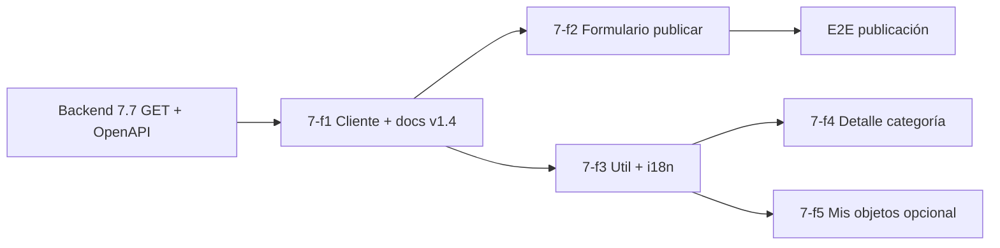

# Sprint Change Proposal — DLT-004 (frontend)

**Fecha:** 2026-05-26  
**Proyecto:** regalalo (frontend Angular)  
**Autor del análisis:** Correct Course (BMad)  
**Solicitante:** Emanuel — activación con `docs/delta-frontend-DLT-004.md`  
**Referencia delta:** DLT-004 · `technical-design-frontend` v1.3 → v1.4  
**Delta backend relacionado:** `../backend/docs/delta-backend-DLT-004.md` (Épica 7 backend `done`)

**Estado del documento:** ✅ Aprobado por Emanuel — 2026-05-26

---

## 1. Resumen del problema

### Problema

El backend completó **DLT-004** (Épica 7): `POST /items` exige `category` y `weightRange`, columnas en BD y analítica instrumentada. El frontend sigue en **`docs/architecture.md` v1.3**, sin campos en modelos de dominio documentados, y el formulario de publicación **no captura** categoría ni peso: envía valores fijos `'other'` / `'lt1'` como parche temporal tras la regeneración OpenAPI de **6-f1**.

### Contexto de descubrimiento

| Artefacto | Estado |
|-----------|--------|
| `docs/delta-frontend-DLT-004.md` | Pendiente de aprobación — define contratos §4–5 y reglas §6 |
| `docs/architecture.md` | **v1.3** — `POST /items` sin `category`/`weightRange`; interfaces `Item`/`ItemSummary` sin esos campos |
| `backend/openapi/openapi.json` | `PublishItemMultipart` con enums ✅; **`GetItemResponse` sin `category`** ❌ |
| `src/app/core/api/generated/models/get-item-response.ts` | Sin `category` |
| `src/app/core/api/generated/models/publish-item-multipart.ts` | Con `category` y `weightRange` ✅ |
| `publicar.component.ts` | Hardcode `category: 'other'`, `weightRange: 'lt1'` (deuda documentada en 6-f1) |
| `sprint-status.yaml` | Épicas 1–6 frontend `done`; **sin épica DLT-004 frontend** |
| Backend `sprint-status.yaml` | Épica 7 `done`; retro H1: handoff frontend pendiente |

### Evidencia

```281:288:src/app/features/items/publicar/publicar.component.ts
      const body: PublishItemMultipart = {
        title: title.trim(),
        description: description.trim(),
        condition,
        postalCode: postalCode.trim(),
        category: 'other',
        weightRange: 'lt1',
        images: this.imageBlobs(),
      };
```

- Historia **6-f1** difirió explícitamente la UI de publicación: *«desalineación previa spec/UI; fuera alcance 6-f1»*.
- Backend `GetItemResponseDto` no mapea `category` ni `weightRange` en `GET /items/:id` — el delta frontend asume que **sí** los devuelven (brecha cross-repo; ver §2.4).

### Tipo de issue

**Nuevo requisito / alineación de contrato** — extensión analítica ya desplegada en backend; el frontend debe capturar y mostrar (parcialmente) datos de categoría sin cambiar reglas de negocio core.

### Historia disparadora (equivalente)

No hay story frontend fallida; el disparador es el **delta DLT-004** tras cerrar Épica 7 backend y la deuda dejada en 6-f1.

---

## 2. Análisis de impacto

### 2.1 Épicas afectadas

| Épica | Estado | Impacto |
|-------|--------|---------|
| **2** Publicación y exploración | `done` | **Retrofit 2.2** (formulario publicar); **retrofit 2.4** (detalle — mostrar categoría) |
| **5** Perfil y actividad | `done` | **Retrofit opcional 5.3** (etiqueta categoría en «Mis objetos» — no obligatorio MVP) |
| **6** DLT-003 usuario | `done` | Sin conflicto; 6-f1 ya regeneró `PublishItemMultipart` |
| **7 (nueva, frontend)** | — | Épica de alineación DLT-004 (espejo del handoff backend) |

Las épicas 2 y 5 **siguen siendo viables**; los AC de 2.2 y 2.4 quedan **incompletos** respecto a v1.4.

### 2.2 Historias con AC obsoletos o incompletos

| Historia | Estado | Qué falta |
|----------|--------|-----------|
| **2.2** Publicar objeto | `done` | Selectores `category` y `weightRange`; validación reactiva; payload desde formulario (no hardcode) |
| **2.4** Detalle de objeto | `done` | Mostrar etiqueta visible de `category` (Regla 2 delta §6) |
| **5.3** Mis objetos | `done` | Opcional: chip/etiqueta `category` en tarjetas (Regla 4 — no obligatorio MVP) |

### 2.3 Conflictos en artefactos

| Artefacto | Conflicto | Acción |
|-----------|-----------|--------|
| `docs/architecture.md` | v1.3 sin campos ítem analíticos | Fusionar `delta-frontend-DLT-004.md` → **v1.4** |
| `delta-frontend-DLT-004.md` | Pendiente aprobación | Marcar **aprobado** tras OK de Emanuel |
| `_bmad-output/planning-artifacts/epics.md` | Sin FR ni épica 7 frontend | Añadir FR-F30…F32 + Épica 7-f + historias |
| `docs/prd.md` | FR-F6 sin categoría/peso | Ampliar FR-F6; enlace a `docs/prd-analytics.md` |
| `docs/project/Mis objetos.html` | Modal publicar sin selectores categoría/peso | **Desviación controlada:** añadir dos `<select>` en paso 1 del wizard siguiendo tokens existentes |
| Cliente OpenAPI | Parcialmente actualizado | `npm run api:generate` tras OpenAPI backend con GET actualizado |
| `sprint-status.yaml` | Sin épica 7-f | Tras aprobación: entradas `7-f*` en `backlog` |

### 2.4 Brecha cross-repo (bloqueante parcial)

El **delta frontend** exige `category` y `weightRange` en respuestas de:

- `GET /items`
- `GET /items/:id`
- `GET /users/me/items`

Hoy el backend **persiste** ambos campos pero **no los expone** en esos DTOs ni en `openapi.json` (`GetItemResponse`, `ItemSummaryDto`, `MyItemDto`).

| Capacidad frontend | ¿Bloqueada? |
|--------------------|-------------|
| Formulario publicación (`POST`) | **No** — API ya exige campos; solo falta UI |
| Detalle: mostrar categoría | **Sí** — hasta actualizar backend + OpenAPI + regenerar cliente |
| Feed / listados: mostrar categoría | **No requerido** en MVP (delta no exige en feed) |
| Mis objetos: etiqueta categoría (opcional) | **Sí** — mismo bloqueo GET |

**Recomendación:** historia backend **7.7** (o hotfix coordinado) *«Exponer `category` (y `weightRange` en contrato) en respuestas GET de ítems + OpenAPI»* **antes o en paralelo** con **7-f4**.

---

## 3. Enfoque recomendado

### Opciones evaluadas

| Opción | Viabilidad | Comentario |
|--------|------------|------------|
| **1. Ajuste directo** | ✅ **Recomendada** | Nueva Épica 7-f + retrofits 2.2/2.4; coordinación backend GET |
| **2. Rollback épicas 2** | ❌ | Innecesario; el código del formulario es extensible |
| **3. Revisión MVP** | ❌ | Analítica ya acordada; publicación debe capturar dimensión real |

### Decisión

**Opción 1:** Incorporar delta en `architecture.md` v1.4, coordinar OpenAPI GET en backend, añadir **Épica 7-f (frontend DLT-004)** con historias ordenadas. Mantener **weightRange invisible** en toda UI de lectura (Regla 3).

### Esfuerzo y riesgo

| Dimensión | Estimación |
|-----------|------------|
| Esfuerzo frontend | **Bajo–medio** (~2–3 días: formulario, util etiquetas, detalle, i18n, tests) |
| Esfuerzo backend (coordinación) | **Bajo** (~0.5–1 día: DTOs GET + OpenAPI) |
| Riesgo técnico | **Bajo** en POST; **medio** si se implementa detalle antes del GET backend |
| Riesgo UX | **Bajo** — selectores estándar; prototipo `Mis objetos.html` ampliable sin romper handoff |
| Timeline | No reduce MVP funcional; **sí** corrige datos analíticos erróneos (todo `other`/`lt1`) |

---

## 4. Propuestas de cambio detalladas

### 4.1 `docs/architecture.md` — versión 1.4

Aplicar los cambios de **Sección A** (§4 contratos API) y **Sección A** (§5 modelos TS) y **Sección B** (§6 reglas de presentación) de `delta-frontend-DLT-004.md`.

**Cabecera:**

```markdown
> Versión 1.4 — DLT-004: category y weightRange en ítems (publicación, respuestas GET, reglas UI).
> Delta fuente: docs/delta-frontend-DLT-004.md (aprobado 2026-05-26).
```

**Rationale:** Fuente única de verdad frontend alineada con PRD Analítica y backend v1.4.

---

### 4.2 `docs/prd.md` — publicación de objetos (FR-F6)

**OLD:**

> FR-F6: El donante autenticado puede publicar un objeto con título, descripción, condición, código postal del objeto y hasta 5 imágenes comprimidas en cliente.

**NEW:**

> FR-F6: El donante autenticado puede publicar un objeto con título, descripción, condición, **categoría (`category`)**, **rango de peso (`weightRange`)**, código postal del objeto y hasta 5 imágenes comprimidas en cliente. Valores según catálogo en `docs/prd-analytics.md` §4 / `architecture.md` v1.4.

**Rationale:** Trazabilidad MVP ↔ analítica sin duplicar catálogo AE.

---

### 4.3 `_bmad-output/planning-artifacts/epics.md`

#### Nuevos requisitos funcionales (propuesta)

| ID | Requisito |
|----|-----------|
| FR-F30 | Publicación incluye `category` y `weightRange` obligatorios con selectores y valores enum del contrato |
| FR-F31 | Detalle de objeto muestra la **etiqueta visible** de `category`; `weightRange` no se muestra al usuario |
| FR-F32 | Cliente OpenAPI y `architecture.md` reflejan v1.4 (ítems con campos analíticos) |

#### Nueva épica

**Épica 7-f: Alineación analítica en ítems (DLT-004 — frontend)**  
**FRs:** FR-F30…FR-F32  
**UX:** `Mis objetos.html` (modal publicar), `Explorar v3.html` (detalle — panel categoría)

#### Historias propuestas (orden sugerido)

| ID | Título | Depende de |
|----|--------|------------|
| **7-f1** | Regenerar cliente OpenAPI y actualizar `architecture.md` v1.4 | OpenAPI backend con GET actualizado (ver 7.7 backend) |
| **7-f2** | Publicar: selectores `category` y `weightRange` (retrofit 2.2) | 7-f1 (tipos); puede iniciar UI si enums ya en `PublishItemMultipart` |
| **7-f3** | Utilidad `item-category` + i18n etiquetas enum | 7-f1 |
| **7-f4** | Detalle: mostrar categoría; nunca mostrar peso (retrofit 2.4) | 7-f1, 7-f3, **backend GET con `category`** |
| **7-f5** | *(Opcional)* Mis objetos: etiqueta categoría en tarjeta (retrofit 5.3) | 7-f3, backend GET `users/me/items` |

#### Coordinación backend (fuera de épica 7-f, mismo sprint)

| ID | Título | Repo |
|----|--------|------|
| **7.7** | Exponer `category` y `weightRange` en DTOs/OpenAPI de `GET /items`, `GET /items/:id`, `GET /users/me/items` | backend |

---

### 4.4 Story 2.2 — Publicar objeto (retrofit AC)

**Section:** Acceptance Criteria — payload y validación

**OLD:**

```text
When completo título, descripción, condición, código postal del objeto y 1–5 imágenes comprimidas
Then se llama ItemsService.itemsPost con multipart (title, description, condition, postalCode, images[])
```

**NEW:**

```text
When completo título, descripción, condición, category, weightRange, código postal y 1–5 imágenes comprimidas
Then se llama ItemsService.itemsPost con multipart incluyendo category y weightRange (valores enum internos, no etiquetas visibles)
And category y weightRange son obligatorios — el envío no procede si faltan
And orden en paso 1 del formulario: condition → category → weightRange → postalCode (paso 2–3 sin cambio de imágenes)
And no se envían literales fijos other/lt1 salvo como default de formulario vacío bloqueado por validación
```

**Rationale:** Contrato POST ya breaking en backend; elimina datos analíticos falsos.

---

### 4.5 Story 2.4 — Detalle de objeto (retrofit AC)

**OLD:**

```text
Then GET /items/:id muestra título, descripción, condición, estado, requestsPaused, degradedAt, distancia, imágenes, donante
```

**NEW:**

```text
Then GET /items/:id muestra … (campos existentes) y la etiqueta visible de category (mapeo cliente desde enum)
And weightRange no se renderiza en ningún elemento de la UI (solo persistido en backend)
```

**Rationale:** Reglas 2 y 3 del delta §6.

---

### 4.6 Implementación técnica (referencia para dev-story)

| Área | Detalle |
|------|---------|
| Formulario | Añadir controles `category` y `weightRange` en `publicar.component` paso 1, tras `condition`; `<select>` o botones tipo condición según handoff |
| Tipos | Reutilizar unions de `PublishItemMultipart`; opcional `src/app/core/models/item-taxonomy.ts` con `ItemCategory`, `ItemWeightRange` |
| Util | `item-category-label.util.ts` — mapa valor → clave i18n o etiqueta |
| Detalle | `item-detail-panel` — fila/chip categoría; **no** añadir peso |
| i18n | Claves `items.category.*`, `items.weight_range.*` en `es.json`, `ca.json`, `en.json` |
| Tests | Actualizar `publicar.component.spec.ts` (payload real); detalle cuando exista `category` en `GetItemResponse` |
| Prototipo | Extender `PublishModal` en `Mis objetos.html` solo si se mantiene paridad documental (opcional) |

---

## 5. Implementación y handoff

### Clasificación de alcance

**Moderada** — Nueva épica frontend, retrofits documentales en historias `done`, coordinación backend GET (~1 historia).

### Destinatarios

| Rol | Responsabilidad |
|-----|-----------------|
| **Emanuel** | Aprobar propuesta; priorizar 7.7 backend vs 7-f2 en paralelo |
| **Developer backend** | 7.7: DTOs + OpenAPI GET |
| **Developer (bmad-dev-story)** | 7-f1 → 7-f4 (7-f5 opcional) |
| **Tech writer (opcional)** | Marcar delta aprobado; fusionar en `architecture.md` |

### Criterios de éxito

1. Publicación envía `category` y `weightRange` elegidos por el usuario (no hardcode).
2. `npm run build` y tests de publicar verdes.
3. Detalle muestra categoría con etiqueta i18n cuando backend expone el campo.
4. Ninguna vista muestra `weightRange` al usuario final.
5. `docs/architecture.md` en v1.4; `delta-frontend-DLT-004.md` → **Aprobado**.
6. E2E publicación contra backend con migración `013` aplicada.

### Secuencia recomendada



**Atajo permitido:** **7-f2** puede empezar en cuanto existan enums en `PublishItemMultipart` (ya en repo); **7-f4** espera **7.7**.

---

## 6. Checklist Correct Course (resumen)

| Sección | Resultado |
|---------|-----------|
| 1 Trigger y contexto | [x] Delta DLT-004; deuda 6-f1 hardcode; backend épica 7 done |
| 2 Impacto épicas | [x] Retrofit 2.2, 2.4; opcional 5.3; nueva épica 7-f |
| 3 Artefactos | [x] architecture, epics, prd; brecha OpenAPI GET |
| 4 Camino forward | [x] Opción 1 — ajuste directo + coordinación backend |
| 5 Componentes propuesta | [x] Este documento |
| 6 Aprobación | [x] Emanuel — 2026-05-26 |
| 6.4 sprint-status | [x] Épica 7-f en `sprint-status.yaml` |

---

## 7. Implementación (aprobado 2026-05-26)

| Artefacto | Estado |
|-----------|--------|
| `sprint-status.yaml` | Épica 7-f1…7-f5 en `backlog` |
| `epics.md` | FR-F30…F32, Épica 7-f, AC 2.2/2.4 actualizados |
| `docs/architecture.md` | v1.4 |
| `docs/prd.md` | Objeto: category + weightRange |
| `docs/delta-frontend-DLT-004.md` | Aprobado |
| Backend | Planificar historia **7.7** (GET + OpenAPI) |

**Siguiente paso BMad:** `create-story` para **7-f1** (o **7-f2** en paralelo si solo publicación; **7-f4** tras **7.7** backend) → `bmad-dev-story`.

---

*Generado por workflow bmad-correct-course · 2026-05-26*
