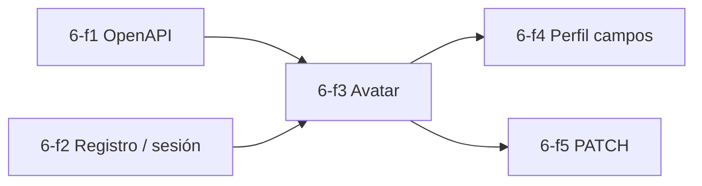

# Story 6-f3: Regla de avatar compartida (retrofit 2.x–4.x, shell)

Status: done

<!-- Validation: checklist BMad create-story aplicado. Ultimate context engine analysis completed - comprehensive developer guide created. Épica 6 DLT-003 — componente transversal; depende de 6-f1; desbloquea 6-f4. -->

## Story

Como usuario,
quiero ver avatares coherentes (foto o iniciales del nombre),
en perfil, candidatos, entregas y navegación.

**FR:** FR-F28 · **Épica:** 6 · **Retrofit de:** avatares en épicas 2.x, 3.x, 4.x, 5.x (presentación) y shell

**Diseño de referencia:** `docs/project/Entregas.html` (`Avatar`), `Perfil.html`, `Explorar v3.html`, `Mis objetos.html` — círculo, `primaryLight`/`primary-50`, borde `border-default`, tipografía display en iniciales

## Acceptance Criteria

1. **Utilidad y regla DLT-003**
   - **Given** `firstName` y `lastName` no vacíos (tras trim)
   - **When** se calculan iniciales para fallback
   - **Then** `initialsFromName(firstName, lastName)` devuelve `firstName[0].toUpperCase() + lastName[0].toUpperCase()` (una letra por campo; si un nombre tiene varias palabras, solo el primer carácter del string)
   - **And** si falta `firstName` o `lastName` (null, undefined o string vacío tras trim), la utilidad devuelve `''` y el componente aplica fallback documentado (AC #4)

2. **Componente compartido `UserAvatarComponent`**
   - **Given** inputs `avatarUrl`, `firstName?`, `lastName?`, `userId?`, `size` (`'sm' | 'md' | 'lg'`, default `'md'`)
   - **When** `avatarUrl !== null` y no es cadena vacía
   - **Then** se renderiza `` con `[src]="avatarUrl"`, `alt` descriptivo (p. ej. iniciales o nombre si el padre lo pasa), dimensiones fijas según `size`, `object-fit: cover`, `border-radius: 50%`
   - **And** se usa `NgOptimizedImage` con `ngSrc`, `width` y `height` acordes al tamaño del variant (34 / 36 / 40 px según mockups)
   - **When** `avatarUrl === null` o vacío y hay iniciales válidas vía `initialsFromName`
   - **Then** se muestra círculo con iniciales y estilos del design system (tokens `--color-primary-50`, `--border-default`, `--font-display`, etc. — alineado a `.candidate-row__avatar` / `Entregas.html` `Avatar`)
   - **And** el host o contenedor expone `role="img"` y `aria-label` coherente (iniciales o texto i18n del padre)

3. **Puntos de integración obligatorios**
   - **Given** la lista de touchpoints de la épica
   - **When** se revisa la UI tras la historia
   - **Then** **todos** usan `<app-user-avatar>` (o la utilidad solo dentro del componente), **no** llamadas directas a `initialsFromUserId` en templates ni `computed` de features:

   | Área | Archivo(s) | Fuente de datos |
   |---|---|---|
   | Shell navbar | `app-shell.component.ts` | `SessionService` — `firstName`, `lastName` (6-f2); `avatarUrl` si está en sesión o `null` |
   | Perfil privado | `perfil.component.html` | `PrivateProfile` tras `GET /users/me` — `avatarUrl`, `firstName`, `lastName` |
   | Perfil público | `perfil-publico.component.html` | `PublicProfile` — `avatarUrl`, `firstName`, `lastName` |
   | Candidatos | `candidate-row`, `item-select-receiver-dialog` | Sin nombre en `RankedCandidate` → ver AC #4 |
   | Donante en detalle | `item-donor-row` | Sin nombre en `ItemDonor` → ver AC #4 |
   | Entregas listado | `entregas.component.ts` (`sessionPartyHint`) | Solo `otherPartyUserId` en `MyDeliverySession` → ver AC #4 |
   | Entrega detalle | `entrega-detalle.component.html` | `DeliverySessionOtherParty` sin identidad → ver AC #4 |
   | Mis objetos reservado | `mis-objetos.component.html` | Party con `userId` → ver AC #4 |

   - **And** **no** se cambia `displayName` ni textos de nombre en perfil (historia **6-f4**)

4. **Fallback documentado cuando el contrato no trae identidad**
   - **Given** `RankedCandidate`, `ItemDonor`, `MyDeliverySession.otherPartyUserId` o `DeliverySessionOtherParty` (OpenAPI actual: solo `userId` + métricas, sin `firstName`/`lastName`/`avatarUrl`)
   - **When** el padre no puede pasar nombre ni `avatarUrl`
   - **Then** `UserAvatarComponent` usa **internamente** `initialsFromUserId(userId)` como único fallback permitido
   - **And** `initialsFromUserId` queda **deprecado para uso externo** (comentario JSDoc en `user-initials.util.ts`); ningún otro fichero importa la función salvo `user-avatar.component.ts`
   - **And** no se añaden llamadas `GET /users/:id` en listas (N+1 prohibido en esta historia)

5. **Regresión visual y accesibilidad**
   - **Given** tamaños existentes por pantalla (34px shell/candidatos, 40px donante/entrega según SCSS actual)
   - **When** se sustituyen `<div class="*__avatar">` por el componente
   - **Then** dimensiones y contraste se mantienen o mejoran sin desviar `colors_and_type.css`
   - **And** specs afectados se actualizan (`app-shell`, `candidate-row`, `item-donor-row`, `entrega-detalle` si aplica)

6. **Alcance acotado — no hacer en 6-f3**
   - **Then** **no** formulario PATCH ni edición de `avatarUrl` (**6-f5**)
   - **And** **no** refactor de nombres visibles en listas (solo avatar/iniciales)
   - **And** **no** editar `src/app/core/api/generated/`
   - **And** **no** exigir cambios en backend/OpenAPI para `RankedCandidate`/`ItemDonor` (deuda documentada; mejora futura opcional)

## Tasks / Subtasks

### A. Pre-requisitos (bloqueante)

- [x] Confirmar **6-f1** `done` (tipos `PrivateProfile` / `PublicProfile` con `firstName`, `lastName`, `avatarUrl`)
- [x] Recomendado **6-f2** `done` para shell (`SessionUser` con `firstName`, `lastName`)
- [x] Si tipos generados siguen en v1.2: ejecutar `npm run api:generate` antes de implementar

### B. Utilidad de iniciales (AC: 1)

- [x] Crear `src/app/core/utils/user-display.util.ts` con `initialsFromName(firstName: string, lastName: string): string`
- [x] Añadir `user-display.util.spec.ts` (pares válidos, trim, vacíos, unicode)

### C. Componente `UserAvatarComponent` (AC: 2, 4, 5)

- [x] `src/app/shared/components/user-avatar/user-avatar.component.ts` — standalone, OnPush, `input()` signals
- [x] Variants de tamaño mapeados a px (sm 34, md 36, lg 40 — ajustar a SCSS existente del call site)
- [x] Rama imagen: `NgOptimizedImage`, `fill` o width/height fijos, `loading="lazy"` si aplica
- [x] Rama iniciales: estilos en `user-avatar.component.scss` (reutilizar tokens; no inventar colores)
- [x] Importar `initialsFromUserId` solo aquí para fallback `userId`
- [x] Exportar componente desde barrel si el proyecto usa `shared/components/index` (opcional)

### D. Retrofit por touchpoint (AC: 3)

- [x] `app-shell`: sustituir `computed(() => 'MG')` por datos de `SessionService`; `<app-user-avatar size="sm" …>`
- [x] `perfil.component`: quitar `initials` computed con UUID; pasar campos de `profile()`
- [x] `perfil-publico.component`: idem con `PublicProfile`
- [x] `candidate-row` + template + spec
- [x] `item-donor-row` + spec
- [x] `item-select-receiver-dialog`
- [x] `entrega-detalle` (avatares en template)
- [x] `entregas.component` — `sessionPartyHint`: usar iniciales del componente/util o texto derivado de `UserAvatar` vía helper pequeño (sin duplicar lógica)
- [x] `mis-objetos` — avatar reservado
- [x] Eliminar imports de `initialsFromUserId` en todos los ficheros anteriores

### E. Deprecación y limpieza (AC: 4)

- [x] JSDoc `@deprecated` en `initialsFromUserId` — "Solo uso interno UserAvatarComponent"
- [x] Grep repo: cero usos de `initialsFromUserId` fuera de `user-avatar` y `user-initials.util.ts`

### F. Tests (AC: 5)

- [x] `user-display.util.spec.ts`
- [x] `user-avatar.component.spec.ts`: imagen vs iniciales vs fallback userId
- [x] Actualizar `app-shell.component.spec.ts` (mock sesión con nombre; ya no `'MG'` fijo)
- [x] Actualizar `candidate-row.component.spec.ts` si cambia DOM
- [x] `npm test` — suite de componentes tocados

### G. Verificación final

- [x] `npm run build`
- [x] Smoke: shell, fila candidato, detalle entrega, perfil (avatar img si API devuelve URL)
- [x] Dev Agent Record: File List, Completion Notes

### Review Findings

- [x] [Review][Patch] Shell: avatar en enlace de perfil sin `decorative` — doble anuncio accesible (link `aria-label` + host `role="img"`) [`app-shell.component.ts`:71-76]
- [x] [Review][Patch] Fallback `effectiveAriaLabel` usa literal `'Avatar'` en inglés sin i18n [`user-avatar.component.ts`:90]
- [x] [Review][Patch] Avatar vacío (sin iniciales) sigue exponiendo `role="img"` y etiqueta genérica [`user-avatar.component.ts`:59-61,89-91]
- [x] [Review][Patch] `candidate-row.component.spec.ts` no asserta `app-user-avatar` tras refactor DOM (AC #5) [`candidate-row.component.spec.ts`]
- [x] [Review][Defer] Cambios `publicar.component.ts` (`category`/`weightRange`) fuera de alcance 6-f3 — fix compile documentado en Completion Notes; extraer a historia/commit aparte [`publicar.component.ts`:286-287] — deferred, pre-existing debt from 6-f1
- [x] [Review][Defer] `resolveAvatarInitials` exportado desde fichero del componente acopla `entregas` al shared; mover a `user-display.util` en refactor futuro [`user-avatar.component.ts`:20-33] — deferred, aceptado en Completion Notes

## Dev Notes

### Contexto — brecha actual (evidencia en repo)

| Patrón actual | Ubicaciones | Objetivo 6-f3 |
|---|---|---|
| `initialsFromUserId(uuid)` | 9+ ficheros (grep) | Centralizado en `UserAvatarComponent` |
| `app-shell` mock `'MG'` | `app-shell.component.ts:87-88` | Sesión real `firstName`/`lastName` |
| `<div class="*__avatar">{{ initials() }}</div>` | perfil, candidatos, donante, entregas | `<app-user-avatar>` |
| Sin componente avatar | — | Nuevo shared |

### Regla de presentación (canónica)

```text
Si avatarUrl !== null (y no vacío) → 
Si avatarUrl === null y hay firstName + lastName → iniciales nombre
Si no hay identidad en DTO → fallback initialsFromUserId(userId) SOLO dentro del componente
```

Fuentes: `docs/delta-frontend-DLT-003_2.md` §6 Cambio 1, `docs/architecture.md` §6, `epics.md` Story 6-f3.

### Contrato OpenAPI — qué trae identidad hoy

| Schema | Campos identidad | Implicación 6-f3 |
|---|---|---|
| `PrivateProfile` / `PublicProfile` | ✅ `firstName`, `lastName`, `avatarUrl` | Regla completa tras 6-f1 |
| `RankedCandidate` | ❌ solo `userId` | Fallback UUID en componente |
| `ItemDonor` | ❌ solo `id` | Fallback UUID (`id` = userId) |
| `DeliverySessionOtherParty` | ❌ solo `userId` | Fallback UUID |
| `MyDeliverySession` | ❌ `otherPartyUserId` | Hint listado: fallback UUID |

**No** abrir deuda de backend en esta historia; documentar en Completion Notes si PO quiere ampliar OpenAPI después.

### API del componente (recomendado)

```typescript
// user-avatar.component.ts — orientativo
readonly avatarUrl = input<string | null>(null);
readonly firstName = input<string | undefined>();
readonly lastName = input<string | undefined>();
readonly userId = input<string | undefined>(); // fallback
readonly size = input<'sm' | 'md' | 'lg'>('md');
readonly ariaLabel = input<string | undefined>(); // opcional override
```

Padres con perfil completo:

```html
<app-user-avatar
  [avatarUrl]="profile()!.avatarUrl"
  [firstName]="profile()!.firstName"
  [lastName]="profile()!.lastName"
  [userId]="profile()!.id"
  size="lg"
/>
```

Padres con solo `userId` (candidato):

```html
<app-user-avatar [userId]="candidate().userId" size="sm" />
```

### Estilos — alinear a mockups (no inventar)

Referencia `Entregas.html` función `Avatar` (líneas ~240–248): círculo, `primaryLight`, borde 1.5px, `fontDisplay`, fontSize ≈ `size * 0.38`.

SCSS existente a unificar vía variantes del componente:

| Variant | px | Referencia actual |
|---|---|---|
| sm | 34 | `.navbar__avatar`, `.candidate-row__avatar` |
| md | 36 | `Entregas.html` default |
| lg | 40 | `.donor-row__avatar`, `.entrega-detalle__avatar` |

Usar variables CSS del proyecto (`--color-primary-50`, `--font-display`, `--weight-bold`, etc.).

### `NgOptimizedImage`

- Importar en `UserAvatarComponent`.
- Para URLs externas de avatar: `ngSrc`, `width`, `height` requeridos por la directiva; no usar para el círculo de iniciales (solo rama `@if` imagen).
- Si la URL es dinámica de usuario, no hace falta `priority` salvo avatar above-the-fold en perfil (valorar `priority` solo en header perfil).

### Shell — integración sesión

Estado actual:

```87:88:src/app/layout/app-shell/app-shell.component.ts
  /** Mock hasta historia 5.1 */
  readonly initials = computed(() => 'MG');
```

Tras 6-f2, `SessionUser` incluye `firstName`/`lastName`. Inyectar `SessionService`:

- Pasar nombres al avatar.
- `avatarUrl`: null hasta que sesión o 6-f4/6-f5 lo persistan (OK mostrar iniciales de nombre).

### Perfil privado/público en 6-f3 vs 6-f4

- **6-f3:** solo sustituir bloque avatar por `UserAvatarComponent` usando campos API ya cargados (`GET /users/me`, `GET /users/:id`).
- **6-f4:** `displayName`, subtítulos, configuración, AC completos 5.1/5.5 — **no** mezclar en 6-f3.

Código actual a reemplazar (perfil):

```160:163:src/app/features/profile/perfil/perfil.component.ts
  readonly initials = computed(() => {
    const p = this.profile();
    return p ? initialsFromUserId(p.id) : '';
  });
```

### Qué preservar

| Comportamiento | Detalle |
|---|---|
| Layout filas | No cambiar estructura `candidate-row`, `item-donor-row` salvo nodo avatar |
| Rankings / scores | Sin cambios en `scoreDisplay`, distancias, fechas |
| Rutas y guards | Sin cambios |
| Landing `rep-chip-avatar` | Fuera de alcance (marketing estático) |

### Qué NO hacer en 6-f3

- ❌ Regenerar OpenAPI (6-f1) ni editar `generated/`
- ❌ PATCH perfil / aviso postal (6-f5)
- ❌ Cambiar `displayName` desde email (6-f4)
- ❌ Formulario registro (6-f2)
- ❌ Fetch masivo de perfiles públicos en listas
- ❌ Strings hardcodeados en avatar (i18n solo si label visible; iniciales no se traducen)

### Dependencias



**Bloqueante:** 6-f1 (`PrivateProfile`/`PublicProfile` con campos DLT-003).

**Recomendado:** 6-f2 para shell con nombres reales.

**Desbloquea:** 6-f4 (perfiles ya usan componente; 6-f4 afina copy y layout).

### Intelligence de historias anteriores

**6-f1:** Regla avatar en `docs/architecture.md` §6; lista explícita de ficheros con `initialsFromUserId` para 6-f3; prohibido crear componente en 6-f1.

**6-f2:** `SessionUser` con `firstName`/`lastName` — usar en shell; no tocar avatar URL en registro.

### Architecture compliance

| Regla | Fuente |
|---|---|
| Regla avatar img vs iniciales | `docs/delta-frontend-DLT-003_2.md` §6, `docs/architecture.md` §6 |
| FR-F28 | `epics.md` |
| Diseño tokens | `docs/project/colors_and_type.css`, mockups listados |
| `NgOptimizedImage` en imágenes | `AGENTS.md` |
| Standalone, OnPush, `input()` | `AGENTS.md`, `_bmad-output/project-context.md` |
| No editar `generated/` | `docs/api-client.md` |

### Testing requirements

- Unit: `initialsFromName` casos borde (acentos, trim, un solo nombre vacío).
- Component: tres ramas render (img, iniciales nombre, fallback UUID).
- Actualizar specs que assertan texto `'MG'` o iniciales derivadas de UUID en DOM.
- Comando: `npm test`
- Manual: usuario con `avatarUrl` en API vs `null` con nombre

### Referencias obligatorias

- [Source: _bmad-output/initiative-regalalo/archive-v6/epics.md#Story-6-f3]
- [Source: docs/delta-frontend-DLT-003_2.md#Sección-6-Cambio-1]
- [Source: docs/architecture.md] — §6 regla avatar
- [Source: _bmad-output/initiative-regalalo/sprint-change-proposal-2026-05-25-DLT-003_2.md] — §2.4 utilidad avatar
- [Source: _bmad-output/initiative-regalalo/archive-v6/6-f1-regenerar-cliente-openapi-y-architecture-v1-3.md]
- [Source: _bmad-output/initiative-regalalo/archive-v6/6-f2-registro-firstname-lastname-phone-retrofit-1-3.md]
- [Source: docs/project/Entregas.html] — componente `Avatar`
- [Source: src/app/core/utils/user-initials.util.ts] — fallback legacy

## Dev Agent Record

### Agent Model Used

Composer (dev-story 2026-05-26)

### Debug Log References

- Suite bloqueada por error TS preexistente en `publicar.component.ts` (campos `category`/`weightRange` tras 6-f1); fix mínimo con defaults para desbloquear compile/tests.

### Completion Notes List

- Creado `initialsFromName` y `UserAvatarComponent` con regla img → nombre → UUID; variantes sm/md/lg y override `--user-avatar-size` en perfil (68px) y perfil público (48px).
- Retrofit en shell, perfiles, candidatos, donante, diálogo selección, entregas (hint vía `resolveAvatarInitials`), detalle entrega y mis-objetos reservado.
- `initialsFromUserId` deprecado; único import externo eliminado (grep limpio).
- Input `decorative` para avatares dentro de enlaces con aria-label padre.
- Tests: 428/428 OK; `npm run build` OK.
- Deuda OpenAPI: `RankedCandidate`/`ItemDonor`/`DeliverySessionOtherParty` sin nombre — fallback UUID documentado; ampliación backend opcional futura.

### File List

- `src/app/core/utils/user-display.util.ts` (nuevo)
- `src/app/core/utils/user-display.util.spec.ts` (nuevo)
- `src/app/core/utils/user-initials.util.ts` (deprecación JSDoc)
- `src/app/shared/components/user-avatar/user-avatar.component.ts` (nuevo)
- `src/app/shared/components/user-avatar/user-avatar.component.scss` (nuevo)
- `src/app/shared/components/user-avatar/user-avatar.component.spec.ts` (nuevo)
- `src/app/layout/app-shell/app-shell.component.ts`
- `src/app/layout/app-shell/app-shell.component.scss`
- `src/app/layout/app-shell/app-shell.component.spec.ts`
- `src/app/features/profile/perfil/perfil.component.ts`
- `src/app/features/profile/perfil/perfil.component.html`
- `src/app/features/profile/perfil/perfil.component.scss`
- `src/app/features/profile/perfil-publico/perfil-publico.component.ts`
- `src/app/features/profile/perfil-publico/perfil-publico.component.html`
- `src/app/features/profile/perfil-publico/perfil-publico.component.scss`
- `src/app/shared/components/candidate-row/candidate-row.component.ts`
- `src/app/shared/components/candidate-row/candidate-row.component.html`
- `src/app/shared/components/candidate-row/candidate-row.component.scss`
- `src/app/shared/components/item-donor-row/item-donor-row.component.ts`
- `src/app/shared/components/item-donor-row/item-donor-row.component.html`
- `src/app/shared/components/item-donor-row/item-donor-row.component.scss`
- `src/app/shared/components/item-select-receiver-dialog/item-select-receiver-dialog.component.ts`
- `src/app/shared/components/item-select-receiver-dialog/item-select-receiver-dialog.component.html`
- `src/app/shared/components/item-select-receiver-dialog/item-select-receiver-dialog.component.scss`
- `src/app/features/delivery/entrega-detalle/entrega-detalle.component.ts`
- `src/app/features/delivery/entrega-detalle/entrega-detalle.component.html`
- `src/app/features/delivery/entrega-detalle/entrega-detalle.component.scss`
- `src/app/features/delivery/entregas/entregas.component.ts`
- `src/app/features/items/mis-objetos/mis-objetos.component.ts`
- `src/app/features/items/mis-objetos/mis-objetos.component.html`
- `src/app/features/items/mis-objetos/mis-objetos.component.scss`
- `src/app/features/items/publicar/publicar.component.ts` (fix compile: defaults category/weightRange)

## Change Log

- 2026-05-26: Code review — patches a11y (decorative shell, i18n label, avatar vacío), specs avatar/candidate-row.
- 2026-05-26: Story 6-f3 — componente avatar compartido, utilidad `initialsFromName`, retrofit touchpoints, deprecación `initialsFromUserId`.
