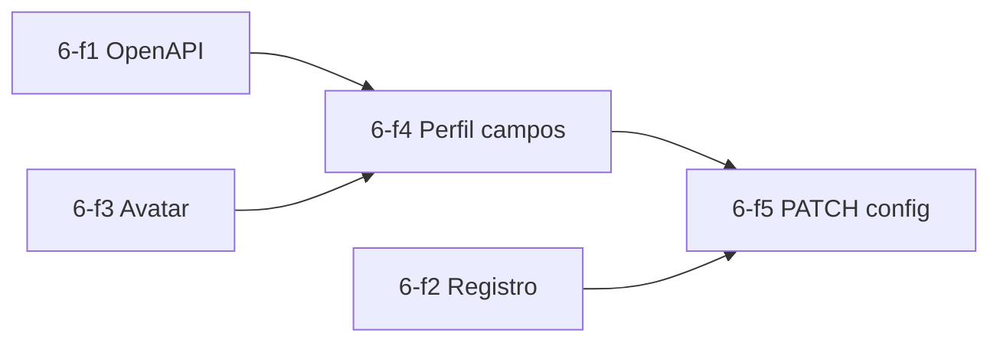

# Story 6-f5: PATCH /users/me — configuración, aviso postal y re-login

Status: done

<!-- Validation: checklist BMad create-story aplicado. Ultimate context engine analysis completed - comprehensive developer guide created. Capacidad edición perfil DLT-003 — depende de 6-f1 y 6-f4. -->

## Story

Como usuario autenticado,
quiero editar mi perfil desde la pestaña configuración,
para mantener mis datos al día.

**FR:** FR-F26, FR-F27 · **Épica:** 6 · **Cierra:** delta DLT-003 frontend (última historia de la épica)

**Diseño de referencia:** [`docs/project/Perfil.html`](../../docs/project/Perfil.html) (`SettingsTab` L615–710: sección «Cuenta», filas editables, botón guardar en postal — **extender** con campos DLT-003 usando patrones `Section`/`RowItem`/`FieldInput` de `Login.html`)

## Acceptance Criteria

1. **Formulario editable en tab `configuracion` (`/perfil`)**
   - **Given** cliente OpenAPI regenerado (**6-f1** `done`) y tab Configuración con campos DLT-003 en lectura (**6-f4** `done`)
   - **When** cargo `/perfil` con tab «Configuración» activa (default actual)
   - **Then** la sección «Cuenta» incluye formulario reactivo (`FormGroup`) con campos editables: `firstName`, `lastName`, `avatarUrl`, `phone`, `postalCode`, `preferredLanguage`
   - **And** `email` permanece **solo lectura** (no editable, no incluido en PATCH)
   - **And** `emailVerified` permanece solo lectura (badge/texto de 6-f4)
   - **And** validación cliente alineada con OpenAPI `UpdateProfileRequest`:
     - `firstName` / `lastName`: requeridos en formulario, `minLength(2)`, `maxLength(50)`
     - `postalCode`: patrón `^\d{5}$` (mismo que registro)
     - `phone`: opcional; vacío → enviar `null` en PATCH si el usuario borró un valor previo, omitir si no cambió
     - `avatarUrl`: opcional; URL válida o vacío → `null` para quitar avatar
     - `preferredLanguage`: valores permitidos según tipo generado (OpenAPI actual: enum `es`; si el spec amplía a `ca`/`en`, reflejarlo)
   - **And** botón «Guardar cambios» deshabilitado si formulario inválido o **sin cambios** respecto al perfil cargado
   - **And** layout y tokens siguen `Perfil.html` SettingsTab + `app-field-input` (no UI kit ajeno)

2. **PATCH parcial con `UsersService.usersMePatch`**
   - **Given** formulario válido con al menos un campo modificado
   - **When** confirmo guardar
   - **Then** se llama `UsersService.usersMePatch({ body })` con **solo** propiedades cambiadas (`UpdateProfileRequest` parcial)
   - **And** **nunca** se incluye `postalCode` en el body si el valor es idéntico al original (evita invalidación JWT accidental)
   - **And** ante `200` con `UpdateProfileResponse`:
     - actualizar `profile` signal con merge de campos editables + conservar `email`, `emailVerified`, métricas no devueltas por PATCH
     - resetear formulario a valores guardados (`markAsPristine`)
     - mostrar feedback de éxito accesible (banner inline o toast según patrón existente en perfil)
     - si cambiaron `firstName`/`lastName`: actualizar `SessionService.setUser` (campos de sesión) **sin** esperar re-login salvo cambio de CP
   - **And** si cambió `preferredLanguage` y el valor es soportado por `LocaleService`: sincronizar UI con `LocaleService.setLocale` + persistir `rgl_locale`

3. **Aviso inline al modificar código postal (FR-F27)**
   - **Given** el control `postalCode` del formulario
   - **When** su valor difiere del `postalCode` original del perfil cargado (`profile()`)
   - **Then** se muestra aviso informativo **inline** visible (no modal, no `confirm()` nativo) con copy i18n equivalente a:
     > «Cambiar tu código postal actualizará tu ubicación y cerrará tu sesión actual. Tendrás que volver a iniciar sesión.»
   - **And** el aviso desaparece si el usuario restaura el CP original
   - **And** el aviso usa estilos informativos de `colors_and_type.css` (fondo/borde suave, no error)

4. **Invalidación JWT tras cambio de CP y re-login**
   - **Given** PATCH exitoso cuyo body **incluyó** `postalCode` distinto del original
   - **When** el backend invalida el JWT (`jwt_version++`) y la **siguiente** petición autenticada responde `401`
   - **Then** `authErrorInterceptor` limpia token y redirige a `/login?returnUrl=<ruta segura>`
   - **And** `returnUrl` canónico = **`/perfil`** (ruta real de la app; **no** `/profile` ni `/perfil/configuracion` del borrador delta — tab Configuración es default al cargar `/perfil`)
   - **And** tras login exitoso el usuario vuelve a `/perfil` con tab configuración (default) y puede editar de nuevo
   - **Implementación recomendada:** tras PATCH con cambio de CP, guardar flag en `sessionStorage` (p. ej. `rgl_relogin_return=/perfil`); interceptor lo consume para `returnUrl` en el próximo 401 y lo elimina; fallback = `router.url` actual si no hay flag

5. **Errores HTTP — preservar datos del formulario**
   - **Given** error `400` por código postal no geocodificable o validación de campo
   - **When** guardo
   - **Then** mensaje i18n específico en `postalCode` o campo afectado; **no** se pierden otros valores ya editados en el formulario
   - **And** errores `400` con `ValidationError.errors[].path` mapeados a controles (util dedicada, patrón `register-error.util.ts`)
   - **And** `401` en el PATCH mismo → interceptor estándar (no tratar como éxito)
   - **And** error de red → banner reintentar sin resetear formulario

6. **Regresión — resto del perfil**
   - **Given** tabs donaciones, solicitudes, reputación, cabecera, logout
   - **When** implemento 6-f5
   - **Then** comportamiento existente sin regresión (specs `perfil.component.spec.ts` actualizados)
   - **And** cabecera sigue usando `displayName` / `<app-user-avatar>` de 6-f3/6-f4 y se refresca tras guardar nombre/avatar

7. **i18n (NFR — historia 1.4)**
   - **Given** formulario, aviso postal, éxito y errores
   - **When** cambio idioma (`es`, `ca`, `en`)
   - **Then** claves Transloco en `public/i18n/{es,ca,en}.json`:

   | Clave | ES (referencia) |
   |---|---|
   | `profile.settings.first_name_label` | Nombre |
   | `profile.settings.last_name_label` | Apellidos |
   | `profile.settings.avatar_url_label` | URL del avatar |
   | `profile.settings.avatar_url_helper` | Enlace público a tu imagen. Déjalo vacío para usar iniciales. |
   | `profile.settings.phone_label` | Teléfono |
   | `profile.settings.postal_label` | Código postal |
   | `profile.settings.language_label` | Idioma preferido |
   | `profile.settings.save` | Guardar cambios |
   | `profile.settings.saving` | Guardando… |
   | `profile.settings.success` | Perfil actualizado |
   | `profile.settings.postal_warning` | Cambiar tu código postal actualizará tu ubicación y cerrará tu sesión actual. Tendrás que volver a iniciar sesión. |
   | `profile.settings.error.postal_invalid` | Código postal no válido o no geocodificable |
   | `profile.settings.error.generic` | No se pudo guardar. Inténtalo de nuevo. |
   | `profile.settings.validation.first_name_min` | Mínimo 2 caracteres |
   | `profile.settings.validation.last_name_min` | Mínimo 2 caracteres |
   | `profile.settings.validation.postal_format` | Introduce 5 dígitos |

   - **And** reutilizar claves de 6-f4 para `email`, `emailVerified`, `language.*` donde aplique (no duplicar)

8. **Alcance acotado — no hacer en 6-f5**
   - **Then** **no** editar `src/app/core/api/generated/`
   - **And** **no** implementar «Cambiar contraseña» ni notificaciones de `Perfil.html` (fuera MVP / sin endpoint)
   - **And** **no** subida de archivos de avatar — solo URL (`avatarUrl`)
   - **And** **no** regenerar OpenAPI (reservado a 6-f1)

## Tasks / Subtasks

### A. Pre-requisitos (bloqueante)

- [x] Confirmar **6-f1** `done` — existen `UsersService.usersMePatch`, `UpdateProfileRequest`, `UpdateProfileResponse`
- [x] Confirmar **6-f4** `done` — tab Configuración muestra campos DLT-003 (lectura) y cabecera con nombre/avatar
- [x] Si tipos generados siguen v1.2: ejecutar `npm run api:generate` antes de implementar

### B. Utilidad de errores PATCH (AC: 5)

- [x] Crear `profile-update-error.util.ts` (+ spec) en `src/app/features/profile/perfil/`:
  - Mapear `400` geocodificación → `profile.settings.error.postal_invalid` en campo `postalCode`
  - Mapear paths `firstName`, `lastName`, `phone`, `avatarUrl`, `preferredLanguage` a claves de campo
  - Red / desconocido → banner `profile.settings.error.generic`
- [x] Patrón análogo a `register-error.util.ts` + `mapRegisterError`

### C. Formulario reactivo en tab Configuración (AC: 1, 2, 3)

- [x] `perfil.component.ts`:
  - Importar `ReactiveFormsModule`, `FormBuilder`, `FieldInputComponent`
  - Crear `settingsForm` nonNullable; poblar desde `profile()` tras `loadProfile` y tras PATCH exitoso
  - Computed `postalCodeChanged` / `showPostalWarning` comparando control vs `profile()?.postalCode`
  - Computed `settingsFormDirty` / `hasSettingsChanges` para habilitar guardar
  - Método `buildPatchBody(): UpdateProfileRequest` — **solo diffs**; tests unitarios obligatorios para no enviar CP sin cambio
  - Método `saveSettings()`: guard `inFlight`, llamar `usersMePatch`, manejar éxito/error
  - Tras PATCH con CP cambiado: `sessionStorage.setItem('rgl_relogin_return', '/perfil')`
  - Tras éxito sin CP: merge respuesta en `profile` signal + `patchValue` form
- [x] `perfil.component.html` — reemplazar filas estáticas de cuenta (excepto email/verified) por:
  - `app-field-input` para textos
  - `<select>` estilizado para `preferredLanguage` (patrón visual `field__*` coherente con `FieldInput`)
  - Bloque aviso postal (`@if (showPostalWarning())`) con `role="note"` o `aria-live="polite"`
  - Botón guardar + estado `submitting`
- [x] `perfil.component.scss`: estilos aviso postal (info), botón guardar alineado a `Perfil.html` L678–681

### D. Interceptor 401 — returnUrl perfil (AC: 4)

- [x] `auth-error.interceptor.ts`:
  - Antes de redirect, leer y consumir `sessionStorage.getItem('rgl_relogin_return')`
  - Si valor pasa `sanitizeReturnUrl()` → usar como `returnUrl`; si no, mantener `router.url`
- [x] Actualizar `auth-error.interceptor.spec.ts` con caso flag → `/perfil`
- [x] **No** hardcodear redirect en el componente de perfil — delegar al interceptor existente

### E. Sesión y cabecera (AC: 2, 6)

- [x] Tras PATCH exitoso sin cambio de CP: si `firstName`/`lastName`/`avatarUrl` cambiaron, actualizar `SessionService.setUser` con spread del user en sesión + campos nuevos (6-f2 ya amplió `SessionUser`)
- [x] Cabecera perfil: `displayName()` y avatar reaccionan al `profile` signal actualizado (sin recarga completa de página)

### F. i18n (AC: 7)

- [x] Añadir claves tabla AC #7 en `public/i18n/es.json`, `ca.json`, `en.json`
- [x] Migrar labels duplicados de `profile.account.*` a `profile.settings.*` donde el campo sea editable, o alias documentado

### G. Tests (AC: 1–6)

- [x] `profile-update-error.util.spec.ts` — casos 400 postal, paths, genérico
- [x] `perfil.component.spec.ts`:
  - Mock `usersMePatch`; assert body parcial solo con campos cambiados
  - Assert aviso postal visible solo cuando CP difiere
  - Assert **no** incluye `postalCode` en body si no cambió
  - Assert éxito actualiza DOM / profile signal
  - Regresión: logout, tabs, load error
- [x] `npm test` — specs perfil + interceptor

### Review Findings

- [x] [Review][Patch] `canSaveSettings` solo miraba `dirty`, no diffs reales vs perfil (AC1) [`perfil.component.ts`] — corregido con `settingsHasPatchChanges` + `buildProfilePatchBody`
- [x] [Review][Patch] `sessionStorage` sin guard `isPlatformBrowser` en `saveSettings` [`perfil.component.ts`] — alineado con interceptor
- [x] [Review][Defer] Mensaje i18n específico para `maxlength` en nombre/apellidos — usa `field_invalid` genérico; patrón aceptable, fuera de tabla AC7

### H. Verificación final

- [x] `npm run build`
- [x] Smoke manual:
  1. Editar nombre → guardar → cabecera actualizada sin logout
  2. Cambiar CP → ver aviso → guardar → siguiente navegación API → redirect login → login → vuelta `/perfil`
  3. CP inválido → error inline, resto de campos intactos
- [x] Dev Agent Record: File List, Completion Notes

## Dev Notes

### Contexto — estado actual del tab Configuración (pre-6-f5)

| Elemento | Ubicación | Estado |
|---|---|---|
| Tab `configuracion` default | `perfil.component.ts` L79 | ✅ |
| Email + postal **solo lectura** | `perfil.component.html` L738–745 | ❌ → formulario editable |
| Sin `usersMePatch` en cliente | `generated/services/users.service.ts` | ❌ hasta 6-f1 |
| `PrivateProfile` v1.2 | `generated/models/private-profile.ts` (7 campos) | ❌ hasta 6-f1 |
| Interceptor 401 | `auth-error.interceptor.ts` L47–49 | `returnUrl: router.url` — ampliar con flag postal |
| Ruta perfil | `profile.routes.ts` | **`/perfil`** (no `/profile`) |

### Contrato PATCH (referencia obligatoria)

**Request parcial** (`UpdateProfileRequest`):

```typescript
{
  firstName?: string;
  lastName?: string;
  avatarUrl?: string | null;
  phone?: string | null;
  postalCode?: string;
  preferredLanguage?: string;
}
```

**Response 200** (`UpdateProfileResponse`): subset sin email/métricas — hacer merge en UI.

**Errores:** `400` payload inválido / CP no geocodificable · `401` no autenticado.

Fuente: `docs/delta-frontend-DLT-003_2.md` Cambio 6, `docs/architecture.md` § PATCH `/users/me`, `backend/openapi/openapi.json`.

### Comportamiento crítico CP + JWT

```text
Usuario guarda PATCH con postalCode nuevo
  → Backend 200 + invalida JWT actual
  → UI muestra éxito; token aún en memoria hasta próxima petición
  → Siguiente GET autenticado → 401
  → Interceptor: clearToken + /login?returnUrl=/perfil
  → Login OK → navega a /perfil (tab configuración default)
```

**Guardrail dev:** incluir `postalCode` en body **solo** si `form.postalCode !== originalPostalCode`. Test explícito — bug aquí invalida sesión en cada guardado.

### Código actual a transformar

**Tab configuración (sustituir filas estáticas por form):**

```732:745:src/app/features/profile/perfil/perfil.component.html
        @case ('configuracion') {
          <div class="perfil__account">
            <div class="perfil__account-section">
              ...
              <div class="perfil__account-row">
                <div class="perfil__account-row-label">{{ t('profile.account.postal_label') }}</div>
                <div class="perfil__account-row-value">{{ p.postalCode }}</div>
              </div>
```

**Interceptor (extender returnUrl):**

```47:49:src/app/core/interceptors/auth-error.interceptor.ts
      void router.navigate(['/login'], {
        queryParams: { returnUrl: router.url },
      });
```

Importar `sanitizeReturnUrl` de `core/utils/return-url.util.ts`.

### Patrón formulario — reutilizar stack existente

| Pieza | Reutilizar |
|---|---|
| Inputs | `app-field-input` (`shared/components/field-input/`) |
| Validación postal | Mismo regex que `register.component.ts` |
| Errores API | Nuevo `profile-update-error.util.ts` ← `register-error.util.ts` |
| PATCH API | `UsersService.usersMePatch` (generado, 6-f1) |
| Idioma UI | `LocaleService.setLocale` si PATCH cambia `preferredLanguage` |

### Diseño — Perfil.html SettingsTab

- Sección «Cuenta» con borde/sombra `.perfil__account-section` ya existente
- Postal editable en prototipo (L663–698): input compacto + botón «Guardar» — en Angular: **un** botón guardar del formulario completo (no guardar postal aislado)
- Aviso postal: **nuevo** bloque inline bajo el campo CP (delta §6 Cambio 2) — no existe en HTML prototipo; usar tokens info de `colors_and_type.css`
- Email: fila solo lectura (RowItem sin input)

### Discrepancia rutas documentación vs app

| Documento | Ruta mencionada | Usar en implementación |
|---|---|---|
| `delta-frontend-DLT-003_2.md` | `/login?returnUrl=/perfil/configuracion` | ❌ |
| `docs/architecture.md` v1.3 | `/login?returnUrl=/profile` | ❌ |
| **App real** | `/perfil` | ✅ **`returnUrl=/perfil`** |

Tab configuración no tiene ruta URL propia; `activeTab` default = `'configuracion'`.

### Intelligence de historias anteriores

**6-f1:** Genera `usersMePatch`, `UpdateProfileRequest`. No tocar `generated/`. Bloqueante.

**6-f4:** Deja Configuración en **solo lectura** a propósito; añade filas phone/language/verified. **6-f5** convierte esos campos (salvo email/verified) en editables. Reutilizar claves i18n `profile.account.*` para lectura o unificar con `profile.settings.*`.

**6-f3:** Tras cambiar `avatarUrl`, cabecera debe refrescar `<app-user-avatar>` vía `profile` signal.

**6-f2:** `SessionUser` con `firstName`/`lastName` — sincronizar tras PATCH de nombre.

**1.4 i18n:** Cero strings literales en template; Transloco en es/ca/en.

### Architecture compliance

| Regla | Fuente |
|---|---|
| FR-F26, FR-F27 | `epics.md` Story 6-f5 |
| PATCH parcial + invalidación CP | `docs/delta-frontend-DLT-003_2.md` §4 Cambio 6, §6 Cambio 2 |
| Cliente generado | `docs/api-client.md`, `AGENTS.md` |
| Diseño Settings | `docs/project/Perfil.html` SettingsTab |
| Formularios reactivos, signals, OnPush | `AGENTS.md`, `_bmad-output/project-context.md` |
| WCAG AA | labels, aviso con `aria-live`, errores en campo |

### Testing requirements

- Unit: `buildPatchBody` / diff logic (crítico para CP)
- Unit: `mapProfileUpdateError` casos 400
- Component: aviso postal visible/oculto; PATCH mock; no regresión tabs
- Interceptor: flag `rgl_relogin_return`
- Comando: `npm test`; smoke manual flujo CP (AC #4)

### Qué NO hacer en 6-f5

- ❌ Modal de confirmación para cambio CP (delta exige inline)
- ❌ Enviar PATCH con todos los campos siempre (riesgo invalidar JWT)
- ❌ Duplicar tipos `UpdateProfileRequest` en `core/models/`
- ❌ Cambiar contrato backend / OpenAPI manualmente
- ❌ Implementar cambio de contraseña desde perfil (sin endpoint en MVP)

### Dependencias



**Bloqueantes:** 6-f1 (tipos + `usersMePatch`), 6-f4 (UI base Configuración).

**Desbloquea:** cierre Épica 6 frontend DLT-003; retroactivo FR-F26/F27.

### Referencias obligatorias

- [Source: _bmad-output/initiative-regalalo/archive-v6/epics.md#Story-6-f5]
- [Source: docs/delta-frontend-DLT-003_2.md] — Cambio 6, §6 Cambio 2
- [Source: _bmad-output/initiative-regalalo/sprint-change-proposal-2026-05-25-DLT-003_2.md] — §4.7, §4.8
- [Source: docs/architecture.md] — PATCH `/users/me`, regla aviso postal §6
- [Source: _bmad-output/initiative-regalalo/archive-v6/6-f1-regenerar-cliente-openapi-y-architecture-v1-3.md]
- [Source: _bmad-output/initiative-regalalo/archive-v6/6-f4-perfil-privado-y-publico-campos-dlt-003.md]
- [Source: docs/project/Perfil.html] — SettingsTab
- [Source: src/app/features/profile/perfil/perfil.component.ts]
- [Source: src/app/core/interceptors/auth-error.interceptor.ts]
- [Source: src/app/features/auth/register/register-error.util.ts] — patrón errores

## Dev Agent Record

### Agent Model Used

Composer (dev-story 2026-05-26)

### Debug Log References

- Prerrequisitos 6-f1/6-f4 confirmados en sprint-status (`done`); cliente OpenAPI ya incluye `usersMePatch`.
- `canSaveSettings` requiere señal reactiva (`settingsFormState`) porque `FormGroup.valid/dirty` no dispara `computed` en OnPush.

### Completion Notes List

- Tab Configuración convertido a formulario reactivo con `app-field-input`, select de idioma y botón «Guardar cambios» (deshabilitado si inválido o sin cambios).
- PATCH parcial vía `buildProfilePatchBody` — nunca envía `postalCode` sin cambio real (test explícito).
- Aviso inline FR-F27 al modificar CP; flag `rgl_relogin_return=/perfil` consumido por `authErrorInterceptor` en el próximo 401.
- Errores 400 mapeados con `mapProfileUpdateError`; éxito mergea respuesta en `profile` signal y sincroniza sesión/idioma.
- i18n `profile.settings.*` en es/ca/en.
- Tests: 456/456 pass; build OK.
- Code review 2026-05-26: 2 parches (diff real en guardar, `isPlatformBrowser` en flag CP); 60 tests perfil OK.

### File List

- `src/app/features/profile/perfil/profile-update-error.util.ts` (nuevo)
- `src/app/features/profile/perfil/profile-update-error.util.spec.ts` (nuevo)
- `src/app/features/profile/perfil/profile-patch.util.ts` (nuevo)
- `src/app/features/profile/perfil/profile-patch.util.spec.ts` (nuevo)
- `src/app/features/profile/perfil/perfil.component.ts`
- `src/app/features/profile/perfil/perfil.component.html`
- `src/app/features/profile/perfil/perfil.component.scss`
- `src/app/features/profile/perfil/perfil.component.spec.ts`
- `src/app/core/interceptors/auth-error.interceptor.ts`
- `src/app/core/interceptors/auth-error.interceptor.spec.ts`
- `public/i18n/es.json`
- `public/i18n/ca.json`
- `public/i18n/en.json`

## Change Log

- 2026-05-26: Code review — parches `canSaveSettings` por diff real, guard SSR en flag re-login, test regresión botón guardar.
- 2026-05-26: Implementación 6-f5 — formulario PATCH perfil, aviso postal, interceptor re-login, i18n y tests.
