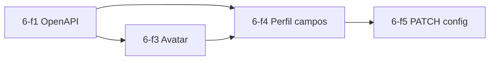

# Story 6-f4: Perfil privado y público con campos DLT-003 (retrofit 5.1, 5.5)

Status: done

<!-- Validation: checklist BMad create-story aplicado. Ultimate context engine analysis completed - comprehensive developer guide created. Retrofit DLT-003 de Stories 5.1 y 5.5 — depende de 6-f1 y 6-f3. -->

## Story

Como usuario,
quiero ver nombre y avatar correctos en mi perfil y en perfiles públicos,
para identificar participantes con fiabilidad.

**FR:** FR-F29 · **Épica:** 6 · **Retrofit de:** Story 5.1 (`5-1-ver-perfil-privado.md`), Story 5.5 (`5-5-ver-perfil-publico-de-otro-usuario.md`)

**Diseño de referencia:** [`docs/project/Perfil.html`](../../docs/project/Perfil.html) (ProfileHeader L350–422: `user.name`, avatar 68px, stats), [`docs/project/Explorar v3.html`](../../docs/project/Explorar v3.html) (DonorRow — identidad visible en contexto social)

## Acceptance Criteria

1. **Perfil privado `/perfil` — contrato y cabecera (retrofit 5.1)**
   - **Given** cliente OpenAPI regenerado (historia **6-f1** `done`) y `UserAvatarComponent` integrado (historia **6-f3** `done`)
   - **When** cargo `/perfil` autenticado
   - **Then** `UsersService.usersMeGet()` devuelve `PrivateProfile` con campos DLT-003 y la UI los consume sin tipos duplicados en `core/models/`
   - **And** la cabecera muestra: `firstName`, `lastName`, avatar (`avatarUrl` vía `<app-user-avatar>` o img según 6-f3), `postalCode`, `reputationScore`, `totalReceived`, `totalDonated`, `consecutiveNoShows`, `createdAt`
   - **And** `displayName` = `firstName` + espacio + `lastName` (trim); **prohibido** derivar nombre del local-part de `email` (eliminar lógica actual en `perfil.component.ts` L165–170)
   - **And** `reputationScore` negativo se muestra con signo real (NFR-F7) — sin regresión

2. **Perfil privado — pestaña Configuración (solo lectura en 6-f4)**
   - **Given** tab `configuracion` activa
   - **When** el perfil está cargado
   - **Then** la sección «Cuenta» muestra filas de solo lectura además de email y postal existentes:
     - `phone` — valor o copy i18n «No indicado» si `null`/vacío
     - `preferredLanguage` — etiqueta localizada (`es`/`ca`/`en`)
     - `emailVerified` — badge o texto i18n verificado / pendiente
   - **And** **no** se implementa formulario editable ni `PATCH /users/me` (**historia 6-f5**)
   - **And** se preservan logout, tabs, donaciones/solicitudes/reputación sin regresión (AC 17 de 5.5)

3. **Perfil público `/users/:id` — identidad DLT-003 (retrofit 5.5)**
   - **Given** UUID v4 válido distinto del usuario de sesión
   - **When** `UsersService.usersIdGet({ id })` responde `200`
   - **Then** se renderizan `firstName`, `lastName`, `avatarUrl` (vía `<app-user-avatar>`), `reputationScore`, `totalReceived`, `totalDonated`, `createdAt` desde tipo **`PublicProfile`** generado
   - **And** título visible = `displayName` público (`firstName` + `lastName`) — **sustituir** `profile.public.anonymous_user` como título principal cuando hay nombre
   - **And** **no** se muestran `email`, `postalCode`, `phone`, `consecutiveNoShows`, `preferredLanguage`, `emailVerified`, `requestsPaused` ni tabs privados
   - **And** nota de privacidad inferior (`profile.public.privacy_note`) se mantiene

4. **Utilidad compartida de nombre visible**
   - **Given** múltiples pantallas que muestran nombre de usuario
   - **When** se implementa 6-f4
   - **Then** existe helper reutilizable p. ej. `displayNameFromParts(firstName: string, lastName: string): string` en `src/app/core/utils/user-display.util.ts` (mismo fichero que `initialsFromName` de 6-f3)
   - **And** `perfil` y `perfil-publico` lo usan; **no** duplicar concatenación inline en templates

5. **Avatar — delegación a 6-f3**
   - **Given** 6-f3 entregó `UserAvatarComponent`
   - **When** reviso perfil privado y público
   - **Then** ambos usan `<app-user-avatar>` con `[avatarUrl]`, `[firstName]`, `[lastName]`, `[userId]` y `size="lg"` (68px alineado a `Perfil.html` cabecera)
   - **And** **no** quedan `initialsFromUserId` ni `<div class="*__avatar">{{ initials() }}</div>` en estos componentes
   - **And** si 6-f3 aún no está `done`, implementar avatar inline siguiendo la misma regla DLT-003 y migrar a componente en 6-f3 sin conflicto

6. **i18n (NFR — historia 1.4)**
   - **Given** campos nuevos visibles en configuración y título público con nombre
   - **When** cambio idioma
   - **Then** claves Transloco en `public/i18n/{es,ca,en}.json`:

   | Clave | ES (referencia) |
   |---|---|
   | `profile.account.phone_label` | Teléfono |
   | `profile.account.phone_empty` | No indicado |
   | `profile.account.language_label` | Idioma preferido |
   | `profile.account.language.es` | Español |
   | `profile.account.language.ca` | Catalán |
   | `profile.account.language.en` | Inglés |
   | `profile.account.email_verified_label` | Correo verificado |
   | `profile.account.email_verified_yes` | Verificado |
   | `profile.account.email_verified_no` | Pendiente de verificación |
   | `profile.public.display_name_aria` | Perfil de {{name}} |

   - **And** conservar claves existentes de stats, errores y privacidad

7. **Errores, rutas y regresión (preservar 5.5)**
   - **Given** comportamiento ya implementado en 5.5
   - **When** aplico retrofit DLT-003
   - **Then** se mantienen: validación UUID, 404/400/load errors, redirect a `/perfil` si `id === sessionUserId`, `Location.back()` + fallback `/explorar`, skeletons, enlaces desde donante/candidatos/entregas
   - **And** specs de `perfil-publico` y `perfil` se actualizan con mocks `PrivateProfile`/`PublicProfile` DLT-003

8. **Alcance acotado — no hacer en 6-f4**
   - **Then** **no** formulario PATCH ni aviso de cambio de CP (**6-f5**)
   - **And** **no** editar `src/app/core/api/generated/`
   - **And** **no** cambiar interceptor 401 / `returnUrl` (**6-f5**)
   - **And** **no** modificar registro/login (**6-f2** / 1.5)
   - **And** **no** refactor de avatares fuera de perfil privado/público (**6-f3** ya cubre touchpoints transversales)

## Tasks / Subtasks

### A. Pre-requisitos (bloqueante)

- [x] Confirmar **6-f1** `done` — `PrivateProfile` y `PublicProfile` con `firstName`, `lastName`, `avatarUrl`, etc.
- [x] Confirmar **6-f3** `done` — `UserAvatarComponent` + `initialsFromName` en `user-display.util.ts`
- [x] Si tipos generados siguen v1.2: `npm run api:generate` antes de implementar

### B. Utilidad `displayNameFromParts` (AC: 4)

- [x] Añadir a `user-display.util.ts`: `displayNameFromParts(firstName, lastName)` con trim y espacio simple
- [x] Tests en `user-display.util.spec.ts` (vacíos, trim, unicode)

### C. Perfil privado — cabecera y nombre (AC: 1, 5)

- [x] `perfil.component.ts`: eliminar `initials` computed con `initialsFromUserId`; reemplazar `displayName` por `displayNameFromParts(p.firstName, p.lastName)`
- [x] `perfil.component.html`: sustituir bloque `perfil__avatar` por `<app-user-avatar size="lg" …>`; título con `displayName()`
- [x] Importar `UserAvatarComponent` en `imports` del componente
- [x] Eliminar import `initialsFromUserId` si ya no se usa

### D. Perfil privado — tab Configuración lectura (AC: 2)

- [x] Añadir filas `perfil__account-row` para phone, preferredLanguage, emailVerified (patrón `RowItem` de `Perfil.html` SettingsTab)
- [x] Helper `languageLabelKey(lang: string)` → clave i18n
- [x] **No** añadir inputs editables ni botón guardar

### E. Perfil público — identidad (AC: 3, 5, 7)

- [x] `perfil-publico.component.ts`: eliminar `initialsFromUserId`; añadir `displayName` computed con `displayNameFromParts`
- [x] `perfil-publico.component.html`: `<app-user-avatar size="lg">`; `<h1>{{ displayName() }}</h1>` en lugar de `anonymous_user`
- [x] Mantener `memberSince`, stats grid, privacy note, toolbar back
- [x] Importar `UserAvatarComponent`

### F. i18n (AC: 6)

- [x] Actualizar `public/i18n/es.json`, `ca.json`, `en.json` con claves de tabla AC #6
- [x] Opcional: mantener `profile.public.anonymous_user` como fallback si API devolviera nombres vacíos (edge case documentado)

### G. Tests (AC: 1, 3, 7)

- [x] Actualizar `perfil.component.spec.ts`:
  - Mock `PrivateProfile` con `firstName`, `lastName`, `avatarUrl`, `phone`, `preferredLanguage`, `emailVerified`
  - Assert DOM muestra nombre completo (no email local-part)
  - Assert filas configuración con phone null → clave empty
- [x] Actualizar `perfil-publico.component.spec.ts`:
  - Mock `PublicProfile` con nombres
  - Assert título = nombre completo; no `anonymous_user` cuando hay datos
  - Regresión: 404, UUID inválido, redirect propio
- [x] `npm test` — specs de perfil

### H. Verificación final

- [x] `npm run build`
- [x] Smoke: `/perfil` muestra nombre real; `/users/:id` muestra nombre del otro usuario; avatar img si API devuelve URL
- [x] Dev Agent Record: File List, Completion Notes

### Review Findings

- [x] [Review][Patch] Teléfono en Configuración no reacciona al cambio de idioma UI [`perfil.component.ts`/`perfil.component.html`] — `phoneDisplayValue()` usa `transloco.translate()` imperativo; con OnPush el texto «No indicado» puede quedar en el idioma anterior. Sustituir por `@if` + `t('profile.account.phone_empty')` en plantilla y eliminar el método.

## Dev Notes

### Contexto — brecha actual (evidencia en repo, pre-6-f4)

| Patrón actual | Ubicación | Objetivo 6-f4 |
|---|---|---|
| `displayName` desde `email.split('@')` | `perfil.component.ts` L165–170 | `firstName` + `lastName` |
| `initialsFromUserId(p.id)` | `perfil.component.ts` L160–163 | `UserAvatarComponent` (6-f3) |
| Título `profile.public.anonymous_user` | `perfil-publico.component.html` L85–87 | Nombre real del `PublicProfile` |
| `initialsFromUserId` en público | `perfil-publico.component.ts` L49–52 | `UserAvatarComponent` |
| Settings solo email + postal | `perfil.component.html` L732–746 | + phone, language, emailVerified (lectura) |
| `PrivateProfile` / `PublicProfile` v1.2 | `generated/models/*.ts` | Regenerar vía 6-f1 |

### Contrato API post-DLT-003 (referencia)

**`GET /users/me` → `PrivateProfile`:**

```typescript
{
  id, email, firstName, lastName, avatarUrl, phone, postalCode,
  preferredLanguage, emailVerified, reputationScore, totalReceived,
  totalDonated, consecutiveNoShows, createdAt
}
```

**`GET /users/:id` → `PublicProfile`:**

```typescript
{
  id, firstName, lastName, avatarUrl, reputationScore,
  totalReceived, totalDonated, createdAt
}
```

Fuente: `docs/delta-frontend-DLT-003_2.md` Cambios 4–5, `backend/openapi/openapi.json`.

### Código actual a reemplazar

**Nombre desde email (eliminar):**

```165:170:src/app/features/profile/perfil/perfil.component.ts
  readonly displayName = computed(() => {
    const p = this.profile();
    if (!p) return '';
    const local = p.email.split('@')[0] ?? '';
    return local.charAt(0).toUpperCase() + local.slice(1);
  });
```

**Perfil público anónimo (sustituir título):**

```85:87:src/app/features/profile/perfil-publico/perfil-publico.component.html
          <h1 class="perfil-publico__title">
            {{ t('profile.public.anonymous_user') }}
          </h1>
```

### Utilidad recomendada

```typescript
// user-display.util.ts — añadir junto a initialsFromName (6-f3)
export function displayNameFromParts(firstName: string, lastName: string): string {
  return `${firstName.trim()} ${lastName.trim()}`.trim();
}
```

Usar en computed:

```typescript
readonly displayName = computed(() => {
  const p = this.profile();
  return p ? displayNameFromParts(p.firstName, p.lastName) : '';
});
```

**Fallback edge case:** si tras trim el nombre queda vacío (datos legacy), mostrar `profile.public.anonymous_user` o email **solo** como fallback documentado — no como camino feliz.

### Integración `UserAvatarComponent` (6-f3)

Template orientativo perfil privado:

```html
<app-user-avatar
  [avatarUrl]="p.avatarUrl"
  [firstName]="p.firstName"
  [lastName]="p.lastName"
  [userId]="p.id"
  size="lg"
  [ariaLabel]="displayName()"
/>
```

Tamaño `lg` ≈ 68px según `Perfil.html` L370–374. Ajustar SCSS del componente si el header privado ya define 68px en `.perfil__avatar`.

### Tab Configuración — filas nuevas (solo lectura)

Patrón existente:

```738:745:src/app/features/profile/perfil/perfil.component.html
              <div class="perfil__account-row">
                <div class="perfil__account-row-label">{{ t('profile.account.email_label') }}</div>
                <div class="perfil__account-row-value">{{ p.email }}</div>
              </div>
```

Añadir tres filas similares. **6-f5** convertirá phone/postal/language en campos editables + PATCH; en 6-f4 solo mostrar valores actuales.

### Perfil público — qué preservar de 5.5

| Comportamiento | Archivo | Mantener |
|---|---|---|
| Redirect propio → `/perfil` | `perfil-publico.component.ts` L91–97 | ✅ |
| UUID v4 validation | L124–129 | ✅ |
| Error 404/400/load | L147–157 | ✅ |
| Grid 3 stats (sin no-shows) | template | ✅ |
| Privacy note | template L127–129 | ✅ |
| Enlaces desde donante/candidatos/entrega | otros componentes | ✅ sin cambio en 6-f4 |

### Qué NO hacer en 6-f4

- ❌ `UsersService.usersMePatch` / formulario reactivo editable (**6-f5**)
- ❌ Aviso inline cambio CP (**6-f5**)
- ❌ Modificar `auth-error.interceptor` returnUrl (**6-f5**)
- ❌ Regenerar OpenAPI manualmente (**6-f1**)
- ❌ Retrofit avatares en shell/candidatos/entregas (**6-f3**)
- ❌ Duplicar interfaces en `core/models/` — usar `PrivateProfile` / `PublicProfile` generados

### Dependencias



**Bloqueantes:** 6-f1 (tipos), 6-f3 (avatar compartido en cabeceras).

**Desbloquea:** 6-f5 (formulario edición sobre mismos campos).

### Intelligence de historias anteriores

**6-f1:** Tipos `PrivateProfile`/`PublicProfile` con campos DLT-003; no editar `generated/`. Errores TS en perfil esperados hasta 6-f4.

**6-f2:** `SessionUser` con `firstName`/`lastName` — coherente con nombres en cabecera; no sincronizar sesión con `usersMeGet` en 6-f4 salvo que ya exista patrón (opcional: tras cargar perfil, actualizar sesión si nombres difieren — **fuera de alcance** salvo bug obvio).

**6-f3:** Explícitamente deja `displayName` y textos de nombre para **6-f4**. Solo sustituye nodos avatar por `<app-user-avatar>`. Reutilizar `user-display.util.ts`.

**5.5 (done):** AC #3 usaba `anonymous_user` porque API v1.2 no tenía nombre — **6-f4 revoca** ese AC para título cuando DLT-003 trae `firstName`/`lastName`.

### Architecture compliance

| Regla | Fuente |
|---|---|
| FR-F20, FR-F24, FR-F29 | `epics.md` |
| Contratos GET `/users/me`, `/users/:id` | `docs/delta-frontend-DLT-003_2.md` §4 |
| Regla avatar | `docs/architecture.md` §6 — delegada a 6-f3 |
| Diseño cabecera perfil | `docs/project/Perfil.html` ProfileHeader |
| Vista pública social | `docs/project/Explorar v3.html` DonorRow (tono identidad) |
| Cliente generado | `docs/api-client.md`, `AGENTS.md` |
| Standalone, OnPush, signals | `AGENTS.md`, `_bmad-output/project-context.md` |
| i18n Transloco | Historia 1.4 |

### Testing requirements

- Unit: `displayNameFromParts` casos borde.
- `perfil.component.spec.ts`: mock DLT-003; assert nombre visible ≠ email; filas phone/language/verified.
- `perfil-publico.component.spec.ts`: mock con nombres; assert h1 contiene nombre; regresión errores/redirect.
- Comando: `npm test`
- Manual: usuario con/sin `avatarUrl`; perfil público desde enlace donante en detalle objeto

### Referencias obligatorias

- [Source: _bmad-output/initiative-regalalo/archive-v6/epics.md#Story-6-f4]
- [Source: _bmad-output/initiative-regalalo/archive-v6/epics.md#Story-5.1] — AC DLT-003 actualizados
- [Source: _bmad-output/initiative-regalalo/archive-v6/epics.md#Story-5.5] — AC DLT-003 actualizados
- [Source: docs/delta-frontend-DLT-003_2.md] — Cambios 4–5
- [Source: _bmad-output/initiative-regalalo/sprint-change-proposal-2026-05-25-DLT-003_2.md] — §4.5, §4.6 retrofits 5.1/5.5
- [Source: _bmad-output/initiative-regalalo/archive-v6/6-f1-regenerar-cliente-openapi-y-architecture-v1-3.md]
- [Source: _bmad-output/initiative-regalalo/archive-v6/6-f3-componente-avatar-regla-presentacion.md]
- [Source: _bmad-output/initiative-regalalo/archive-v6/5-5-ver-perfil-publico-de-otro-usuario.md]
- [Source: docs/project/Perfil.html] — ProfileHeader, SettingsTab
- [Source: src/app/features/profile/perfil/perfil.component.ts]
- [Source: src/app/features/profile/perfil-publico/perfil-publico.component.ts]

## Dev Agent Record

### Agent Model Used

Composer (dev-story 2026-05-26)

### Debug Log References

- `npm test -- --no-watch` — 440 tests passed
- `npm run build` — OK (warnings de budget SCSS preexistentes)

### Completion Notes List

- Añadido `displayNameFromParts` en `user-display.util.ts` con tests de borde (trim, vacíos, unicode).
- Perfil privado: `displayName` desde `firstName`/`lastName` (eliminada derivación del local-part del email); cabecera con `<app-user-avatar size="lg">` y `ariaLabel`.
- Tab Configuración: filas de solo lectura para teléfono, idioma preferido y estado de verificación de email; sin PATCH (alcance 6-f5).
- Perfil público: título con nombre real; fallback a `anonymous_user` si nombres vacíos; avatar 68px alineado a `Perfil.html`.
- i18n es/ca/en con claves AC #6.
- Regresión de errores/redirect en perfil público preservada.

### File List

- `src/app/core/utils/user-display.util.ts`
- `src/app/core/utils/user-display.util.spec.ts`
- `src/app/features/profile/perfil/perfil.component.ts`
- `src/app/features/profile/perfil/perfil.component.html`
- `src/app/features/profile/perfil/perfil.component.spec.ts`
- `src/app/features/profile/perfil-publico/perfil-publico.component.ts`
- `src/app/features/profile/perfil-publico/perfil-publico.component.html`
- `src/app/features/profile/perfil-publico/perfil-publico.component.scss`
- `src/app/features/profile/perfil-publico/perfil-publico.component.spec.ts`
- `public/i18n/es.json`
- `public/i18n/ca.json`
- `public/i18n/en.json`

## Change Log

- 2026-05-26: Retrofit DLT-003 en perfil privado y público — nombres reales, tab configuración lectura, i18n y tests.
- 2026-05-26: Code review — teléfono vacío en plantilla con `t()` para reactividad i18n (OnPush).
