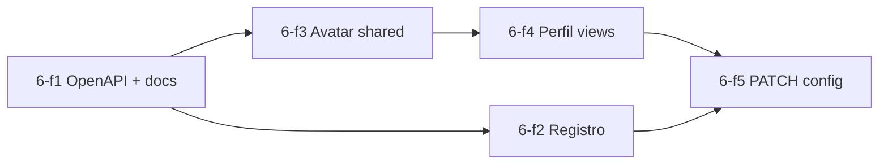

# Story 6-f1: Regenerar cliente OpenAPI y architecture v1.3

Status: done

<!-- Validation: checklist BMad create-story aplicado. Ultimate context engine analysis completed - comprehensive developer guide created. Épica 6 DLT-003 — historia fundacional; sin cambios de UI. -->

## Story

Como desarrollador frontend,
quiero el cliente API y `docs/architecture.md` alineados con DLT-003,
para implementar el resto de historias de la épica 6 sin tipos obsoletos.

## Acceptance Criteria

1. **Given** `../backend/openapi/openapi.json` con campos DLT-003 (verificado en repo: `firstName`, `lastName`, `avatarUrl`, `phone`, `preferredLanguage`, `emailVerified`, `UpdateProfileRequest`, `PATCH /users/me`)
   **When** ejecuto la cadena de regeneración documentada en `docs/api-client.md`
   **Then** `npm run api:generate` completa sin error
   **And** los modelos generados en `src/app/core/api/generated/models/` incluyen los campos DLT-003 en perfiles y registro
   **And** existe operación generada `UsersService.usersMePatch` (fn `users-me-patch.ts`, path `PATCH /users/me`)

2. **Given** el cliente regenerado
   **When** inspecciono tipos clave
   **Then** cumplen el contrato del delta aprobado (`docs/delta-frontend-DLT-003_2.md`):

   | Modelo / servicio | Campos / método esperados |
   |---|---|
   | `RegisterRequest` | `firstName`, `lastName`, `phone?`, `email`, `password`, `postalCode`, `recaptchaToken` |
   | `AuthUser` | `firstName`, `lastName` (+ campos existentes) |
   | `LoginUser` | `firstName`, `lastName` (+ campos existentes) |
   | `PrivateProfile` | `firstName`, `lastName`, `avatarUrl`, `phone`, `preferredLanguage`, `emailVerified` (+ campos existentes) |
   | `PublicProfile` | `firstName`, `lastName`, `avatarUrl` (+ campos existentes) |
   | `UpdateProfileRequest` | `firstName?`, `lastName?`, `avatarUrl?`, `phone?`, `postalCode?`, `preferredLanguage?` |
   | `UpdateProfileResponse` | `id`, `firstName`, `lastName`, `avatarUrl`, `phone`, `postalCode`, `preferredLanguage` |
   | `UsersService` | `usersMePatch`, `usersMePatch$Response` |

3. **Given** el delta aprobado y Correct Course `sprint-change-proposal-2026-05-25-DLT-003_2.md`
   **When** reviso/actualizo `docs/architecture.md`
   **Then** la cabecera indica **Versión 1.3** con referencia a DLT-003
   **And** §4 (contratos F3 auth + F5 users) documenta payloads/responses DLT-003 (register, login, GET `/users/me`, GET `/users/:id`, PATCH `/users/me`)
   **And** §5 incluye interfaces `User` y `PublicUser` con campos DLT-003
   **And** §6 incluye **todas** las reglas de presentación del delta Sección 6 (avatar, aviso postal, formulario registro) **además** de las reglas `requestsPaused` ya existentes

4. **Given** `docs/api-client.md` como guía operativa diaria
   **When** cierro la historia
   **Then** la tabla de servicios menciona `UsersService.usersMePatch`
   **And** la sección de modelos cita `UpdateProfileRequest`, `UpdateProfileResponse` y los campos nuevos en `PrivateProfile` / `PublicProfile` / `RegisterRequest`

5. **Given** código generado versionado en git
   **When** termino la regeneración
   **Then** **no** edito manualmente ningún fichero bajo `src/app/core/api/generated/`
   **And** el diff del cliente generado queda listo para commit (historia fundacional de la épica)

6. **Given** alcance acotado de 6-f1 (solo contrato + docs)
   **When** ejecuto `npm run build` tras regenerar
   **Then** documento en Completion Notes si hay errores TS esperados en features (p. ej. `register.component.ts` por `RegisterRequest` con `firstName`/`lastName` requeridos)
   **And** **no** implemento retrofits de UI/registro/perfil en esta historia (reservados a 6-f2…6-f5)

## Tasks / Subtasks

### A. Preparación y verificación del contrato (AC: 1)

- [x] Confirmar que `../backend/openapi/openapi.json` contiene DLT-003 (grep `firstName`, `UpdateProfileRequest`, `"patch"` en `/users/me`)
- [x] Si el spec local estuviera desactualizado: `cd ../backend && npm run openapi:generate` antes del paso frontend
- [x] Desde raíz frontend: `npm run api:generate`

### B. Validación del cliente generado (AC: 1, 2, 5)

- [x] Verificar existencia de:
  - `src/app/core/api/generated/fn/users/users-me-patch.ts`
  - `src/app/core/api/generated/models/update-profile-request.ts`
  - `src/app/core/api/generated/models/update-profile-response.ts`
- [x] Abrir y contrastar `private-profile.ts`, `public-profile.ts`, `register-request.ts`, `auth-user.ts`, `login-user.ts` vs tabla AC #2
- [x] Confirmar reexport en `models.ts` y métodos en `services/users.service.ts`
- [x] **Prohibido:** editar ficheros en `generated/`

### C. Actualizar documentación de arquitectura (AC: 3)

- [x] Revisar `docs/architecture.md` §4–5 — ya deberían estar en v1.3; corregir gaps si los hay
- [x] **Completar §6** con reglas DLT-003 faltantes (estado actual solo tiene reglas `requestsPaused`):

  **Regla avatar (delta §6 Cambio 1):**
  - Si `avatarUrl !== null` → ``
  - Si `avatarUrl === null` → iniciales `firstName[0]` + `lastName[0]` mayúsculas
  - Puntos de aplicación: perfil propio, perfil público, candidatos, sesión entrega, shell

  **Regla aviso postal (delta §6 Cambio 2):**
  - Aviso inline antes de guardar cambio de `postalCode` (no modal)
  - Texto de referencia en delta; ruta real de returnUrl: `/profile` (no `/perfil/configuracion` del borrador delta)

  **Regla formulario registro (delta §6 Cambio 3):**
  - Orden: `firstName`, `lastName`, `email`, `password`, `postalCode`, `phone` (opcional)
  - Validación cliente: nombre/apellido mín. 2 chars; phone texto libre

- [x] Mantener reglas `requestsPaused` existentes en §6 (no eliminar)

### D. Actualizar guía operativa API (AC: 4)

- [x] Editar `docs/api-client.md`:
  - Tabla servicios: añadir `usersMePatch` bajo `UsersService`
  - Sección modelos: citar `UpdateProfileRequest`, `UpdateProfileResponse`
  - Ejemplo breve de PATCH si encaja el estilo del doc

### E. Verificación final (AC: 5, 6)

- [x] `npm run build` — registrar resultado (éxito o lista de errores TS esperados)
- [x] Completar File List y Completion Notes en Dev Agent Record

### Review Findings

- [x] [Review][Defer] `npm run build` falla en `register.component.ts` (falta `firstName`/`lastName` en body) — esperado AC #6; corrige **6-f2** [src/app/features/auth/register/register.component.ts:142]
- [x] [Review][Defer] `npm run build` falla en `publicar.component.ts` (`PublishItemMultipart` exige `category`/`weightRange` tras regeneración) — desalineación previa spec/UI; fuera alcance 6-f1 [src/app/features/items/publicar/publicar.component.ts:281]
- [x] [Review][Defer] Tabla «Errores de compilación esperados» en Dev Notes no incluye `publicar.component.ts` aunque Completion Notes sí — inconsistencia doc menor, no bloquea contrato

## Dev Notes

### Contexto DLT-003 — brecha actual (evidencia en repo)

El backend completó Épica 6 DLT-003; el frontend **no regeneró** el cliente OpenAPI. Correct Course aprobado 2026-05-25.

| Artefacto | Estado actual (pre-6-f1) | Objetivo post-6-f1 |
|---|---|---|
| `backend/openapi/openapi.json` | ✅ DLT-003 completo | Sin cambio (fuente de verdad) |
| `src/app/core/api/generated/models/private-profile.ts` | ❌ Solo v1.2 (7 campos) | 14 campos con identidad/avatar |
| `src/app/core/api/generated/models/public-profile.ts` | ❌ Sin nombre/avatar | Con `firstName`, `lastName`, `avatarUrl` |
| `src/app/core/api/generated/models/register-request.ts` | ❌ Sin `firstName`/`lastName`/`phone` | Payload DLT-003 |
| `UsersService.usersMePatch` | ❌ No existe | Generado |
| `docs/architecture.md` | ⚠️ v1.3 en cabecera; §4–5 OK; **§6 incompleto** (faltan reglas avatar/postal/registro) | §6 completo |
| `docs/api-client.md` | ⚠️ Sin `usersMePatch` | Actualizado |

### Cadena de regeneración (obligatoria)

```bash
# Opcional — solo si openapi.json backend desactualizado
cd ../backend
npm run openapi:generate

# Obligatorio — desde raíz regalalo
cd ../regalalo
npm run api:generate
```

Config: `openapi-ng.config.json` → input `../backend/openapi/openapi.json`, output `src/app/core/api/generated`, `removeStaleFiles: true`.

### Archivos generados esperados (post-regeneración)

**Nuevos o reemplazados:**
- `fn/users/users-me-patch.ts`
- `models/update-profile-request.ts`
- `models/update-profile-response.ts`
- Modelos auth/users actualizados

**No tocar manualmente:** todo `src/app/core/api/generated/**`

### Errores de compilación esperados (NO arreglar en 6-f1)

Tras regenerar, es **normal** que fallen builds por desalineación de features implementadas contra v1.2:

| Archivo | Motivo | Historia que lo corrige |
|---|---|---|
| `features/auth/register/register.component.ts` | `RegisterRequest` exige `firstName`/`lastName` | **6-f2** |
| `features/profile/perfil/perfil.component.ts` | Usa `initialsFromUserId`, no campos DLT-003 | **6-f4**, **6-f5** |
| `features/profile/perfil-publico/perfil-publico.component.ts` | AC 5.5 usaba iniciales desde UUID | **6-f4** |
| `shared/components/candidate-row`, `item-donor-row`, `entrega-detalle`, `entregas` | `initialsFromUserId` | **6-f3** |

Utilidad actual a sustituir en historias posteriores:

```1:4:src/app/core/utils/user-initials.util.ts
/** Iniciales derivadas de un UUID de usuario (mismo criterio que ItemDonorRow). */
export function initialsFromUserId(userId: string): string {
  return userId.replace(/-/g, '').slice(0, 2).toUpperCase();
}
```

### Dependencias de la épica 6 (orden estricto)



**6-f1 desbloquea:** 6-f2, 6-f3, 6-f4, 6-f5. Ninguna otra historia de épica 6 debe empezar antes.

### Qué NO hacer en esta historia

- ❌ Modificar componentes Angular (registro, perfil, avatares)
- ❌ Crear `UserAvatarComponent` (historia 6-f3)
- ❌ Añadir formulario PATCH (historia 6-f5)
- ❌ Editar ficheros en `generated/` a mano
- ❌ Duplicar interfaces DLT-003 en `core/models/` — usar tipos generados
- ❌ Cambiar interceptores (6-f5 documenta returnUrl tras cambio CP)

### Architecture compliance

| Regla | Fuente |
|---|---|
| Cliente OpenAPI canónico | `docs/api-client.md`, `AGENTS.md`, `_bmad-output/project-context.md` |
| No editar `generated/` | `docs/api-client.md` regla #1 |
| `apiUrl` termina en `/api` | `environment*.ts` — sin cambio en 6-f1 |
| Contratos §4–5 referencia | `docs/architecture.md` v1.3 |
| Delta fuente aprobado | `docs/delta-frontend-DLT-003_2.md` |
| Correct Course | `_bmad-output/initiative-regalalo/sprint-change-proposal-2026-05-25-DLT-003_2.md` |

### Testing requirements

- **Sin tests nuevos** en 6-f1 (historia de infraestructura/documentación).
- Verificación manual: inspección de tipos generados + build report.
- Historias 6-f2+ actualizarán specs de registro, perfil y avatar.

### Referencias obligatorias

- [Source: docs/api-client.md] — regeneración y reglas de uso
- [Source: docs/delta-frontend-DLT-003_2.md] — delta DLT-003 Secciones 4–6
- [Source: docs/architecture.md] — v1.3 §4–6
- [Source: _bmad-output/initiative-regalalo/archive-v6/epics.md#Story-6-f1] — AC originales
- [Source: _bmad-output/initiative-regalalo/sprint-change-proposal-2026-05-25-DLT-003_2.md] — contexto Correct Course
- [Source: ../backend/openapi/openapi.json] — spec OpenAPI
- [Source: openapi-ng.config.json] — config ng-openapi-gen

## Dev Agent Record

### Agent Model Used

Composer (dev-story 2026-05-25)

### Debug Log References

- OpenAPI backend verificado: `firstName`, `UpdateProfileRequest`, `PATCH /users/me` presentes en `../backend/openapi/openapi.json` (sin regenerar backend).
- `npm run api:generate`: exit 0 — 44 modelos, 5 servicios; generado `users-me-patch.ts`, `update-profile-request.ts`, `update-profile-response.ts`.

### Completion Notes List

- Cliente OpenAPI regenerado desde spec DLT-003; tipos clave (`RegisterRequest`, `AuthUser`, `LoginUser`, `PrivateProfile`, `PublicProfile`, `UpdateProfileRequest`, `UpdateProfileResponse`) alineados con AC #2.
- `UsersService.usersMePatch` / `usersMePatch$Response` disponibles; reexport en `functions.ts` y `models.ts`.
- `docs/architecture.md` §6 completado: reglas avatar, aviso postal (returnUrl `/profile`), formulario registro y reglas `requestsPaused` consolidadas.
- `docs/api-client.md` actualizado: tabla servicios, modelos DLT-003 y ejemplo PATCH.
- `npm run build` **falla** (esperado, fuera de alcance 6-f1):
  - `register.component.ts:142` — falta `firstName`/`lastName` en body → **6-f2**
  - `publicar.component.ts:281` — falta `category`/`weightRange` en `PublishItemMultipart` (desalineación previa del spec, no corregida en esta historia)
- Sin tests nuevos (historia infraestructura/documentación).

### File List

- `src/app/core/api/generated/**` (regenerado completo)
- `docs/architecture.md`
- `docs/api-client.md`

### Change Log

- 2026-05-25: Regeneración cliente OpenAPI DLT-003; documentación architecture v1.3 §6 y api-client.md actualizados.
- 2026-05-25: Code review — clean review (0 patch, 0 decision-needed, 3 defer); status → done.
