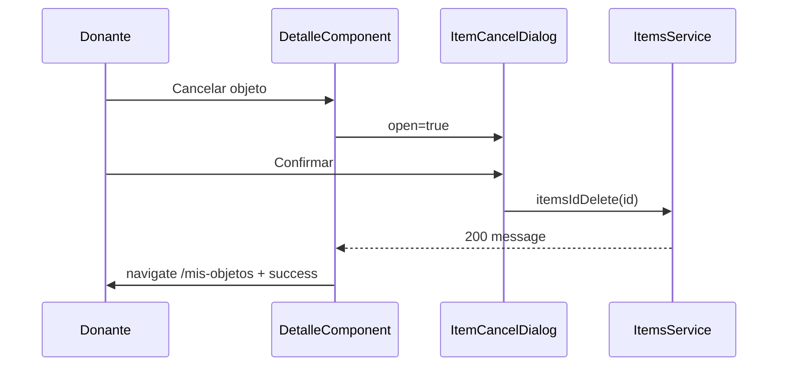

# Story 2.5: Cancelar objeto propio (sin sesión activa)

Status: done

<!-- Validation: checklist BMad create-story aplicado. Ultimate context engine analysis completed. -->

## Story

Como donante,
quiero cancelar un objeto que publiqué cuando no hay entrega en curso,
para retirarlo del sistema.

## Acceptance Criteria

1. **Given** soy donante del objeto (`session.user().id === item.donor.id`) y `status === 'active'` (sin sesión de entrega en curso en la UI)  
   **When** pulso «Cancelar objeto» y confirmo en un diálogo accesible  
   **Then** se llama `ItemsService.itemsIdDelete({ id })` y ante `200` la UI muestra mensaje de éxito y navega fuera del detalle (p. ej. `/mis-objetos` o `/explorar`)

2. **Given** soy donante y `status === 'reserved'` (objeto con receptor seleccionado / entrega en curso)  
   **When** veo la zona de gestión  
   **Then** **no** se muestra el flujo de cancelación de objeto de esta historia (queda para historia 4.5 con advertencia explícita)

3. **Given** no soy donante  
   **When** intento cancelar (no debería haber CTA)  
   **Then** si la API devuelve `403`, mensaje de error genérico (sin revelar permisos internos)

4. **Given** objeto no encontrado (`404`) o no autenticado (`401`)  
   **When** falla `DELETE`  
   **Then** manejo coherente con el resto de la app (`401` → interceptor; `404` → mensaje en diálogo o vista)

5. **Given** el diálogo de confirmación abierto  
   **When** uso lector de pantalla o teclado  
   **Then** cumple WCAG AA: `role="dialog"`, `aria-modal="true"`, título/descripción asociados, foco inicial en el diálogo, Escape cierra sin confirmar, botones con etiquetas i18n

6. **Given** cancelación exitosa  
   **When** el usuario vuelve al tablón  
   **Then** el objeto cancelado ya no aparece en el feed activo (el backend lo excluye; no requiere invalidación especial si se redirige)

## Tasks / Subtasks

- [x] **Prerrequisito — zona donante en detalle** (AC: 1, 2) — ver «Dependencia 2.4»
  - [x] Historia 2.4 implementada o, como mínimo, `DetalleComponent` con `isDonor` y bloque gestión donante en `/items/:id`
  - [x] Ruta `items/:id` registrada en `items.routes.ts`

- [x] Componente diálogo reutilizable (AC: 1, 5)
  - [x] `ItemCancelDialogComponent` en `shared/components/item-cancel-dialog/` portado de `CancelModal` en `Mis objetos.html` (L991–1037)
  - [x] Inputs: `open` (signal o input), `itemTitle` (opcional, para contexto)
  - [x] Outputs: `confirmed`, `dismissed`
  - [x] Overlay + panel: tokens `colors_and_type.css`; botón primario destructivo + ghost «Volver»
  - [x] **No** incluir rama `mode === 'session'` / no-show (historia 4.3 / 4.5)

- [x] Extender `BtnComponent` o estilos locales (AC: 1)
  - [x] Variante `danger` / `dangerGhost` alineada con prototipo (`Btn variant="dangerGhost"` L540, `danger` L1031)
  - [x] Si se extiende `BtnComponent`, actualizar `btn.component.scss` con tokens `--error`, `--error-bg` del design system

- [x] Integración en detalle donante (AC: 1, 2)
  - [x] `canCancelItem = computed(() => isDonor() && item()?.status === 'active')`
  - [x] Botón «Cancelar objeto» solo si `canCancelItem()`
  - [x] Al confirmar: `itemsIdDelete({ id })` + `takeUntilDestroyed`
  - [x] Éxito: toast/banner + `router.navigate(['/mis-objetos'])` (preferido) o `/explorar` con query `?cancelled=1` opcional
  - [x] Estado `cancelling` deshabilita botones del diálogo

- [x] Utilidad de errores cancelación (AC: 3, 4)
  - [x] `mapCancelItemError(err)` en `features/items/` o `shared/utils/` — patrón `publish-error.util.ts`
  - [x] `401` → `{}` (interceptor)
  - [x] `403` → `items.cancel.errors.forbidden`
  - [x] `404` → `items.cancel.errors.not_found`
  - [x] Otros → `items.cancel.errors.generic`

- [x] i18n `items.cancel.*` en `public/i18n/{es,ca,en}.json` (AC: 1, 5)
  - [x] Título, cuerpo, CTA confirmar/volver, éxito, errores

- [x] Specs
  - [x] `item-cancel-dialog.component.spec.ts`: apertura, confirm, dismiss, ARIA básico
  - [x] `detalle.component.spec.ts` (o integración): donante+active muestra botón; reserved no; mock `itemsIdDelete` éxito y 403

### Review Findings

- [x] [Review][Patch] `itemTitle` no se usa en el diálogo — se pasa desde detalle pero el template ignora el título del objeto [`item-cancel-dialog.component.html:20`]
- [x] [Review][Patch] Modal sin focus trap — Tab puede salir del overlay; AC5 / patrón WAI-ARIA modal incompleto [`item-cancel-dialog.component.ts:76`]
- [x] [Review][Patch] Sin devolver foco al disparador al cerrar el diálogo — riesgo de foco perdido tras dismiss/confirm [`item-cancel-dialog.component.ts:48`]
- [x] [Review][Patch] `?cancelled=1` persiste en URL — recargar `/mis-objetos` vuelve a mostrar el banner de éxito [`mis-objetos.component.ts:57`]
- [x] [Review][Patch] Falta test DELETE 404 — AC4 exige manejo de `not_found` en flujo de cancelación [`detalle.component.spec.ts`]
- [x] [Review][Patch] Falta test bloqueo Escape/backdrop con `cancelling=true` — AC5 / estado loading del diálogo [`item-cancel-dialog.component.spec.ts:83`]
- [x] [Review][Patch] Scroll del fondo no bloqueado con modal abierto — el body sigue scrolleable bajo el overlay [`item-cancel-dialog.component.scss:1`]
- [x] [Review][Defer] Página `mis-objetos` sigue siendo stub mínimo — la story admite stub; listado completo queda para 5.3 [`mis-objetos.component.ts:15`] — deferred, pre-existing scope

## Dev Notes

### ⛔ Diseño obligatorio

**Fichero:** `docs/project/Mis objetos.html` — `CancelModal` modo objeto (L991–1037), botón trigger en `ActiveContent` (L539–542).  
**Tokens:** `docs/project/colors_and_type.css`.

| Elemento prototipo | Implementación |
|---|---|
| Overlay `rgba(20,23,26,0.55)` | `.cancel-dialog__backdrop` |
| Panel `maxWidth:400`, `borderRadius:16`, `sh3` | `.cancel-dialog__panel` |
| Título Playfair 20px | `items.cancel.dialog_title` |
| Cuerpo 13px `fgMid` | `items.cancel.dialog_body` |
| Footer ghost + danger | `BtnComponent` variantes |
| Copy sesión / no-show | **Excluir** (4.3 / 4.5) |

**Nota:** El prototipo vive en «Mis objetos», pero el AC de epics no exige esa ruta aún (`mis-objetos` es stub). El **punto de entrada v1** es la zona donante del **detalle** (`/items/:id`) definida en historia 2.4. Reutilizar el mismo diálogo cuando 5.3 implemente listado completo.

### Dependencia 2.4 (bloqueante funcional)

| Estado actual | Acción |
|---|---|
| `2-4-ver-detalle-de-objeto` → `ready-for-dev`; no hay `detalle/` en `src/` | Implementar **2.4 antes** o en la **misma PR** que 2.5 |
| 2.4 reserva zona gestión donante sin cancelar/pausar | 2.5 **añade** botón + diálogo + `DELETE` en esa zona |

Sin detalle donante, no hay superficie UI que cumpla AC#1 salvo reimplementar todo el detalle dentro de 2.5 (anti-patrón).

### Alcance «sin sesión activa»

| `item.status` | UI cancelar objeto (2.5) | Backend `DELETE /items/:id` |
|---|---|---|
| `active` | Sí — flujo completo | Cancela ítem; sin sesión que cerrar |
| `reserved` | **No** — copy o gestión 4.5 | API **sí** cancela sesión+ítem (tests 19.x) — **no exponer** en 2.5 |
| `completed` / `cancelled` | No | 404 en repo si no cancelable |

La UI usa `status === 'active'` como proxy de «sin entrega en curso», coherente con epics y tests backend `11.1` (`hasActiveDeliverySession: false`).

### API — contrato exacto

**Servicio:** `ItemsService.itemsIdDelete` — `src/app/core/api/generated/services/items.service.ts`  
**Path:** `DELETE /items/{id}`  
**Respuesta:** `CancelItemResponse { message: string }`

```typescript
await this.itemsApi.itemsIdDelete({ id: itemId });
// éxito → navegar + mensaje i18n items.cancel.success
```

**Errores documentados** (`docs/architecture.md`, tests `items-cancel.test.ts`):

| Código | Manejo UI |
|---|---|
| `200` | Éxito |
| `400` | UUID inválido — raro si ruta validada |
| `401` | Interceptor — no duplicar |
| `403` | `items.cancel.errors.forbidden` |
| `404` | `items.cancel.errors.not_found` |
| 5xx / red | `items.cancel.errors.generic` |

**NO** modificar `generated/`. Backend ya implementado (`CancelItemUseCase`, `item.repository.cancelItem`).

### Flujo UX recomendado



### Componentes existentes a reutilizar

| Componente | Uso |
|---|---|
| `BtnComponent` | Volver, confirmar (añadir variantes danger) |
| `AlertBoxComponent` | Error post-fallo en detalle (opcional si error en diálogo) |
| `SessionService.user()` | `isDonor` |
| `ItemsService` | `itemsIdGet` (2.4), `itemsIdDelete` (2.5) |
| Patrón `explorar` / `publicar` | signals, OnPush, `takeUntilDestroyed`, `HttpErrorResponse` |

### Estructura de archivos

```
src/app/shared/components/item-cancel-dialog/
├── item-cancel-dialog.component.ts
├── item-cancel-dialog.component.html
├── item-cancel-dialog.component.scss
└── item-cancel-dialog.component.spec.ts

src/app/shared/components/btn/                    ← UPDATE variantes danger
src/app/features/items/detalle/                   ← UPDATE (depende 2.4)
├── detalle.component.ts                          ← wire cancel + dialog
└── detalle.component.spec.ts

src/app/features/items/cancel-item-error.util.ts  ← NUEVO (opcional nombre)
src/app/features/items/cancel-item-error.util.spec.ts

public/i18n/{es,ca,en}.json                       ← items.cancel.*
```

### i18n — claves nuevas (`items.cancel.*`)

| Clave | ES (referencia) |
|---|---|
| `dialog_title` | Cancelar objeto |
| `dialog_body` | El objeto dejará de aparecer en el tablón. No tiene consecuencias en tu reputación. |
| `confirm` | Cancelar objeto |
| `dismiss` | Volver |
| `trigger` | Cancelar objeto |
| `success` | Objeto cancelado correctamente |
| `errors.forbidden` | No puedes cancelar este objeto |
| `errors.not_found` | El objeto ya no está disponible |
| `errors.generic` | No se pudo cancelar el objeto. Inténtalo de nuevo. |
| `errors.connection` | Error de conexión. Comprueba tu red. |
| `reserved_hint` | Este objeto tiene una entrega en curso. La cancelación con entrega activa estará disponible próximamente. |

(Añadir CA/EN en los tres JSON.)

### Testing

```bash
npx ng test --watch=false --include="src/app/shared/components/item-cancel-dialog/**/*.spec.ts"
npx ng test --watch=false --include="src/app/features/items/detalle/**/*.spec.ts"
```

- Mock `ItemsService.itemsIdDelete` → resolve `{ message: '...' }`
- Donante + `status: 'active'` → botón visible
- Donante + `status: 'reserved'` → sin botón cancelar (2.5); puede mostrar `reserved_hint`
- `403` → clave `forbidden` en UI
- Diálogo: `role="dialog"`, Escape cierra

### Previous Story Intelligence (2.4 — ready-for-dev)

- Zona gestión donante en detalle **sin** implementar cancelar/pausar — 2.5 es el primer hook
- Posible brecha `requestsPaused` en GET detalle — no bloquea cancelación; sí bloquea 2.6
- Ruta `/items/:id` + galería/donante según `Explorar v3.html`
- Reutilizar `formatDistanceKm`, `AlertBoxComponent`, convención i18n `items.detail.*`

### Previous Story Intelligence (2.3 — done)

- Feed en `/explorar`; cards enlazan a `/items/:id`
- Tras cancelar, redirigir a `/explorar` o `/mis-objetos` evita 404 en detalle del ítem cancelado

### Previous Story Intelligence (2.2 — done)

- `publicar` redirige a `/mis-objetos` — coherente destino post-cancelación
- `publish-error.util.ts` — plantilla para `mapCancelItemError`

### Git intelligence reciente

- `669f284` — feed + cards; patrón feature `items/` + specs Vitest
- Backend `items-cancel.test.ts` (11.x) y `items-cancel-with-session.test.ts` (19.x) — **no cambiar API** en 2.5
- No introducir `HttpClient` manual

### Anti-patterns (prohibido)

| Prohibido | Hacer en su lugar |
|---|---|
| Cancelar con `status === 'reserved'` en UI 2.5 | Ocultar CTA; deferir a 4.5 |
| `POST` cancelar o URL inventada | `itemsIdDelete` |
| Modal sesión + no-show en 2.5 | Solo modo objeto |
| Strings en template | Transloco `items.cancel.*` |
| Editar `generated/` | Cliente ya tiene `itemsIdDelete` |
| Duplicar guard 401 | Interceptor global |
| Implementar listado completo Mis objetos | Stub puede quedarse; detalle basta para AC |

### Fuera de alcance

| Funcionalidad | Historia |
|---|---|
| Cancelar objeto con sesión activa + advertencia fuerte | 4.5 |
| Cancelar solo sesión + no-show | 4.3 |
| Pausar solicitudes | 2.6 |
| Listado `GET /users/me/items` | 5.3 |
| Email TPL-005 al receptor | Backend fire-and-forget — sin UI |

### Project Structure Notes

- Diálogo en `shared/` para reutilización en 5.3 / `Mis objetos.html` futuro.
- Variantes `danger` en `BtnComponent` benefician 4.2–4.3 también.

### References

- [Source: `_bmad-output/initiative-regalalo/archive-v6/epics.md` — Story 2.5, FR-F9, UX-DR6, tabla diseño 2.5]
- [Source: `docs/architecture.md` — DELETE /items/:id]
- [Source: `docs/api-client.md` — ItemsService.itemsIdDelete]
- [Source: `docs/project/Mis objetos.html` — CancelModal, ActiveContent]
- [Source: `../backend/src/application/use-cases/item/cancel-item.use-case.ts`]
- [Source: `../backend/tests/items-cancel.test.ts` — casos 11.1–11.5]
- [Source: `../backend/tests/items-cancel-with-session.test.ts` — no UI en 2.5]
- [Source: `_bmad-output/initiative-regalalo/archive-v6/2-4-ver-detalle-de-objeto.md`]
- [Source: `_bmad-output/project-context.md`]
- [Source: `src/app/features/items/mis-objetos/mis-objetos.component.ts` — stub]
- [Source: `src/app/core/api/generated/services/items.service.ts`]

## Dev Agent Record

### Agent Model Used

Composer (dev-story workflow)

### Debug Log References

- Tests focalizados 2.5: 22/22 OK (`item-cancel-dialog`, `detalle`, `cancel-item-error.util`)
- Suite completa: 182/184 OK (2 fallos preexistentes en `landing.component.spec.ts`, no relacionados)

### Completion Notes List

- Añadido `ItemCancelDialogComponent` reutilizable (modo objeto únicamente) con ARIA, Escape y tokens del design system.
- Extendido `BtnComponent` con variantes `ghost`, `danger` y `dangerGhost`.
- Integrado flujo cancelación en `DetalleComponent`: CTA solo donante+`active`, hint en `reserved`, `itemsIdDelete`, errores mapeados, navegación a `/mis-objetos?cancelled=1`.
- Creado `mapCancelItemError` siguiendo patrón de `publish-error.util`.
- i18n `items.cancel.*` en es/ca/en.
- Banner de éxito mínimo en `MisObjetosComponent` al recibir `?cancelled=1`.

### File List

- `src/app/shared/components/item-cancel-dialog/item-cancel-dialog.component.ts` (nuevo)
- `src/app/shared/components/item-cancel-dialog/item-cancel-dialog.component.html` (nuevo)
- `src/app/shared/components/item-cancel-dialog/item-cancel-dialog.component.scss` (nuevo)
- `src/app/shared/components/item-cancel-dialog/item-cancel-dialog.component.spec.ts` (nuevo)
- `src/app/shared/components/btn/btn.component.ts` (modificado)
- `src/app/shared/components/btn/btn.component.scss` (modificado)
- `src/app/features/items/cancel-item-error.util.ts` (nuevo)
- `src/app/features/items/cancel-item-error.util.spec.ts` (nuevo)
- `src/app/features/items/detalle/detalle.component.ts` (modificado)
- `src/app/features/items/detalle/detalle.component.html` (modificado)
- `src/app/features/items/detalle/detalle.component.scss` (modificado)
- `src/app/features/items/detalle/detalle.component.spec.ts` (modificado)
- `src/app/features/items/mis-objetos/mis-objetos.component.ts` (modificado)
- `public/i18n/es.json` (modificado)
- `public/i18n/ca.json` (modificado)
- `public/i18n/en.json` (modificado)

## Change Log

- 2026-05-22: Implementación historia 2.5 — cancelación de objeto propio sin sesión activa (detalle + diálogo + API DELETE + i18n + tests).
- 2026-05-22: Code review — 7 patches aplicados (itemTitle, focus trap, restore focus, URL `cancelled`, tests 404/cancelling, scroll lock).
