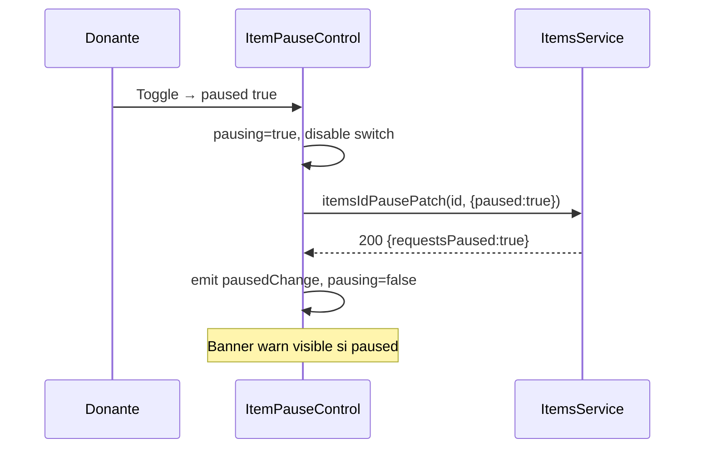

# Story 2.6: Pausar y reanudar solicitudes de un objeto

Status: done

<!-- Validation: checklist BMad create-story aplicado. Ultimate context engine analysis completed. -->

## Story

Como donante,
quiero pausar temporalmente las solicitudes de mi objeto activo,
para controlar cuándo acepto candidatos.

## Acceptance Criteria

1. **Given** soy donante y `status === 'active'`  
   **When** veo el detalle (`/items/:id`) o el listado mínimo en `/mis-objetos`  
   **Then** aparece el control de pausa (toggle) solo en ese estado; oculto si `reserved`, `completed` o `cancelled`

2. **Given** el toggle está en «aceptando solicitudes» (`requestsPaused === false`)  
   **When** activo el interruptor hacia pausado  
   **Then** se llama `ItemsService.itemsIdPausePatch({ id, body: { paused: true } })` y ante `200` la UI refleja `requestsPaused: true` (signal `item` actualizado)

3. **Given** el toggle está pausado (`requestsPaused === true`)  
   **When** lo desactivo  
   **Then** `itemsIdPausePatch` con `{ paused: false }` y la UI muestra estado reanudado

4. **Given** objeto no activo (`409`) o no soy donante (`403`)  
   **When** falla el `PATCH`  
   **Then** mensaje i18n apropiado; el toggle revierte al valor previo (no dejar UI inconsistente)

5. **Given** `404`, `401` o error de red  
   **When** falla el `PATCH`  
   **Then** manejo coherente (`401` → interceptor; `404`/`5xx`/red → claves `items.pause.errors.*`)

6. **Given** listado `GET /users/me/items` del donante con `requestsPaused === true`  
   **When** renderizo la fila en `/mis-objetos`  
   **Then** indicador visual identificable de un vistazo (p. ej. sufijo «· pausadas» del prototipo `ItemRow` L378)

7. **Given** el toggle cumple WCAG AA  
   **When** uso teclado o lector de pantalla  
   **Then** `role="switch"`, `aria-checked`, etiqueta asociada, foco visible, `Space`/`Enter` activan el cambio; estado `disabled` durante petición en curso

## Tasks / Subtasks

- [x] **Prerrequisito API — `requestsPaused` en `GET /users/me/items`** (AC: 6) — ver «Brecha contrato API»
  - [x] Backend: `requests_paused` en SQL `findMyItems`, `UserItemRecord`, `MyItemDto`, mapper en `get-my-items.use-case.ts`, schema OpenAPI `MyItem`
  - [x] `npm run openapi:generate` (backend) → `npm run api:generate` (frontend)
  - [x] Verificar `MyItem.requestsPaused` en `generated/models/my-item.ts`

- [x] Componente toggle reutilizable (AC: 1, 2, 3, 7)
  - [x] `ToggleSwitchComponent` en `shared/components/toggle-switch/` portado de `Toggle` en `Mis objetos.html` (L186–195)
  - [x] Inputs: `checked`, `disabled`, `ariaLabel` (o `labelId` + `aria-labelledby`)
  - [x] Output: `checkedChange` con el **nuevo** valor booleano
  - [x] Estilos: track 40×22px, thumb 16px, `C.primary` activo, `C.border` inactivo — tokens `colors_and_type.css`

- [x] Bloque pausa donante reutilizable (AC: 1–5, 7)
  - [x] `ItemPauseControlComponent` en `shared/components/item-pause-control/` portado de `ActiveContent` pause block (L488–511)
  - [x] Inputs: `itemId`, `requestsPaused`, `status`, `disabled` (opcional)
  - [x] Output opcional: `pausedChange` para padre que quiera reaccionar
  - [x] Internamente: `itemsIdPausePatch`, estado `pausing`, revert on error, banner warn si pausado (L503–510)

- [x] Integración en detalle donante (AC: 1–5)
  - [x] `canManagePause = computed(() => isDonor() && item()?.status === 'active')`
  - [x] Sustituir/ampliar `items.detail.donor_manage_hint` por `<app-item-pause-control>` cuando `canManagePause()`
  - [x] Tras éxito: `item.update(i => i ? { ...i, requestsPaused: res.requestsPaused } : i)` — no recargar GET completo salvo error de sincronización
  - [x] Si `isDonor()` y no `active`: copy breve sin toggle (p. ej. gestión no disponible en este estado)

- [x] Listado mínimo `/mis-objetos` (AC: 1, 6)
  - [x] Cargar `UsersService.usersMeItemsGet()` al iniciar (signals `items`, `loading`, `error`)
  - [x] Filas clicables → `routerLink` `/items/:id` (gestión completa en detalle)
  - [x] Indicador pausa: texto `items.pause.list_suffix` («· pausadas») cuando `item.requestsPaused && item.status === 'active'`
  - [x] ~~**No** implementar panel lateral completo~~ — **Actualizado 2026-05-22:** panel completo según `Mis objetos.html`; listado mínimo sustituido por decisión de review. Candidatos/entregas siguen fuera de AC 2.6 salvo lo que el prototipo exija para pausa en fila + panel activo.

- [x] Utilidad de errores pausa (AC: 4, 5)
  - [x] `mapPauseItemError(err)` en `features/items/` — patrón `publicar/publish-error.util.ts`
  - [x] `401` → `{}` (interceptor)
  - [x] `403` → `items.pause.errors.forbidden`
  - [x] `404` → `items.pause.errors.not_found`
  - [x] `409` → `items.pause.errors.not_active`
  - [x] Otros → `items.pause.errors.generic` / `connection`

- [x] i18n `items.pause.*` en `public/i18n/{es,ca,en}.json` (AC: 2–7)
  - [x] `title`, `subtitle_active`, `subtitle_paused`, `banner_paused`, `list_suffix`, `errors.*`
  - [x] Actualizar `items.detail.donor_manage_hint` — quitar mención «próximas historias» una vez integrado el control

- [x] Specs
  - [x] `toggle-switch.component.spec.ts`: `aria-checked`, emit al click, disabled no emite
  - [x] `item-pause-control.component.spec.ts`: mock `itemsIdPausePatch` éxito 12.1/12.2, revert en 403/409
  - [x] `detalle.component.spec.ts`: donante+active muestra control; reserved oculta toggle
  - [x] `mis-objetos.component.spec.ts`: fila con `requestsPaused: true` muestra sufijo

### Review Findings

- [x] [Review][Patch] Doble disparo de Enter en ToggleSwitchComponent — `(keydown.enter)` redundante en `<button>`; Enter ya dispara `click` nativo, causando `onToggle()` dos veces [toggle-switch.component.ts]
- [x] [Review][Patch] `[disabled]="disabled() || null"` no idiomático — simplificar a `[disabled]="disabled()"` [toggle-switch.component.ts]
- [x] [Review][Patch] `errorMessage` como función flecha en lugar de `computed()` — no reactivo con OnPush; signals no rastrea la dependencia [item-pause-control.component.ts:35]
- [x] [Review][Patch] `role="note"` en banner pausado — soporte variable en versiones AXE; usar alternativa más universal (quitar role o usar `aria-live="polite"`) [item-pause-control.component.html:22]
- [x] [Review][Patch] `` sin `NgOptimizedImage` en listado mis-objetos — incumple constraint del proyecto [mis-objetos.component.html:33]
- [x] [Review][Patch] HTTP status 0 (red offline) mapeado a `generic` en lugar de `connection` en `mapPauseItemError` [pause-item-error.util.ts]
- [x] [Review][Patch] Sin copy explicativo para donante + ítem no activo — dev notes exige mensaje breve cuando `isDonor() && status !== 'active'` [detalle.component.html]
- [x] [Review][Patch] `aria-label` en enlace de fila `mis-objetos` sobreescribe el texto interior — sufijo "· pausadas" invisible para lectores de pantalla (AC6/AC7 WCAG) [mis-objetos.component.html:29]
- [x] [Review][Patch] Tests de `detalle.component.spec.ts` solo cubren `reserved`; faltan casos `completed` y `cancelled` para AC1 [detalle.component.spec.ts]
- [x] [Review][Defer] Paginación hardcodeada en 50 ítems — deferred, listado mínimo intencional por spec; paginación completa en historia 5.3 [mis-objetos.component.ts:loadItems]
- [x] [Review][Defer] Banner de pausa + alerta de error superpuestos simultáneamente — deferred, UX válido; pulido visual en iteración futura [item-pause-control.component.html]
- [x] [Review][Defer] Sin `takeUntilDestroyed` en `onToggle` async — deferred, Angular maneja writes en señales de componentes destruidos sin crash [item-pause-control.component.ts:onToggle]
- [x] [Review][Defer] `ariaLabel` con default vacío `''` — deferred, siempre provisto en el uso actual; hacer `required` en refactor futuro [toggle-switch.component.ts]
- [x] [Review][Defer] `showPausedSuffix` no memoizado en `@for` — deferred, método booleano trivial; OnPush limita el impacto [mis-objetos.component.ts]

### Review Findings (2026-05-22 — segunda pasada, working tree)

- [x] [Review][Decision] `mis-objetos` panel completo vs listado mínimo — **Resuelto 2026-05-22:** mantener panel alineado con `docs/project/Mis objetos.html` (decisión producto). La spec L68–72 queda obsoleta en alcance; la fidelidad visual sigue siendo obligatoria vía `project-context.md` (tokens `colors_and_type.css`, sin hex inventados).
- [x] [Review][Patch] Detalle donante sin `<app-item-pause-control>` — viola AC1–AC3 en `/items/:id`; solo enlace a Mis objetos [detalle.component.html:100-106, detalle.component.ts]
- [x] [Review][Patch] Regresión historia 2.5: cancelación donante (`ItemCancelDialog`, `canCancelItem`, hints reservado) eliminada del detalle [detalle.component.html, detalle.component.ts, detalle.component.spec.ts]
- [x] [Review][Patch] Clave `items.pause.not_available` en i18n sin uso en template donante + ítem no activo [detalle.component.html]
- [x] [Review][Patch] `onPausedChange` actualiza `detail`/`items` por `selectedId()` sin validar que el PATCH corresponda al `itemId` — race al cambiar fila o cerrar panel [mis-objetos.component.ts:212-220]
- [x] [Review][Patch] `errorKey` no se limpia cuando el padre cambia `requestsPaused` tras sync externa [item-pause-control.component.ts]
- [x] [Review][Patch] AC7: título visible del toggle sin `aria-labelledby` / `labelId` (solo `aria-label` duplicado) [item-pause-control.component.html, toggle-switch.component.ts]
- [x] [Review][Patch] Sufijo «· pausadas» solo visual; fila sin `aria-describedby` que anuncie pausa al activar [mis-objetos.component.html:122-124]
- [x] [Review][Patch] `` sin `NgOptimizedImage` en listado [mis-objetos.component.html:103]
- [x] [Review][Patch] Rama muerta `d.images.length === 1` dentro de bloque `length > 1` [mis-objetos.component.html:214-221]
- [x] [Review][Patch] Colores hex (`#ebf5ee`, `#f9fafb`, etc.) fuera de tokens `colors_and_type.css` [item-status-badge.component.scss, mis-objetos.component.scss]
- [x] [Review][Patch] Tests detalle esperan `app-item-pause-control` ausente — codifican regresión frente a AC1 [detalle.component.spec.ts:169-170]
- [x] [Review][Patch] Error al cargar candidatos muestra `candidates_empty` en lugar de error de red/API — panel completo confirmado [mis-objetos.component.ts:1182-1185]

## Dev Notes

### ⛔ Diseño obligatorio

**Fichero:** `docs/project/Mis objetos.html` — `Toggle` (L186–195), bloque pausa `ActiveContent` (L488–511), indicador listado `ItemRow` (L375–378).  
**Tokens:** `docs/project/colors_and_type.css`.

| Elemento prototipo | Implementación |
|---|---|
| Fila toggle 13px/12px + switch 40×22 | `.item-pause-control__row` + `app-toggle-switch` |
| Banner warn pausado | `.item-pause-control__banner` — `--warn-bg`, `--warn-border`, `--warn-fg` |
| Toggle track primary / border | `.toggle-switch` estados `checked` / `:not(.checked)` |
| Listado «· pausadas» | `items.pause.list_suffix` en meta de fila |
| Confirmación modal | **No** — el prototipo cambia pausa al instante; «confirmar» en AC = acción del usuario sobre el switch |

### Brecha contrato API (bloqueante para AC#6)

| Capa | Estado actual | Acción |
|---|---|---|
| `GET /items/:id` | ✅ `requestsPaused` en `GetItemResponse` (historia 2.4) | Ninguna |
| `PATCH /items/:id/pause` | ✅ Backend + cliente generado | Usar `itemsIdPausePatch` |
| `GET /users/me/items` | ❌ `MyItem` sin `requestsPaused` en OpenAPI, DTO, SQL y `generated/models/my-item.ts` | Añadir en backend y regenerar (misma cadena que 2.4) |

Sin este prerrequisito, el indicador en `/mis-objetos` no puede cumplir AC#6 con datos reales.

### API — contrato exacto pausa

**Servicio:** `ItemsService.itemsIdPausePatch` — `src/app/core/api/generated/services/items.service.ts`  
**Path:** `PATCH /items/{id}/pause`  
**Body:** `PauseItemRequest { paused: boolean }`  
**Respuesta:** `PauseItemResponse { requestsPaused: boolean }`

```typescript
const res = await this.itemsApi.itemsIdPausePatch({
  id: itemId,
  body: { paused: nextPaused },
});
// res.requestsPaused → actualizar signal local
```

**Errores** (`docs/architecture.md` § Cambio 5, tests `items-pause.test.ts` 12.1–12.9):

| Código | Manejo UI |
|---|---|
| `200` | Actualizar `requestsPaused` local |
| `400` | UUID/body inválido — raro en UI |
| `401` | Interceptor |
| `403` | `items.pause.errors.forbidden` |
| `404` | `items.pause.errors.not_found` |
| `409` | `items.pause.errors.not_active` (ítem no `active`) |
| 5xx / red | `generic` / `connection` |

**NO** modificar `generated/`. Backend `PauseItemUseCase` ya implementado.

### Reglas de presentación (architecture §6)

- Toggle **solo** donante + `status === 'active'`.
- Receptor en detalle ajeno: ya cubierto en 2.4 (`showPausedCta`, CTA deshabilitado) — **no cambiar** salvo sincronizar copy si pausa cambia en tiempo real (opcional: recargar ítem al volver de background; fuera de alcance mínimo).
- Mensaje 409 al solicitar (receptor) — historia **3.1**, no 2.6.

### Estado actual del código (lectura obligatoria)

| Archivo | Estado | Implicación 2.6 |
|---|---|---|
| `detalle.component.ts` | ✅ `requestsPaused` en modelo; `isDonor`, CTAs receptor | Añadir zona pausa donante |
| `detalle.component.html` L100–101 | Solo `donor_manage_hint` placeholder | Reemplazar por `app-item-pause-control` |
| `mis-objetos.component.ts` | Stub `<h1>` | Implementar listado mínimo + indicador |
| `item-cancel-dialog` | ❌ No existe aún (2.5 ready-for-dev) | Independiente de pausa |
| `ToggleSwitchComponent` | ❌ No existe | Crear en `shared/` |

### Flujo UX recomendado



En error: revertir toggle al valor anterior, mostrar `AlertBox` o texto inline con clave i18n.

### Componentes existentes a reutilizar

| Componente | Uso |
|---|---|
| `AlertBoxComponent` | Error tras fallo PATCH (opcional en control o detalle) |
| `BtnComponent` | No obligatorio en toggle; sí en filas mis-objetos si hay CTA |
| `SessionService` | `isDonor` en detalle |
| `ItemsService` | `itemsIdPausePatch` |
| `UsersService` | `usersMeItemsGet` en mis-objetos |
| Patrón detalle | signals, OnPush, `takeUntilDestroyed`, async/await sobre promesas del cliente generado |

### Estructura de archivos

```
src/app/shared/components/toggle-switch/
├── toggle-switch.component.ts|html|scss|spec.ts

src/app/shared/components/item-pause-control/
├── item-pause-control.component.ts|html|scss|spec.ts

src/app/features/items/detalle/                 ← UPDATE
├── detalle.component.ts|html|spec.ts

src/app/features/items/mis-objetos/             ← UPDATE (listado mínimo)
├── mis-objetos.component.ts|html|scss|spec.ts

src/app/features/items/pause-item-error.util.ts ← NUEVO
src/app/features/items/pause-item-error.util.spec.ts

public/i18n/{es,ca,en}.json                     ← items.pause.*

../backend (prerrequisito listado)
├── src/application/dtos/get-my-items.dto.ts
├── src/infrastructure/database/supabase/user.repository.ts
└── openapi + regenerate
```

### i18n — claves nuevas (`items.pause.*`)

| Clave | ES (referencia) |
|---|---|
| `title` | Pausar solicitudes |
| `subtitle_active` | Aceptando nuevas solicitudes |
| `subtitle_paused` | No se admiten nuevas solicitudes |
| `banner_paused` | Las solicitudes están pausadas. Reactívalas para que nuevos receptores puedan interesarse. |
| `list_suffix` | · pausadas |
| `errors.forbidden` | No puedes cambiar la pausa de este objeto |
| `errors.not_found` | El objeto ya no está disponible |
| `errors.not_active` | Solo puedes pausar objetos activos |
| `errors.generic` | No se pudo actualizar la pausa. Inténtalo de nuevo. |
| `errors.connection` | Error de conexión. Comprueba tu red. |

(Añadir CA/EN en los tres JSON.)

### Testing

```bash
npx ng test --watch=false --include="src/app/shared/components/toggle-switch/**/*.spec.ts"
npx ng test --watch=false --include="src/app/shared/components/item-pause-control/**/*.spec.ts"
npx ng test --watch=false --include="src/app/features/items/detalle/**/*.spec.ts"
npx ng test --watch=false --include="src/app/features/items/mis-objetos/**/*.spec.ts"
```

- Mock `itemsIdPausePatch` → `{ requestsPaused: true/false }`
- `409` → clave `not_active`, toggle vuelve al estado previo
- Donante + `status: 'reserved'` → sin `app-item-pause-control`
- Toggle: `role="switch"` y `aria-checked` en spec

### Previous Story Intelligence (2.5 — ready-for-dev)

- Cancelar y pausar comparten superficie donante en detalle; 2.5 añade `ItemCancelDialog` + `DELETE` — **componer** debajo o junto al bloque pausa sin solapar CTAs destructivos
- `BtnComponent` ya tiene variantes `danger` / `dangerGhost`
- Destino post-acción cancelación: `/mis-objetos` — coherente con listado mínimo de esta historia

### Previous Story Intelligence (2.4 — done)

- `GetItemResponse.requestsPaused` disponible; lógica receptor `showPausedCta` / `canShowRequestCta` ya implementada
- Zona donante era placeholder — **2.6 es el primer control funcional de gestión**
- Tras pausar en detalle, un receptor que ya tiene la página abierta sigue viendo estado viejo hasta recarga — aceptable en MVP

### Previous Story Intelligence (2.3 — done)

- Feed excluye ítems no activos; pausa no quita el objeto del tablón
- Receptor ve mensaje pausa en detalle vía `items.detail.cta_paused_*`

### Git intelligence reciente

- `c95fb54` — detalle completo + i18n; extender `detalle` sin romper galería/CTAs
- `669f284` — patrones feature `items/` + Vitest
- Backend `items-pause.test.ts` — casos 12.x listos; no cambiar contrato pause

### Anti-patterns (prohibido)

| Prohibido | Hacer en su lugar |
|---|---|
| Modal de confirmación para pausar (no está en prototipo) | Toggle inmediato + feedback banner |
| `POST` o URL inventada | `itemsIdPausePatch` |
| Mostrar toggle si `status !== 'active'` | `canManagePause` |
| Optimistic UI sin revert en error | Revertir `checked` al fallar |
| Editar `generated/` | Regenerar tras fix OpenAPI my-items |
| Implementar ranking candidatos / `DetailPanel` completo | Épica 3 / 5.3 |
| Duplicar guard `401` | Interceptor global |
| Strings en template | Transloco `items.pause.*` |

### Fuera de alcance

| Funcionalidad | Historia |
|---|---|
| Solicitar objeto (receptor) | 3.1 |
| Mensaje 409 diferenciado al solicitar con pausa | 3.1 |
| Cancelar objeto | 2.5 |
| Listado completo Mis objetos (tabs, panel, candidatos) | 5.3 |
| Pausa desde feed explorar | No — solo donante en sus vistas |
| Email / notificaciones por pausa | Backend N/A |

### Project Structure Notes

- `ItemPauseControlComponent` en `shared/` para reutilizar en 5.3 cuando el listado completo use el mismo bloque `ActiveContent`.
- Prerrequisito backend `requestsPaused` en my-items alinea OpenAPI con `docs/architecture.md` § Cambio 3.

### References

- [Source: `_bmad-output/initiative-regalalo/archive-v6/epics.md` — Story 2.6, FR-F10, tabla diseño 2.6]
- [Source: `docs/architecture.md` — PATCH /items/:id/pause, GET /users/me/items, §6 reglas presentación]
- [Source: `docs/api-client.md` — ItemsService.itemsIdPausePatch, UsersService.usersMeItemsGet]
- [Source: `docs/project/Mis objetos.html` — Toggle, ActiveContent, ItemRow]
- [Source: `../backend/src/application/use-cases/item/pause-item.use-case.ts`]
- [Source: `../backend/tests/items-pause.test.ts` — 12.1–12.9]
- [Source: `../backend/src/application/use-cases/user/get-my-items.use-case.ts` — brecha requestsPaused]
- [Source: `_bmad-output/initiative-regalalo/archive-v6/2-4-ver-detalle-de-objeto.md`]
- [Source: `_bmad-output/initiative-regalalo/archive-v6/2-5-cancelar-objeto-propio-sin-sesion-activa.md`]
- [Source: `_bmad-output/project-context.md`]
- [Source: `src/app/features/items/detalle/detalle.component.ts`]
- [Source: `src/app/core/api/generated/services/items.service.ts`]

## Dev Agent Record

### Agent Model Used

claude-sonnet-4-6 (2026-05-22)

### Debug Log References

### Completion Notes List

- Prerrequisito backend completo: `requestsPaused` añadido a `UserItemRecord`, `MyItemDto`, SQL query, use-case mapper y OpenAPI schema. Frontend regenerado con `npm run api:generate`.
- `ToggleSwitchComponent` (shared): botón ARIA `role="switch"`, `aria-checked`, WCAG AA con `focus-visible`, tokens de diseño `colors_and_type.css`. 9 tests pasan.
- `ItemPauseControlComponent` (shared): integra toggle + `itemsIdPausePatch`, señal `pausing`, manejo de error con revert implícito (no emite `pausedChange` en fallo), banner warn si pausado. 11 tests pasan.
- `mapPauseItemError` utility: mapea 401/403/404/409 y errores de red a claves i18n. 6 tests pasan.
- i18n añadida en es/ca/en: `items.pause.{title,subtitle_active,subtitle_paused,banner_paused,list_suffix,errors.*}`.
- `DetalleComponent`: añadido `canManagePause` computed, `onPausedChange()` actualiza signal local sin reload. Template incluye `<app-item-pause-control>` solo cuando donante + activo. 3 tests nuevos pasan (16 total).
- `MisObjetosComponent`: implementado listado mínimo con `usersMeItemsGet`, filas clicables a `/items/:id`, indicador `· pausadas` cuando `requestsPaused && status === 'active'`. 6 tests pasan.
- Tests de regresión: 223/225 pasan; 2 fallos pre-existentes en `landing.component.spec.ts` (confirmados antes de este cambio).

### File List

**Backend (prerrequisito):**
- `../backend/src/domain/repositories/user.repository.ts` — `requestsPaused` añadido a `UserItemRecord`
- `../backend/src/application/dtos/get-my-items.dto.ts` — `requestsPaused` añadido a `MyItemDto`
- `../backend/src/application/use-cases/user/get-my-items.use-case.ts` — mapper incluye `requestsPaused`
- `../backend/src/infrastructure/database/supabase/user.repository.ts` — SQL selecciona `requests_paused`, mapper actualizado
- `../backend/openapi/openapi.json` — `MyItem.requestsPaused` añadido como `boolean` requerido

**Frontend:**
- `src/app/core/api/generated/models/my-item.ts` — regenerado, incluye `requestsPaused: boolean`
- `src/app/features/items/pause-item-error.util.ts` — NUEVO
- `src/app/features/items/pause-item-error.util.spec.ts` — NUEVO
- `src/app/shared/components/toggle-switch/toggle-switch.component.ts` — NUEVO
- `src/app/shared/components/toggle-switch/toggle-switch.component.scss` — NUEVO
- `src/app/shared/components/toggle-switch/toggle-switch.component.spec.ts` — NUEVO
- `src/app/shared/components/item-pause-control/item-pause-control.component.ts` — NUEVO
- `src/app/shared/components/item-pause-control/item-pause-control.component.html` — NUEVO
- `src/app/shared/components/item-pause-control/item-pause-control.component.scss` — NUEVO
- `src/app/shared/components/item-pause-control/item-pause-control.component.spec.ts` — NUEVO
- `src/app/features/items/detalle/detalle.component.ts` — `canManagePause`, `onPausedChange`, import `ItemPauseControlComponent`
- `src/app/features/items/detalle/detalle.component.html` — bloque `<app-item-pause-control>`
- `src/app/features/items/detalle/detalle.component.spec.ts` — 3 tests nuevos pausa, mock actualizado
- `src/app/features/items/mis-objetos/mis-objetos.component.ts` — listado mínimo implementado
- `src/app/features/items/mis-objetos/mis-objetos.component.html` — NUEVO (template externo)
- `src/app/features/items/mis-objetos/mis-objetos.component.scss` — NUEVO
- `src/app/features/items/mis-objetos/mis-objetos.component.spec.ts` — NUEVO (6 tests)
- `public/i18n/es.json` — `items.pause.*` añadido
- `public/i18n/ca.json` — `items.pause.*` añadido
- `public/i18n/en.json` — `items.pause.*` añadido

## Change Log

- 2026-05-22: Implementación completa historia 2.6 — pausa/reanudación de solicitudes. Prerrequisito backend `requestsPaused` en `GET /users/me/items`, `ToggleSwitchComponent` (WCAG AA), `ItemPauseControlComponent`, integración en detalle donante, listado mínimo `/mis-objetos` con indicador de pausa, utilidad de errores y claves i18n en es/ca/en. 32 tests nuevos/actualizados.
