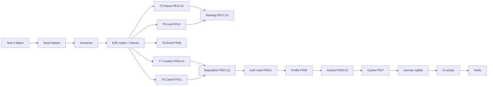

# E2E Critical Coverage Extension — Implementation Plan

> **For agentic workers:** REQUIRED SUB-SKILL: Use superpowers:subagent-driven-development (recommended) or superpowers:executing-plans to implement this plan task-by-task. Steps use checkbox (`- [ ]`) syntax for tracking.

**Goal:** Ampliar la suite Playwright + API E2E para cubrir los flujos críticos del MVP que faltan tras `2026-06-04-e2e-full-flows.md`, con trazabilidad explícita a FR del PRD y ejecución escalonada (PR rápido vs nightly completo).

**Architecture:** Mantener el patrón fase 2: backend posee estado (`POST /api/e2e/scenarios/:name` + `time/*`). Añadir builders de escenario para estados de borde (pasivo, acaparador, límite 3 solicitudes, pausa, no verificado). Tests **UI** para decisiones de producto visibles; tests **híbridos** (UI + assert API) para reglas de negocio; tests **API-only** en `e2e/tests/contracts/` para guards difíciles de forzar en UI (403, 409, límites). Documento vivo `docs/e2e/coverage-matrix.md` como fuente de verdad de cobertura.

**Tech Stack:** Playwright 1.54, Angular 21 (`:4201`), módulo `src/e2e/` backend, Vitest supertest para builders nuevos.

**Prerrequisito:** Plan `2026-06-04-e2e-full-flows.md` completado — `npm run test:e2e:flows` verde en local.

---

## Estado actual vs objetivo

### Ya cubierto (fase 1 + fase 2)

| Área | Specs | FR aproximados |
|------|-------|----------------|
| Auth básico | `e2e/tests/auth/login.spec.ts`, `register.spec.ts` | FR1, FR3, FR4 (formulario) |
| Explorar / publicar smoke | `items/explorar`, `publicar`, `mis-objetos` | FR9 parcial |
| Perfil smoke | `profile/profile.spec.ts` | FR28 parcial |
| Flujo donación núcleo | `flows/publicar-completo`, `solicitud-interesado`, `seleccion-ranking`, `entrega-*`, `sesion-expirada`, `objetos-degradados`, `publicar-imagenes` | FR8, FR12, FR15–16, FR19, FR21–24, FR34 parcial |
| Tiempo | `timing/imagenes-purga-lectura` | FR34 |

### Brecha crítica (prioridad para esta fase)

| Prioridad | FR | Escenario de negocio | Por qué es crítico |
|-----------|-----|----------------------|-------------------|
| P0 | FR11 | Donante cancela objeto con sesión activa | Pierde reserva + notificación receptor |
| P0 | FR13–14 | Pausar / reanudar solicitudes | 409 en postulación — regresión frecuente |
| P0 | FR12 | Límite 3 solicitudes / 30 días | Regla central del ecosistema |
| P0 | FR46 | Email no verificado bloquea rutas | Seguridad y onboarding |
| P0 | FR50–52 | Canales de contacto (donante ve receptor; purga) | SEC-002c + privacidad |
| P1 | FR17–18 | Pasivo y acaparador en ranking | Equilibrio del sistema |
| P1 | FR21 | Primera donación +15 vs +10 | Reputación donante |
| P1 | FR22 | Segunda penalización no-show (-20) | Acumulación `consecutive_no_shows` |
| P1 | FR5–6 | Forgot / reset password + invalidación JWT | Cuenta comprometida |
| P1 | FR39 | Cambio CP invalida sesión | Auth sorpresa en perfil |
| P2 | FR26 | Purga canal contacto 7d | Privacidad post-cierre |
| P2 | FR27 | `cycles_at_limit` tras agotar límite | Acaparador Tier 1/2 |
| P2 | FR29–32 | Filtros perfil (entregas, items, requests) | UX operativa donante/receptor |
| P2 | FR33 | Perfil público | Confianza entre usuarios |
| P3 | FR47 | Digest proximidad | Cron HTTP — mejor contract test backend |
| P3 | — | Journey completo UI (registro→entrega) | Regresión integrada; lento → nightly |

### Pirámide de tests recomendada

```
                    ┌─────────────────────┐
                    │ 1× mega-journey     │  nightly, ~3–5 min
                    │ (opcional)          │
                    └──────────┬──────────┘
              ┌────────────────┴────────────────┐
              │ ~25 specs flows + critical        │  PR: test:e2e:critical
              │ (UI + dualBrowser)              │
              └────────────────┬────────────────┘
        ┌──────────────────────┴──────────────────────┐
        │ ~15 specs contracts (API + scenario seed)   │  PR: incluido en critical
        └──────────────────────┬──────────────────────┘
  ┌────────────────────────────┴────────────────────────────┐
  │ Fase 1 smoke (auth/items) + vitest builders backend       │  CI backend
  └───────────────────────────────────────────────────────────┘
```

---

## File Map (fase 3)

```
Backend (../backend/):
  src/e2e/seed-helpers.ts                         modify — seedPassiveUser, seedHoarderUser, seedUnverifiedUser, seedMaxedRequestsUser
  src/e2e/scenarios/
    item-paused.scenario.ts                       create
    request-limit-reached.scenario.ts             create
    ranking-passive-hidden.scenario.ts            create
    ranking-hoarder-tier1.scenario.ts             create
    ranking-hoarder-tier2.scenario.ts             create
    delivery-with-receiver-channel.scenario.ts    create
    donor-first-donation.scenario.ts              create
    unverified-user.scenario.ts                   create
  src/e2e/time/increment-cycles-at-limit.ts         create — POST /e2e/time/increment-cycles/:userId
  src/interfaces/http/routes/e2e.routes.ts          modify — nueva ruta time
  src/interfaces/http/controllers/e2e.controller.ts
  tests/e2e-scenarios.test.ts                     modify — asserts builders nuevos

Frontend (./):
  docs/e2e/coverage-matrix.md                     create — FR → spec (vivo)
  e2e/helpers/
    api.ts                                        modify — apiPauseItem, apiGetCandidates, apiRequestItem, apiCancelItem, apiGetDeliverySession, apiGetReputationHistory
    e2e-api.ts                                    modify — e2eIncrementCyclesAtLimit
  e2e/fixtures/test.ts                            modify — receiverPage, tripleBrowser fixtures
  e2e/pages/
    item-detalle.page.ts                          create
    entregas.page.ts                              create
    forgot-password.page.ts                       create
    verification-pending.page.ts                  create
  e2e/tests/
    critical/                                     create — specs P0/P1
    contracts/                                    create — API guards
    journeys/                                     create — mega flow (nightly)
    timing/purge-contact-channel.spec.ts          create
  package.json                                    modify — test:e2e:critical, test:e2e:nightly
  playwright.config.ts                            modify — projects chromium-critical | chromium-nightly
```

---

## Task 0: Matriz de cobertura (documento vivo)

**Files:**
- Create: `docs/e2e/coverage-matrix.md`

- [ ] **Step 1: Crear matriz con columnas**

```markdown
# E2E Coverage Matrix — Regálalo

| FR | Descripción breve | Tipo | Spec | Escenario E2E | Estado |
|----|-------------------|------|------|---------------|--------|
| FR12 | Límite 3 solicitudes | contract | `e2e/tests/contracts/request-limit.spec.ts` | `request-limit-reached` | planned |
| ... | ... | ui \| contract \| timing \| nightly | ... | ... | done \| planned \| n/a |
```

- [ ] **Step 2: Poblar filas FR1–FR52** copiando inventario de `_bmad-output/initiative-regalalo/archive-v6/epics.md` §Inventario de Requisitos. Marcar `done` para specs existentes de fase 1–2 (tabla §Estado actual).

- [ ] **Step 3: Regla de mantenimiento** — al añadir un spec, actualizar la fila en el mismo PR.

- [ ] **Step 4: Commit**

```bash
cd "c:/Users/Emanuel/projects/no lo vendo/no-lo-vendo"
git add docs/e2e/coverage-matrix.md
git commit -m "docs(e2e): add FR coverage matrix for critical extension"
```

---

## Task 1: Extender seed-helpers (estados de borde)

**Files:**
- Modify: `../backend/src/e2e/seed-helpers.ts`

- [ ] **Step 1: Añadir parámetros opcionales a `seedVerifiedUser`**

```typescript
export async function seedVerifiedUser(
  pool: Pool,
  input: {
    email: string;
    firstName: string;
    lastName: string;
    password?: string;
    reputationScore?: number;
    totalDonated?: number;
    totalReceived?: number;
    consecutiveNoShows?: number;
    cyclesAtLimit?: number;
    lastActiveAt?: Date | null; // null = usuario nuevo, no pasivo
  },
): Promise<SeededUser> {
  // En INSERT añadir columnas:
  // total_donated, total_received, consecutive_no_shows, cycles_at_limit, last_active_at
  // con COALESCE/defaults del input
}
```

- [ ] **Step 2: `seedUnverifiedUser`** — igual que verified pero `email_verified = FALSE` (sin JWT en escenario; el spec usará registro UI o token E2E dedicado).

- [ ] **Step 3: `seedThreePendingRequestsForUser`** — inserta 3 `item_requests` en ventana 30d para un `requesterId` (3 items distintos de donors semilla).

- [ ] **Step 4: `seedPausedItem`** — `requests_paused = TRUE` en item activo.

- [ ] **Step 5: Vitest rápido** en `tests/e2e-scenarios.test.ts` — `seedVerifiedUser` con `cycles_at_limit = 2` persiste valor.

Run: `cd ../backend && npm run test -- tests/e2e-scenarios.test.ts`
Expected: PASS

- [ ] **Step 6: Commit**

```bash
cd "../backend"
git add src/e2e/seed-helpers.ts tests/e2e-scenarios.test.ts
git commit -m "feat(e2e): seed helpers for passive, hoarder, and request-limit states"
```

---

## Task 2: Nuevos escenarios E2E (backend)

**Files:**
- Create: `../backend/src/e2e/scenarios/item-paused.scenario.ts`
- Create: `../backend/src/e2e/scenarios/request-limit-reached.scenario.ts`
- Create: `../backend/src/e2e/scenarios/ranking-passive-hidden.scenario.ts`
- Create: `../backend/src/e2e/scenarios/ranking-hoarder-tier1.scenario.ts`
- Create: `../backend/src/e2e/scenarios/ranking-hoarder-tier2.scenario.ts`
- Create: `../backend/src/e2e/scenarios/delivery-with-receiver-channel.scenario.ts`
- Create: `../backend/src/e2e/scenarios/donor-first-donation.scenario.ts`
- Modify: `../backend/src/e2e/scenarios/registry.ts`

- [ ] **Step 1: `item-paused`** — `donor` + item activo `requests_paused = true` (vía SQL tras `seedActiveItem`).

- [ ] **Step 2: `request-limit-reached`** — `receiver` con 3 solicitudes `pending` en últimos 7 días + `donor` con `item-published` nuevo para intento 4.

- [ ] **Step 3: `ranking-passive-hidden`**

```typescript
// receiver pasivo: total_donated=0, total_received=1, last_active_at = NOW()-61 days
// donor + item + solicitud del pasivo (no debe aparecer en GET /items/:id/requests)
const passive = await seedVerifiedUser(db, {
  email: 'e2e-passive@receiver.test',
  firstName: 'Pasivo',
  lastName: 'E2E',
  totalDonated: 0,
  totalReceived: 1,
  lastActiveAt: new Date(Date.now() - 61 * 24 * 60 * 60 * 1000),
});
await seedItemRequest(db, { itemId: item.id, requesterId: passive.id });
// Respuesta entities: { itemId, passiveRequestId }
```

- [ ] **Step 4: `ranking-hoarder-tier1`** — receptor con `cycles_at_limit = 1`, `total_donated = 0`, reputación 80; segundo receptor limpio reputación 70. Assert en spec: el de 70 aparece **antes** que el de 80 (penalización -15 efectiva).

- [ ] **Step 5: `ranking-hoarder-tier2`** — receptor `cycles_at_limit = 2`; assert `GET /items/:id/requests` length === 0 para ese candidato (solo donante ve lista sin él).

- [ ] **Step 6: `delivery-with-receiver-channel`** — sesión active con `receiver_contact_channel` poblado (copiar patrón SelectReceiver en SQL de `seedDeliveryActive` ampliado).

- [ ] **Step 7: `donor-first-donation`** — `delivery-active` pero `donor.total_donated = 0` antes de confirmar UI.

- [ ] **Step 8: Registrar en `registry.ts`**

- [ ] **Step 9: Commit**

```bash
git add src/e2e/scenarios/*.ts src/e2e/scenarios/registry.ts
git commit -m "feat(e2e): scenario builders for pause, limits, ranking edge cases"
```

---

## Task 3: Ruta E2E `increment-cycles` + helpers Playwright

**Files:**
- Create: `../backend/src/e2e/time/increment-cycles-at-limit.ts`
- Modify: `../backend/src/interfaces/http/routes/e2e.routes.ts`
- Modify: `../backend/src/interfaces/http/controllers/e2e.controller.ts`
- Modify: `e2e/helpers/e2e-api.ts`
- Modify: `e2e/helpers/api.ts`
- Modify: `e2e/fixtures/test.ts`

- [ ] **Step 1: Backend — ejecutar SQL del job migration 008**

```typescript
// increment-cycles-at-limit.ts — misma lógica que migration 008-setup-increment-cycles-at-limit-job.sql
export async function incrementCyclesAtLimit(pool: Pool, userId: string): Promise<void> {
  await pool.query(
    `UPDATE users SET
       cycles_at_limit = cycles_at_limit + 1,
       last_cycle_incremented_at = NOW()
     WHERE id = $1`,
    [userId],
  );
}
```

Ruta: `POST /api/e2e/time/increment-cycles/:userId`

- [ ] **Step 2: `e2e-api.ts`**

```typescript
export async function e2eIncrementCyclesAtLimit(
  request: APIRequestContext,
  userId: string,
): Promise<void> {
  await e2ePost(request, `/time/increment-cycles/${userId}`);
}
```

- [ ] **Step 3: `api.ts` — helpers usados por contracts**

```typescript
export async function apiRequestItem(
  request: APIRequestContext,
  token: string,
  itemId: string,
  contactChannel: string,
): Promise<{ status: number; body: string }> {
  const res = await request.post(`${API_URL}/items/${itemId}/requests`, {
    headers: { Authorization: `Bearer ${token}` },
    data: { contactChannel },
  });
  return { status: res.status(), body: await res.text() };
}

export async function apiPauseItem(
  request: APIRequestContext,
  token: string,
  itemId: string,
  paused: boolean,
): Promise<void> { /* PATCH /items/:id/pause */ }
```

- [ ] **Step 4: Fixture `receiverPage`** — copia patrón `donorPage` con actor `receiver`.

- [ ] **Step 5: Fixture `tripleBrowser`** — `donorPage`, `receiverPage`, `rivalPage` para ranking.

- [ ] **Step 6: Commit** (backend + frontend en commits separados si repos separados).

---

## Task 4: P0 — Pausar solicitudes (FR13–14)

**Files:**
- Create: `e2e/tests/critical/item-pausar-solicitudes.spec.ts`
- Modify: `src/app/features/items/mis-objetos/` o panel detalle — añadir `data-testid="item-pause-toggle"` si no existe

- [ ] **Step 1: Spec contract (falla primero)**

```typescript
// e2e/tests/contracts/item-paused-409.spec.ts
import { test, expect } from '../../fixtures/test';
import { apiRequestItem } from '../../helpers/api';

test.use({ scenarioName: 'item-paused' });

test('POST request on paused item returns 409', async ({ request, scenario }) => {
  const receiver = scenario.actors['receiver'] ?? scenario.actors['r1'];
  if (!receiver) throw new Error('scenario needs receiver');
  const { status } = await apiRequestItem(
    request,
    receiver.token,
    scenario.entities.itemId!,
    'whatsapp:+5491100000001',
  );
  expect(status).toBe(409);
});
```

Run: `npx playwright test e2e/tests/contracts/item-paused-409.spec.ts`
Expected: FAIL si escenario `item-paused` aún no existe → implementar Task 2 primero.

- [ ] **Step 2: Spec UI — donante pausa y receptor ve mensaje**

```typescript
test.use({ scenarioName: 'item-published' });

test('donor pauses requests and explorar hides request CTA', async ({ dualBrowser, request, scenario }) => {
  const { donorPage, receiverPage } = dualBrowser;
  const itemId = scenario.entities.itemId!;
  // UI: mis-objetos → fila → toggle pausa (data-testid item-pause-toggle)
  // Assert API: GET item donor → requestsPaused true
  // Receiver: detalle item → botón solicitar disabled o mensaje pausa
});
```

- [ ] **Step 3: Añadir testId en template** si el toggle usa `app-toggle-switch` sin testId.

- [ ] **Step 4: Run + commit**

```bash
npx playwright test e2e/tests/critical/item-pausar-solicitudes.spec.ts e2e/tests/contracts/item-paused-409.spec.ts
git commit -m "test(e2e): pause item blocks requests (FR13-14)"
```

---

## Task 5: P0 — Límite 3 solicitudes (FR12)

**Files:**
- Create: `e2e/tests/contracts/request-limit.spec.ts`
- Create: `e2e/tests/critical/request-limit-ui.spec.ts`

- [ ] **Step 1: Contract — cuarta solicitud 409/422**

```typescript
test.use({ scenarioName: 'request-limit-reached' });

test('fourth request in sliding window is rejected', async ({ request, scenario }) => {
  const receiver = scenario.actors['receiver']!;
  const newItemId = scenario.entities.itemId!;
  const { status, body } = await apiRequestItem(
    request,
    receiver.token,
    newItemId,
    'whatsapp:+5491100000002',
  );
  expect(status).toBeGreaterThanOrEqual(400);
  expect(body.toLowerCase()).toMatch(/limit|límite|solicitud/);
});
```

- [ ] **Step 2: UI — bottom sheet muestra error amigable** (opcional si API ya cubre regla; UI assert `data-testid="request-limit-error"`).

- [ ] **Step 3: Actualizar `coverage-matrix.md` FR12 → done.

- [ ] **Step 4: Commit**

---

## Task 6: P0 — Email no verificado (FR46)

**Files:**
- Create: `e2e/tests/critical/email-not-verified-guard.spec.ts`
- Create: `../backend/src/e2e/scenarios/unverified-user.scenario.ts` (opcional — o usar registro UI sin verificar)

- [ ] **Step 1: Flujo UI registro real → verificacion-pendiente**

```typescript
import { test, expect } from '@playwright/test';
import { RegisterPage } from '../../pages/register.page';
import { faker } from '@faker-js/faker';

test('unverified user cannot access explorar', async ({ page, request }) => {
  const register = new RegisterPage(page);
  const email = faker.internet.email().toLowerCase();
  await register.goto();
  await register.fillAndSubmit({ email, password: 'Test1234!', firstName: 'E2E', lastName: 'Unverified', postalCode: '1001' });
  await expect(page.getByTestId('verification-pending-title')).toBeVisible();
  await page.goto('/explorar');
  // Expect redirect o banner 403 — assert URL o testId login guard
  await expect(page).toHaveURL(/login|verificacion-pendiente/);
});
```

- [ ] **Step 2: Contract con token JWT de usuario `email_verified=false`** (escenario `unverified-user` devuelve token para assert `GET /users/me` 403 en ruta protegida).

- [ ] **Step 3: Commit**

---

## Task 7: P0 — Canales de contacto (FR50–52)

**Files:**
- Create: `e2e/tests/critical/delivery-contact-channels.spec.ts`
- Create: `e2e/tests/timing/purge-contact-channel.spec.ts`

- [ ] **Step 1: Donante ve `receiver-contact-channel` en sesión activa**

```typescript
test.use({ scenarioName: 'delivery-with-receiver-channel' });

test('donor sees receiver contact channel on active session', async ({ donorPage, scenario }) => {
  const entrega = new EntregaDetallePage(donorPage.page);
  await entrega.goto(scenario.entities.sessionId!);
  await expect(donorPage.page.getByTestId('receiver-contact-channel')).toBeVisible();
});
```

- [ ] **Step 2: Receptor ve canal donante; donante NO ve campo duplicado del propio canal en respuesta API**

```typescript
test('receiver API session includes donor contact; donor does not receive receiver channel in wrong role', async ({ request, scenario }) => {
  const sessionId = scenario.entities.sessionId!;
  const donor = scenario.actors['donor']!;
  const receiver = scenario.actors['receiver']!;
  const asDonor = await apiGetDeliverySession(request, donor.token, sessionId);
  const asReceiver = await apiGetDeliverySession(request, receiver.token, sessionId);
  expect(asDonor.receiverContactChannel).toBeTruthy();
  expect(asReceiver.contactChannel).toBeTruthy();
  // asDonor no debe exponer contactChannel del donante al receptor (según OpenAPI)
});
```

- [ ] **Step 3: Timing — purga contacto**

```typescript
test.use({ scenarioName: 'delivery-completed' });
test('contact channels purged after e2e time helper', async ({ request, scenario }) => {
  await e2ePurgeContactChannel(request, scenario.entities.sessionId!);
  const receiver = scenario.actors['receiver']!;
  const session = await apiGetDeliverySession(request, receiver.token, scenario.entities.sessionId!);
  expect(session.contactChannel ?? null).toBeFalsy();
});
```

- [ ] **Step 4: Commit**

---

## Task 8: P0 — Cancelar objeto con sesión activa (FR11)

**Files:**
- Create: `e2e/tests/critical/item-cancel-active-session.spec.ts`

- [ ] **Step 1: Usar escenario `delivery-active`**

```typescript
test.use({ scenarioName: 'delivery-active' });

test('donor cancels item and session ends', async ({ donorPage, request, scenario }) => {
  const itemId = scenario.entities.itemId!;
  await donorPage.page.goto(`/items/${itemId}`);
  await donorPage.page.getByTestId('item-cancel-active-session-btn').click();
  await donorPage.page.getByTestId('item-cancel-confirm-btn').click();
  const item = await apiGetItem(request, scenario.actors['donor']!.token, itemId);
  expect(item.status).toBe('cancelled');
});
```

- [ ] **Step 2: Assert receptor — sesión cancelada vía `GET /users/me/delivery-sessions`**

- [ ] **Step 3: Commit**

---

## Task 9: P1 — Ranking pasivo y acaparador (FR17–18)

**Files:**
- Create: `e2e/tests/critical/ranking-passive.spec.ts`
- Create: `e2e/tests/critical/ranking-hoarder.spec.ts`

- [ ] **Step 1: Pasivo invisible**

```typescript
test.use({ scenarioName: 'ranking-passive-hidden' });

test('passive requester not listed for donor', async ({ request, scenario }) => {
  const donor = scenario.actors['donor']!;
  const candidates = await apiGetCandidates(request, donor.token, scenario.entities.itemId!);
  expect(candidates).toHaveLength(0);
});
```

- [ ] **Step 2: Tier 2 — lista vacía de candidatos elegibles**

```typescript
test.use({ scenarioName: 'ranking-hoarder-tier2' });
// seed: 1 requester tier2 + 1 clean; expect length 1 and id !== tier2
```

- [ ] **Step 3: Tier 1 — orden UI (opcional): tripleBrowser, donante abre candidatos, `candidate-card` orden por reputación efectiva**

- [ ] **Step 4: Commit + matrix FR17–18 done**

---

## Task 10: P1 — Reputación primera donación y no-show x2 (FR21–22)

**Files:**
- Create: `e2e/tests/critical/reputation-first-donation.spec.ts`
- Create: `e2e/tests/critical/reputation-double-noshow.spec.ts`
- Modify: `e2e/helpers/api.ts` — `apiGetReputationHistory`

- [ ] **Step 1: Primera donación +15**

```typescript
test.use({ scenarioName: 'donor-first-donation' });

test('first completed donation gives donor +15 reputation', async ({ donorPage, request, scenario }) => {
  const donor = scenario.actors['donor']!;
  const before = await apiGetMe(request, donor.token);
  expect(before.totalDonated).toBe(0);
  // UI confirmar entrega (reutilizar EntregaDetallePage)
  const after = await apiGetMe(request, donor.token);
  expect(after.reputationScore).toBe(before.reputationScore + 15);
  expect(after.totalDonated).toBe(1);
});
```

- [ ] **Step 2: Segundo no-show -20** — escenario nuevo `receiver-two-noshows`: receptor con `consecutive_no_shows = 1`, cancelar con no-show UI → delta -20 en history.

```typescript
const history = await apiGetReputationHistory(request, receiver.token);
expect(history[0].delta).toBe(-20);
```

- [ ] **Step 3: Commit**

---

## Task 11: P1 — Auth recuperación contraseña (FR5–6)

**Files:**
- Create: `e2e/pages/forgot-password.page.ts`
- Create: `e2e/tests/critical/auth-reset-password.spec.ts`
- Modify: `../backend` — endpoint E2E **solo dev**: `POST /api/e2e/auth/last-reset-token/:email` devuelve token para UI (o leer de tabla `password_reset_tokens` en escenario)

- [ ] **Step 1: Escenario `donor-only` + forgot password UI → pantalla confirmación `forgot-password-confirmation`**

- [ ] **Step 2: E2E route devuelve token** (nunca en producción)

```typescript
// backend — e2e.controller.ts
async lastResetToken(req, res) {
  const { rows } = await db.query(
    `SELECT token FROM password_reset_tokens WHERE user_id = (SELECT id FROM users WHERE email = $1) ORDER BY created_at DESC LIMIT 1`,
    [req.params.email],
  );
  res.json({ token: rows[0]?.token });
}
```

- [ ] **Step 3: UI reset-password con token → login con nueva contraseña**

- [ ] **Step 4: Assert `jwt_version` incrementado — login viejo falla 401**

- [ ] **Step 5: Commit**

---

## Task 12: P1 — Perfil PATCH código postal (FR39)

**Files:**
- Create: `e2e/tests/critical/profile-postal-change.spec.ts`

- [ ] **Step 1: `authPage` o `donor-only` — cambiar CP en perfil, guardar**

- [ ] **Step 2: Assert sesión anterior invalidada** — `apiGetMe` con token viejo → 401

- [ ] **Step 3: Re-login / re-inject — explorar sigue funcionando**

- [ ] **Step 4: Commit**

---

## Task 13: P2 — Filtros perfil y perfil público (FR29–33)

**Files:**
- Create: `e2e/tests/critical/profile-activity-filters.spec.ts`
- Create: `e2e/tests/critical/profile-public.spec.ts`
- Create: `e2e/pages/entregas.page.ts`

- [ ] **Step 1: `delivery-active` — donante en `/entregas` filtro rol donante → `delivery-item` visible**

- [ ] **Step 2: Receptor en mis solicitudes / entregas — filtro estado activo**

- [ ] **Step 3: `/users/:id` público — sin email, muestra `profile-name` y reputación**

- [ ] **Step 4: `GET /users/me/reputation-history` tras F6 no-show — evento visible en UI perfil si existe sección**

- [ ] **Step 5: Commit**

---

## Task 14: P2 — `cycles_at_limit` (FR27)

**Files:**
- Create: `e2e/tests/contracts/cycles-at-limit.spec.ts`

- [ ] **Step 1: Escenario `request-limit-reached` + `e2eIncrementCyclesAtLimit`**

- [ ] **Step 2: Assert `apiGetMe` → `cyclesAtLimit === 1`**

- [ ] **Step 3: Combinar con `ranking-hoarder-tier1` spec**

- [ ] **Step 4: Commit**

---

## Task 15: Journey nightly — registro a entrega (opcional)

**Files:**
- Create: `e2e/tests/journeys/full-donation-lifecycle.spec.ts`

- [ ] **Step 1: Serial test, timeout 120_000, `workers: 1`**

```typescript
test.describe.configure({ mode: 'serial' });

test('register → verify (e2e token) → publish → second user requests → select → confirm', async ({ browser, request }) => {
  // 1. Register user A via UI
  // 2. POST /api/e2e/auth/verify-email/:userId (nueva ruta dev) O leer token de escenario híbrido
  // 3. Publish via PublicarPage
  // 4. resetScenario NO — usar purge solo al final; o sub-escenarios aislados por API para B
  // Preferir: A publica UI; B desde scenario item-published vacío con segundo browser createVerifiedUser
});
```

- [ ] **Step 2: Tag `@nightly` en título o proyecto playwright separado**

- [ ] **Step 3: Commit**

---

## Task 16: CI — scripts y proyectos Playwright

**Files:**
- Modify: `package.json`
- Modify: `playwright.config.ts`

- [ ] **Step 1: Scripts**

```json
"test:e2e:critical": "playwright test e2e/tests/flows e2e/tests/timing e2e/tests/critical e2e/tests/contracts --project=chromium",
"test:e2e:nightly": "playwright test e2e/tests/journeys --project=chromium",
"test:e2e:smoke": "playwright test e2e/tests/auth e2e/tests/items e2e/tests/profile --project=chromium"
```

- [ ] **Step 2: Documentar en `docs/e2e.md` (backend) tiempos esperados: critical ~8–12 min, nightly +3 min

- [ ] **Step 3: PR CI usa `test:e2e:critical`; schedule nightly `test:e2e:nightly`**

- [ ] **Step 4: Commit**

---

## Task 17: Verificación final y cierre de brechas

- [ ] **Step 1: Ejecutar suite critical**

```bash
cd "c:/Users/Emanuel/projects/no lo vendo/no-lo-vendo"
npm run test:e2e:critical
```

Expected: todos los tests PASS (listar count ≥ fase 2 + nuevos).

- [ ] **Step 2: Revisar `docs/e2e/coverage-matrix.md`** — todo FR P0/P1 en `done` o `n/a` justificado.

- [ ] **Step 3: Dos pasadas consecutivas** (aislamiento `resetScenario`).

- [ ] **Step 4: Actualizar `2026-06-04-e2e-full-flows.md` §Relación** con enlace a este plan.

- [ ] **Step 5: Commit meta**

```bash
git commit -m "test(e2e): critical coverage extension for MVP flows"
```

---

## Orden de implementación



---

## Criterios de “todos los flujos validados”

Considera el MVP **cubierto en E2E** cuando:

1. **100% FR P0/P1** en `coverage-matrix.md` están `done` o `n/a` con justificación (p. ej. FR47 digest → contract backend, no UI).
2. **Cada transición de estado** del diagrama PRD §8 tiene al menos un spec: `active → reserved → completed | cancelled | expired`, `active → degraded`, `active → cancelled`.
3. **Reglas de exclusión** (pasivo, acaparador T1/T2, límite solicitudes) tienen spec **contract** + al menos un spec **UI** donde el usuario ve el efecto.
4. **Privacidad contacto** — visible en activo, ausente tras purga (timing).
5. CI verde en `test:e2e:critical` en dos pasadas.

No hace falta un único test gigante por FR: la trazabilidad en la matriz es el contrato de completitud.

---

## Riesgos

| Riesgo | Mitigación |
|--------|------------|
| Ranking no determinista | Contracts usan orden relativo con gaps 15+ puntos; UI ranking con 3 candidatos fijos |
| Tests lentos | Separar `critical` vs `nightly`; mantener `workers: 1` en flows que publican |
| Token reset en E2E | Ruta dev `last-reset-token`; nunca montada si `E2E_ENABLED=false` |
| Registro UI sin verificar | Combinar UI + escenario API para guards |
| Duplicar lógica FR | Matriz obliga 1:1 spec↔FR antes de merge |

---

## Relación con planes anteriores

| Plan | Rol |
|------|-----|
| `2026-06-03-e2e-tests.md` | Infraestructura + smoke |
| `2026-06-04-e2e-full-flows.md` | Flujos felices donación (F1–F9, timing imágenes) |
| **Este plan** | Brechas críticas, ranking, auth, privacidad, CI escalonado |

---

## Self-review (cobertura spec)

| Requisito | Task |
|-----------|------|
| FR11 cancelar con sesión | Task 8 |
| FR12 límite 3 | Task 5 |
| FR13–14 pausa | Task 4 |
| FR17–18 ranking | Task 9 |
| FR21–22 reputación | Task 10 |
| FR26 purga contacto | Task 7 |
| FR27 cycles | Task 14 |
| FR29–33 perfil | Task 13 |
| FR39 PATCH CP | Task 12 |
| FR46 email verify | Task 6 |
| FR50–52 contacto | Task 7 |
| FR5–6 reset password | Task 11 |
| Journey integral | Task 15 |
| Trazabilidad | Task 0 |

**Placeholder scan:** sin TBD; rutas y nombres de escenario concretos.

---

## Ejecución con superpowers

Tras guardar este plan:

1. **Subagent-Driven (recomendado)** — un task por sesión, revisar matriz tras Task 0.
2. **Inline Execution** — `executing-plans` con checkpoints tras Tasks 3, 10, 17.

No declarar cobertura completa sin `verification-before-completion` y matriz actualizada.
